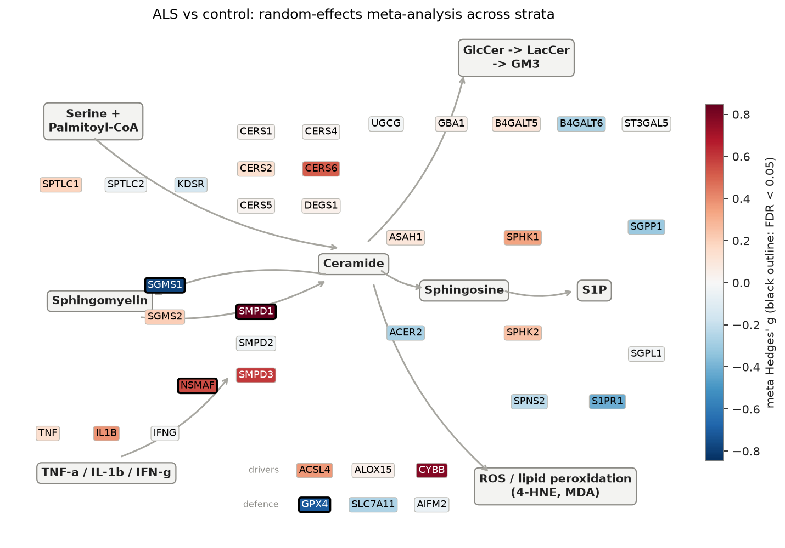
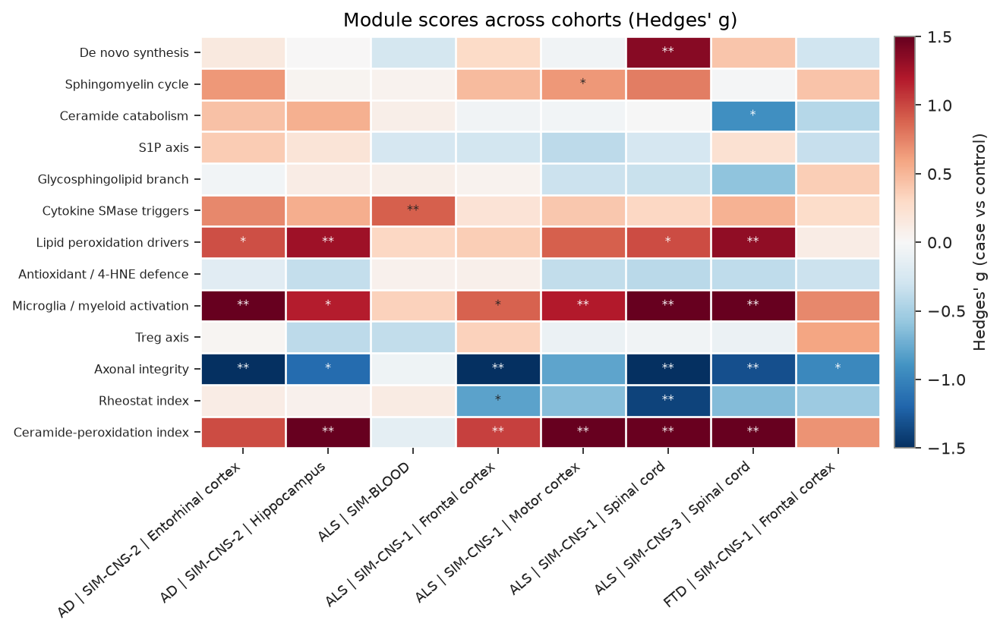
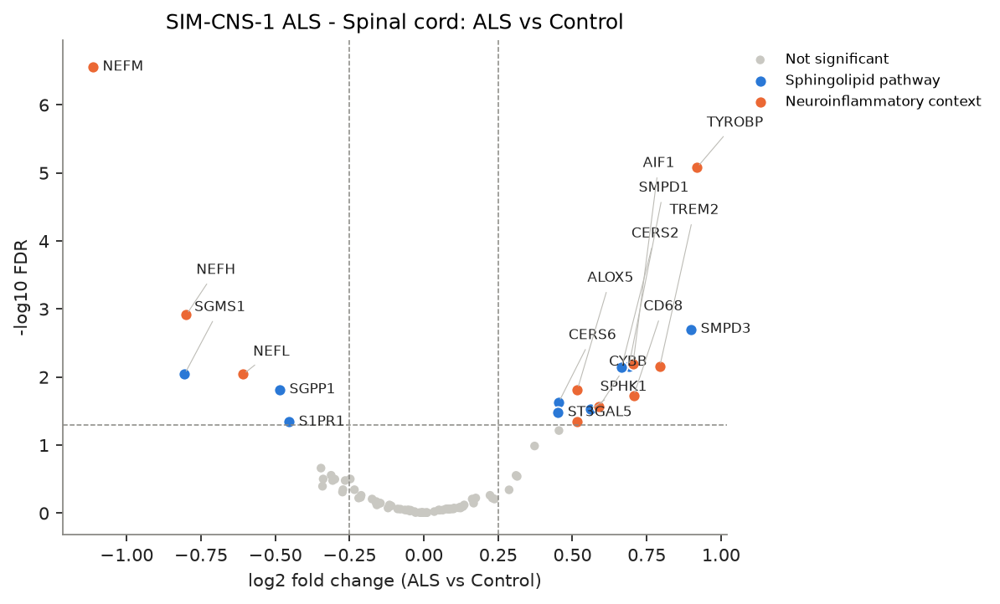
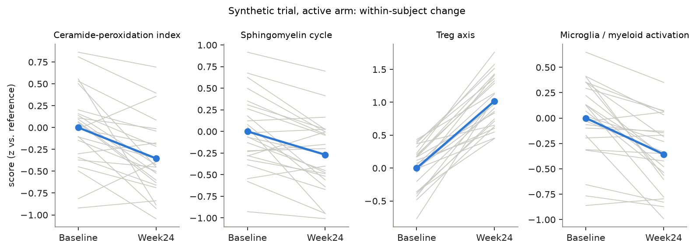
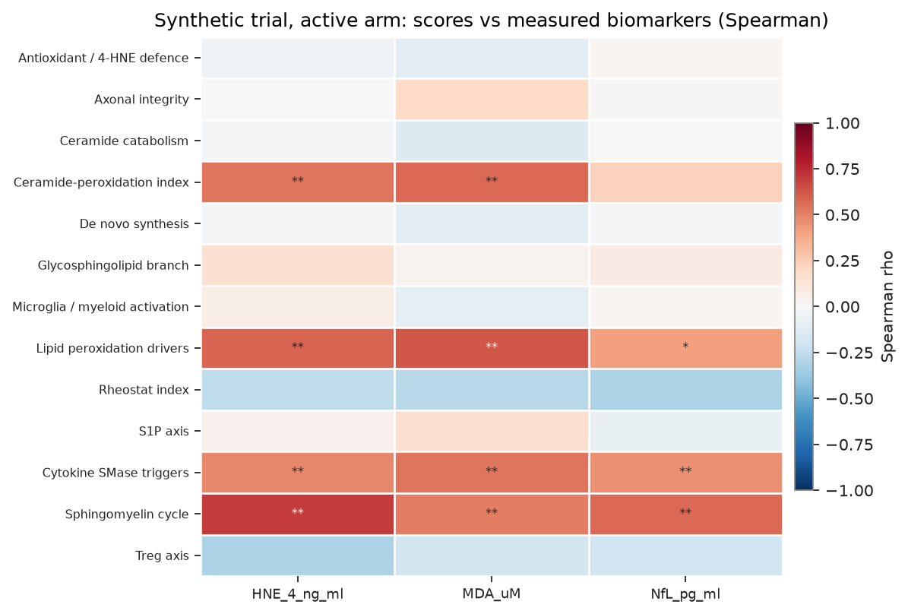
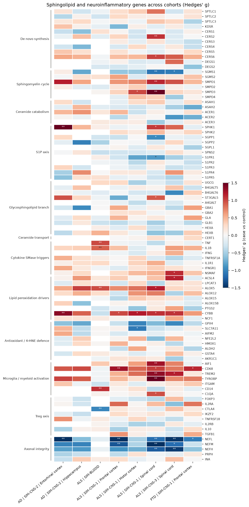

# sphingomap-CNS

**A sphingolipid pathway atlas for neurodegeneration. It maps ceramide, sphingomyelinase and lipid-peroxidation gene networks, together with the neuroinflammatory and regulatory T-cell (Treg) biology around them, across public ALS, FTD and Alzheimer's transcriptomes. The same analysis can then run on your own longitudinal trial data.**

[](https://github.com/DhruvASharma2004/sphingomap-cns/actions/workflows/ci.yml)


sphingomap-CNS extends [sphingomap](https://github.com/DhruvASharma2004/sphingomap), which was built for colorectal cancer, to the central nervous system and blood.

> **About the figures below:** they come from the built-in **synthetic** demo (`sphingomap-cns demo`). That data has planted effects so you can check that the pipeline recovers them. **They are not biological findings.** Real-cohort results are written to `results/atlas/` by the [GEO atlas workflow](.github/workflows/atlas.yml).

<p align="center"></p>

## Why

Pro-inflammatory cytokines from activated microglia and monocytes (TNF-α, IL-1β, IFN-γ) switch on the
acid and neutral sphingomyelinases (*SMPD1*, *SMPD2/3*; TNFR1 → *NSMAF*). These enzymes release ceramide, which drives
mitochondrial ROS production, lipid peroxidation (4-HNE, MDA) and neuronal death. Therapies that expand Tregs
(low-dose IL-2, CTLA4-Ig) aim to dampen that same myeloid inflammation. So the sphingolipid machinery sits
mechanistically between **Treg restoration** and **lipid-peroxidation and axonal-injury biomarkers** such as neurofilament light (NfL).

sphingomap-CNS asks three questions:

1. **Atlas:** across public post-mortem CNS and whole-blood cohorts, how is the sphingolipid / ceramide / peroxidation
   machinery re-wired in ALS, FTD and AD, and how consistent is that change across tissues and cohorts?
2. **Coupling:** within patients, does ceramide-pathway expression track microglial activation, Treg markers and axonal
   integrity genes?
3. **Trial data:** in a longitudinal (e.g. baseline vs on-treatment) proteomic or transcriptomic dataset, do these
   pathways shift within subjects, and do they correlate with measured 4-HNE, MDA, NfL or clinical scores?

## What it does

| Step | Method |
|---|---|
| **Gene sets** | 90 genes in 12 modules. **Sphingolipid:** de novo synthesis (incl. *CERS1–6*), sphingomyelin cycle (*SGMS1/2*, *SMPD1–4*), ceramide catabolism (*ASAH1*, *ACER1–3*), S1P axis, glycosphingolipid branch, ceramide transport. **Context:** cytokine SMase triggers, lipid-peroxidation drivers (*ACSL4*, *ALOX*, *CYBB*), antioxidant / 4-HNE defence (*GPX4*, *SLC7A11*, *AIFM2*, *ALDH2*), microglia/myeloid activation, Treg axis (*FOXP3*, *IL2RA*, *CTLA4*), axonal integrity (*NEFL/M/H*). Retired symbols are harmonised. |
| **Composite indices** | **Ceramide-peroxidation (CPA) index** = ceramide generation + peroxidation drivers − ceramide clearance + antioxidant defence. **Rheostat index** = pro-survival S1P/GSL − pro-ceramide genes. Both are transcript-level proxies for hypothesis generation. |
| **Public data** | One command downloads GEO series: NCBI-generated RNA-seq counts (→ log2 CPM), or microarray series matrices + platform annotation (probes → genes). Disease groups and tissues are assigned from GEO annotations with auditable regex rules (`inspect`, `sample_groups.csv`). |
| **Statistics** | Per gene: linear model case vs control, adjusted for sex/age when annotated; Mann-Whitney check; BH-FDR; Hedges' *g*. Per-sample module scores (z vs controls). Paired *t* / Wilcoxon for within-subject designs. Spearman correlation of scores with any measured biomarker. |
| **Cross-cohort atlas** | Genes × strata heatmap of Hedges' *g*; DerSimonian-Laird random-effects meta-analysis per disease with I² and a per-stratum consistency count. |
| **Outputs** | Interactive `atlas.html` (searchable, sortable, hover details; one self-contained file), Markdown reports, tidy CSVs, JSON summaries, and figures: pathway map, volcano, heatmaps, module-score boxplots, score co-variation, paired trajectories, biomarker correlation. |
| **Engineering** | Installable package + CLI, test suite (parsers, statistics, end-to-end), GitHub Actions CI, plus a workflow that runs the real GEO atlas and commits the results. |

## Quick start

```bash
git clone https://github.com/DhruvASharma2004/sphingomap-cns.git
cd sphingomap-cns
pip install -e .

sphingomap-cns demo                 # offline, synthetic: atlas + longitudinal trial (≈20 s)
open results/demo/atlas/atlas.html  # macOS; use xdg-open on Linux
```

### Public ALS / FTD / AD atlas

```bash
sphingomap-cns cohorts              # what's registered
sphingomap-cns inspect GSE5281      # check how GEO samples map to case / control / tissue
sphingomap-cns atlas                # download all default cohorts, analyse, synthesise
sphingomap-cns atlas GSE112676 GSE112680   # or a subset (here: ALS whole blood only)
```

The downloads are a few GB in total (the NYGC RNA-seq count matrix is the largest file). The **GEO atlas** GitHub
Actions workflow (Actions tab → *Run workflow*) runs the same commands on GitHub's servers and commits
`results/atlas/`, so you don't have to download anything locally.

| Cohort | Disease | Compartment | Platform | Strata |
|---|---|---|---|---|
| GSE153960 (NYGC ALS Consortium / Target ALS) | ALS | CNS | RNA-seq | cervical + lumbar spinal cord, lateral motor cortex, frontal cortex (one sample per donor per tissue) |
| GSE5281 (Liang et al. 2007) | AD | CNS (laser-captured neurons) | Affymetrix U133 Plus 2 | 6 brain regions |
| GSE112676 / GSE112680 (van Rheenen et al. 2018) | ALS | Whole blood | Illumina HT-12 | – |
| GSE124439 (Tam et al. 2019), optional | ALS | CNS | RNA-seq | motor / frontal cortex (left out of the meta-analysis because it likely overlaps GSE153960) |

GSE153960's GEO labels have no separate FTD group (FTLD cases are filed under "Other Neurological Disorders"), so no public FTD comparison is registered yet. FTD data can be analysed with `run`. To add a cohort, add an entry to [`sphingomap_cns/registry.py`](sphingomap_cns/registry.py) and check it with `inspect`.

### Your own data (bulk, proteomics, or pseudobulked single-cell)

```bash
# Longitudinal, within-subject: week 24 vs baseline in the treated arm, with serum biomarkers
sphingomap-cns run -e expression.tsv -s samples.csv \
    --group-col timepoint --case Week24 --control Baseline --pair-col subject \
    --subset arm=Active --biomarkers HNE_4 MDA NfL ALSFRS_R -o results/active_wk24

# Cross-sectional, adjusted: patients vs controls per cell type
sphingomap-cns run -e expression.tsv -s samples.csv --case ALS --control Control \
    --stratum-col cell_type --covariates age sex -o results/als_vs_ctrl

# Single-cell / CyTOF / flow proteomics: cells x markers -> per-sample x cell-type means first
sphingomap-cns pseudobulk cells.csv --cell-type-col cell_type --metadata samples.csv -o data/pb
sphingomap-cns run -e data/pb_expression.tsv -s data/pb_samples.csv --stratum-col cell_type ...
```

`expression.tsv` holds features × samples, with the first column as the gene symbol (for protein assays, the symbol of the target
protein). Counts (`--counts`), linear intensities (log2-transformed automatically) and log-scale values are all accepted.
`samples.csv` needs a `sample` column plus the columns you reference. See [`docs/data-guide.md`](docs/data-guide.md).

## Demo output (synthetic)

| | |
|---|---|
|  |  |
|  |  |

<details><summary>Full gene atlas (synthetic)</summary>


</details>

## Methods notes

- **RNA-seq:** NCBI raw counts → log2(CPM + 1). Genes are kept if CPM ≥ 1 in ≥ 20% of samples in that comparison.
  **Microarray:** series-matrix values, log2-transformed if linear. For each gene the probe with the highest mean is kept, and probes that map to several genes are dropped.
  Genes are kept if their mean is above the 25th percentile of all genes.
- **Groups:** GEO annotations are free text, so case and control are assigned by regex over each sample's annotation *values*.
  Samples that match both patterns, or an `exclude` pattern (e.g. "Other Neurological Disorders"), are dropped.
  Every run writes `sample_groups.csv`.
- **Model:** `expression ~ group + sex + age` (covariates are used when ≥ 90% of samples are annotated); `log2FC` is the adjusted
  coefficient. Hedges' *g* (unadjusted) feeds the meta-analysis.
- **Scores:** each gene is z-scored against the controls (or the reference timepoint), then averaged within a module. +1 means
  "one control SD above the control mean on average".
- **Meta-analysis:** DerSimonian-Laird across the strata of one disease. Brain regions from the same donors are not
  independent, so pooled *p*-values are optimistic. Read them alongside I² and the count of strata that change.

## Limitations

Transcript and protein abundance are not enzyme activity or lipid concentration. Sphingomyelinases and ceramide
synthases are regulated post-translationally and by substrate supply. Post-mortem bulk tissue reflects end-stage disease
and shifting cell composition (neuron loss, gliosis). Results are hypotheses to be tested with targeted lipidomics
(LC-MS/MS ceramide species such as Cer16:0, Cer18:0, Cer24:1/Cer24:0; HPTLC) and functional experiments.

## Project layout

```
sphingomap_cns/
  genesets.py   modules, composite indices, aliases, pathway layout
  registry.py   public GEO cohorts and their grouping rules
  geo.py        GEO download + series-matrix / platform / NCBI-counts parsers
  design.py     normalisation, group / stratum assignment, covariates
  stats.py      linear-model DE, paired tests, Hedges' g, random-effects meta, correlations
  scores.py     module scores and indices
  analysis.py   one comparison -> tables, figures, REPORT.md
  atlas.py      multi-cohort runner and synthesis
  userdata.py   own-data runner and pseudobulk
  report.py     self-contained interactive atlas.html
  plots.py      figures
  simulate.py   synthetic cohorts + longitudinal trial for tests and demos
  cli.py        command-line interface
tests/          pytest suite
```

## References

- Hannun Y. A. & Obeid L. M. Sphingolipids and their metabolism in physiology and disease. *Nat. Rev. Mol. Cell Biol.* 19, 175–191 (2018).
- Cuvillier O. *et al.* Suppression of ceramide-mediated programmed cell death by sphingosine-1-phosphate. *Nature* 381, 800–803 (1996).
- Liang W. S. *et al.* Gene expression profiles in anatomically and functionally distinct regions of the normal aged human brain. *Physiol. Genomics* 28, 311–322 (2007).
- van Rheenen W. *et al.* Whole blood transcriptome analysis in amyotrophic lateral sclerosis: a biomarker study. *PLoS One* 13, e0198874 (2018).
- Tam O. H. *et al.* Postmortem cortex samples identify distinct molecular subtypes of ALS. *Cell Rep.* 29, 1164–1177 (2019).
- DerSimonian R. & Laird N. Meta-analysis in clinical trials. *Control. Clin. Trials* 7, 177–188 (1986).

## Author

**Dhruv Sharma**, M.S. Biotechnology, Johns Hopkins University. Works on sphingolipid and ceramide biology in vascular disease,
colorectal cancer and neuroinflammation.

MIT licensed. Public data are subject to the terms of their GEO submitters.
