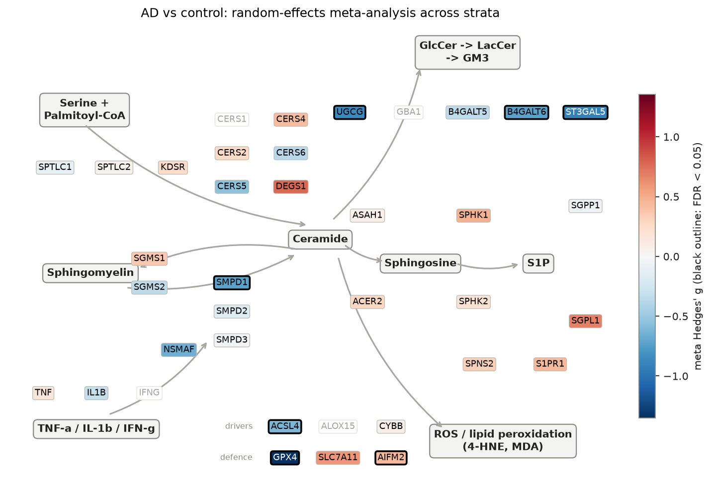
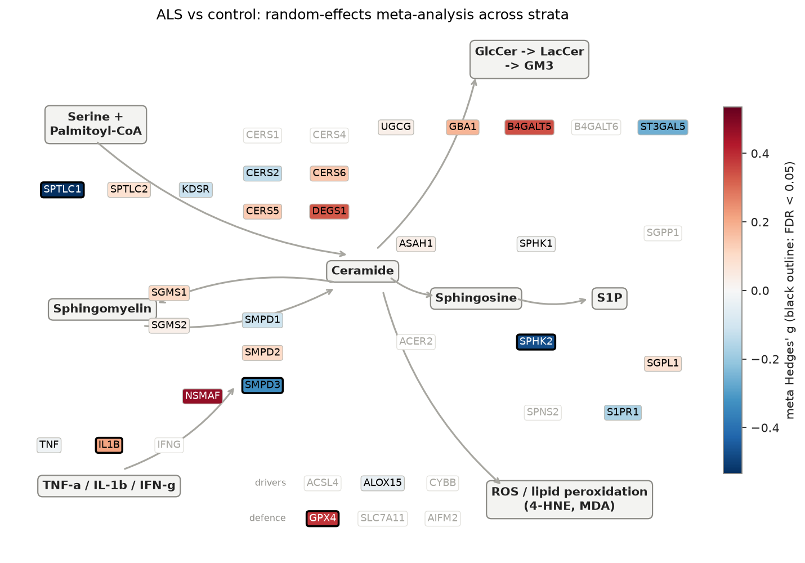

# sphingomap-CNS: Sphingolipid Pathway Atlas

_sphingomap-CNS v0.1.0_

Open `atlas.html` for the interactive version (sortable gene table, per-stratum reports).

## Comparisons

| Contrast | Cohort | Stratum | Case | Control | Covariates | Status |
|---|---|---|---:|---:|---|---|
|  | GSE153960 |  |  |  |  | failed: Not a gzipped file (b'<!') |
| AD | GSE5281 | [Entorhinal cortex](GSE5281/AD_Entorhinal_cortex/REPORT.md) | 10 | 13 | sex_male, age | ok |
| AD | GSE5281 | [Hippocampus](GSE5281/AD_Hippocampus/REPORT.md) | 10 | 13 | sex_male, age | ok |
| AD | GSE5281 | [Middle temporal gyrus](GSE5281/AD_Middle_temporal_gyrus/REPORT.md) | 16 | 12 | sex_male, age | ok |
| AD | GSE5281 | [Posterior cingulate](GSE5281/AD_Posterior_cingulate/REPORT.md) | 9 | 13 | sex_male, age | ok |
| AD | GSE5281 | [Superior frontal gyrus](GSE5281/AD_Superior_frontal_gyrus/REPORT.md) | 23 | 11 | sex_male, age | ok |
| AD | GSE5281 | [Primary visual cortex](GSE5281/AD_Primary_visual_cortex/REPORT.md) | 19 | 12 | sex_male, age | ok |
| ALS | GSE112676 | [All](GSE112676/ALS_All/REPORT.md) | 233 | 508 | sex_male | ok |
| ALS | GSE112680 | [All](GSE112680/ALS_All/REPORT.md) | 164 | 137 |  | ok |

## Atlas

## AD vs control: random-effects meta-analysis

| Gene | Module | meta g | 95% CI | I² | strata up / down (FDR<0.05) | FDR |
|---|---|---:|---|---:|---|---:|
| INA | Axonal integrity | -1.75 | -2.35 to -1.16 | 60% | 0 / 5 of 6 | 5.84e-07 |
| GSTA4 | Antioxidant / 4-HNE defence | -1.49 | -2.06 to -0.93 | 58% | 0 / 4 of 6 | 6.50e-06 |
| NEFM | Axonal integrity | -0.88 | -1.21 to -0.54 | 0% | 0 / 2 of 6 | 6.50e-06 |
| GPX4 | Antioxidant / 4-HNE defence | -1.35 | -1.90 to -0.80 | 57% | 0 / 3 of 6 | 2.52e-05 |
| ST3GAL5 | Glycosphingolipid branch | -0.92 | -1.31 to -0.53 | 24% | 0 / 3 of 6 | 5.21e-05 |
| IL1R1 | Cytokine SMase triggers | +0.75 | +0.42 to +1.08 | 0% | 1 / 0 of 6 | 9.10e-05 |
| PTGS2 | Lipid peroxidation drivers | -0.81 | -1.17 to -0.46 | 0% | 0 / 1 of 5 | 9.10e-05 |
| B4GALT6 | Glycosphingolipid branch | -0.74 | -1.07 to -0.41 | 0% | 0 / 2 of 6 | 1.07e-04 |
| NEFL | Axonal integrity | -0.94 | -1.42 to -0.46 | 49% | 0 / 2 of 6 | 9.95e-04 |
| CTLA4 | Treg axis | +0.67 | +0.31 to +1.03 | 0% | 0 / 0 of 5 | 2.32e-03 |
| CERT1 | Ceramide transport | -1.02 | -1.58 to -0.46 | 62% | 0 / 2 of 6 | 2.32e-03 |
| HEXB | Glycosphingolipid branch | -1.24 | -1.94 to -0.54 | 74% | 0 / 4 of 6 | 3.33e-03 |
| TNFRSF1A | Cytokine SMase triggers | +0.96 | +0.39 to +1.53 | 64% | 2 / 0 of 6 | 6.09e-03 |
| IKZF2 | Treg axis | +0.49 | +0.16 to +0.81 | 0% | 0 / 0 of 6 | 1.71e-02 |
| ALOX15B | Lipid peroxidation drivers | +0.68 | +0.22 to +1.13 | 47% | 2 / 0 of 6 | 1.79e-02 |
| SMPD1 | Sphingomyelin cycle | -0.72 | -1.26 to -0.19 | 61% | 0 / 2 of 6 | 3.07e-02 |
| SMPD2 | Sphingomyelin cycle | -0.19 | -1.05 to +0.68 | 85% | 0 / 1 of 6 | 7.74e-01 |
| SMPD3 | Sphingomyelin cycle | -0.04 | -0.49 to +0.41 | 49% | 0 / 0 of 6 | 8.92e-01 |
| CERS2 | De novo synthesis | +0.27 | -0.40 to +0.93 | 76% | 1 / 0 of 6 | 5.80e-01 |
| CERS3 | De novo synthesis | +0.29 | -0.29 to +0.88 | 68% | 2 / 0 of 6 | 4.72e-01 |
| CERS4 | De novo synthesis | +0.42 | -0.02 to +0.86 | 0% | 0 / 0 of 3 | 1.67e-01 |
| CERS5 | De novo synthesis | -0.55 | -1.15 to +0.05 | 69% | 0 / 2 of 6 | 1.72e-01 |
| CERS6 | De novo synthesis | -0.37 | -0.77 to +0.03 | 33% | 0 / 0 of 6 | 1.67e-01 |
| ASAH1 | Ceramide catabolism | +0.08 | -0.31 to +0.46 | 30% | 0 / 0 of 6 | 7.82e-01 |
| SGMS1 | Sphingomyelin cycle | +0.37 | -0.06 to +0.79 | 42% | 0 / 0 of 6 | 1.89e-01 |
| SGMS2 | Sphingomyelin cycle | -0.35 | -0.70 to -0.00 | 0% | 0 / 0 of 5 | 1.33e-01 |
| UGCG | Glycosphingolipid branch | -0.87 | -1.49 to -0.26 | 69% | 0 / 3 of 6 | 2.37e-02 |
| SPHK1 | S1P axis | +0.48 | -0.06 to +1.02 | 63% | 1 / 0 of 6 | 1.83e-01 |
| S1PR1 | S1P axis | +0.44 | -0.15 to +1.03 | 68% | 2 / 0 of 6 | 2.50e-01 |
| ACSL4 | Lipid peroxidation drivers | -0.61 | -1.05 to -0.18 | 44% | 0 / 1 of 6 | 2.39e-02 |

## ALS vs control: random-effects meta-analysis

| Gene | Module | meta g | 95% CI | I² | strata up / down (FDR<0.05) | FDR |
|---|---|---:|---|---:|---|---:|
| IL2RB | Treg axis | -0.71 | -0.84 to -0.58 | 0% | 0 / 2 of 2 | 3.37e-24 |
| CD68 | Microglia / myeloid activation | -0.61 | -0.74 to -0.48 | 0% | 0 / 2 of 2 | 1.03e-18 |
| S1PR5 | S1P axis | -0.56 | -0.69 to -0.43 | 0% | 0 / 2 of 2 | 4.99e-16 |
| S1PR4 | S1P axis | +0.50 | +0.37 to +0.63 | 0% | 2 / 0 of 2 | 6.04e-13 |
| S1PR3 | S1P axis | +0.47 | +0.34 to +0.60 | 0% | 2 / 0 of 2 | 1.68e-11 |
| IFNGR1 | Cytokine SMase triggers | +0.79 | +0.56 to +1.02 | 63% | 2 / 0 of 2 | 2.28e-10 |
| TYROBP | Microglia / myeloid activation | +0.43 | +0.30 to +0.56 | 0% | 2 / 0 of 2 | 6.60e-10 |
| GPX4 | Antioxidant / 4-HNE defence | +0.39 | +0.26 to +0.52 | 0% | 2 / 0 of 2 | 3.09e-08 |
| SMPD3 | Sphingomyelin cycle | -0.33 | -0.46 to -0.21 | 0% | 0 / 2 of 2 | 2.57e-06 |
| IKZF2 | Treg axis | -0.27 | -0.40 to -0.15 | 0% | 0 / 1 of 2 | 1.73e-04 |
| SPTLC1 | De novo synthesis | -0.53 | -0.79 to -0.28 | 70% | 0 / 2 of 2 | 1.73e-04 |
| LPCAT3 | Lipid peroxidation drivers | -0.26 | -0.38 to -0.13 | 0% | 0 / 1 of 2 | 5.09e-04 |
| HEXB | Glycosphingolipid branch | +0.53 | +0.22 to +0.83 | 80% | 2 / 0 of 2 | 4.09e-03 |
| IL1B | Cytokine SMase triggers | +0.22 | +0.09 to +0.34 | 0% | 1 / 0 of 2 | 4.58e-03 |
| CERT1 | Ceramide transport | +0.40 | +0.15 to +0.65 | 69% | 1 / 0 of 2 | 7.12e-03 |
| SMPD1 | Sphingomyelin cycle | -0.11 | -0.65 to +0.43 | 94% | 0 / 1 of 2 | 8.25e-01 |
| SMPD2 | Sphingomyelin cycle | +0.10 | -0.03 to +0.23 | 0% | 0 / 0 of 2 | 2.89e-01 |
| CERS2 | De novo synthesis | -0.13 | -0.50 to +0.24 | 86% | 0 / 1 of 2 | 7.52e-01 |
| CERS5 | De novo synthesis | +0.14 | +0.01 to +0.26 | 0% | 0 / 0 of 2 | 1.21e-01 |
| CERS6 | De novo synthesis | +0.15 | -0.05 to +0.34 | 52% | 1 / 0 of 2 | 3.13e-01 |
| ASAH1 | Ceramide catabolism | +0.03 | -0.10 to +0.16 | 0% | 0 / 0 of 2 | 8.20e-01 |
| SGMS1 | Sphingomyelin cycle | +0.11 | -0.37 to +0.58 | 92% | 1 / 0 of 2 | 8.20e-01 |
| SGMS2 | Sphingomyelin cycle | +0.03 | -0.10 to +0.16 | 0% | 0 / 0 of 2 | 8.20e-01 |
| UGCG | Glycosphingolipid branch | +0.03 | -0.44 to +0.50 | 91% | 1 / 0 of 2 | 9.20e-01 |
| SPHK1 | S1P axis | -0.00 | -0.42 to +0.41 | 89% | 0 / 1 of 2 | 9.85e-01 |
| S1PR1 | S1P axis | -0.17 | -1.17 to +0.83 | 98% | 1 / 1 of 2 | 8.46e-01 |

## Module scores (Hedges' g, case vs control)

| Score | AD | GSE5281 | Entorhinal cortex | AD | GSE5281 | Hippocampus | AD | GSE5281 | Middle temporal gyrus | AD | GSE5281 | Posterior cingulate | AD | GSE5281 | Primary visual cortex | AD | GSE5281 | Superior frontal gyrus | ALS | GSE112676 | ALS | GSE112680 |
|---|---:|---:|---:|---:|---:|---:|---:|---:|
| De novo synthesis | -0.05 | -0.07 | +0.56 | +1.08* | +0.92 | -0.43 | +0.03 | -0.23 |
| Sphingomyelin cycle | -1.08* | -0.68 | -0.52 | +0.73 | -0.08 | -0.85 | -0.28* | +0.06 |
| Ceramide catabolism | +0.13 | +0.50 | +1.04* | -0.23 | +0.40 | -0.24 | -0.02 | -0.22 |
| S1P axis | +0.08 | +1.23* | +0.40 | +1.27* | +0.52 | -0.20 | -0.04 | -0.02 |
| Glycosphingolipid branch | -0.10 | -1.44* | -1.77* | -2.29* | -0.66 | -0.95 | +0.31* | -0.03 |
| Cytokine SMase triggers | +0.80 | -0.38 | +1.17* | -0.25 | -0.24 | -0.15 | +0.76* | +0.47* |
| Lipid peroxidation drivers | +0.27 | +0.80 | -0.04 | +0.82 | +0.49 | -0.91 | +0.27* | -0.18 |
| Antioxidant / 4-HNE defence | -0.06 | -1.69* | -0.06 | -1.34* | +0.24 | -0.08 | +0.38* | -0.37* |
| Microglia / myeloid activation | -0.48 | +0.00 | -0.80 | +0.52 | +0.52 | -0.34 | -0.01 | -0.08 |
| Treg axis | +1.03 | +0.93 | -0.28 | +1.31* | +0.60 | -0.77 | -0.53* | -0.25 |
| Axonal integrity | -1.69* | -0.50 | -1.80* | -1.10* | -0.70 | -0.73 | -0.07 | -0.06 |
| Rheostat index | +0.99* | +0.74 | -0.48 | -0.33 | -0.23 | +0.29 | +0.25* | -0.38* |
| Ceramide-peroxidation index | -0.10 | +0.51 | +0.67 | +1.48* | +0.50 | -1.23* | -0.22* | +0.01 |

\* FDR < 0.05 within that stratum.

## How to read this

- **Hedges' g** is the standardised case-control difference (0.2 small, 0.5 medium, 0.8 large).
- **Meta-analysis** pools strata of the same disease with DerSimonian-Laird random effects. Brain regions from the same donors are not independent, so pooled p-values are optimistic; read the 'strata up/down' column and I² (between-stratum heterogeneity) alongside them.
- Bulk post-mortem tissue: neuron loss and gliosis shift cell composition, so a change can reflect which cells are present rather than per-cell regulation. Blood cohorts reflect circulating leukocytes, the compartment COYA 302 acts on directly.
- Transcript changes are hypotheses for lipid measurement (Phase 2), not lipid measurements.
