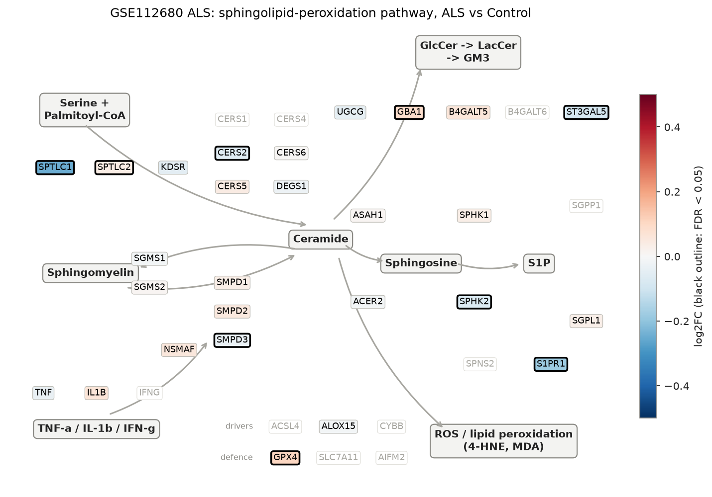
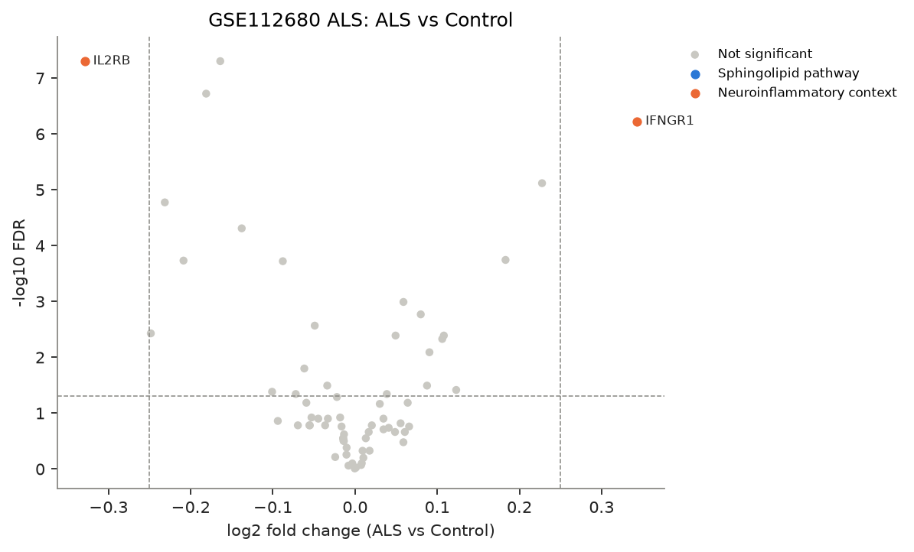
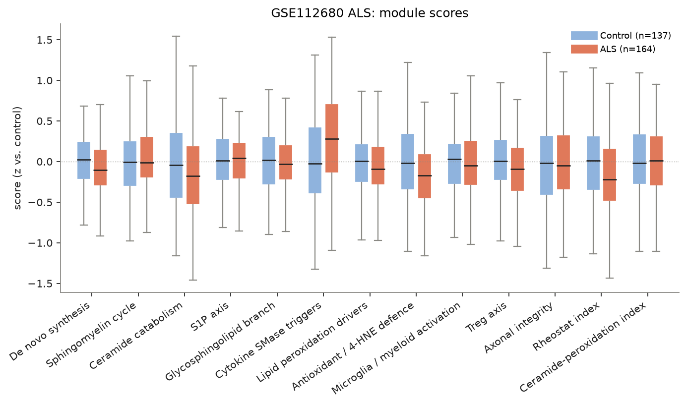
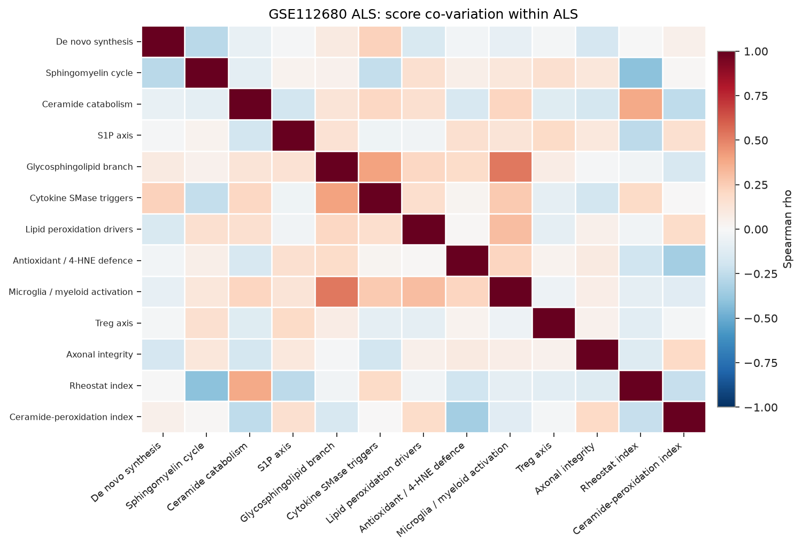
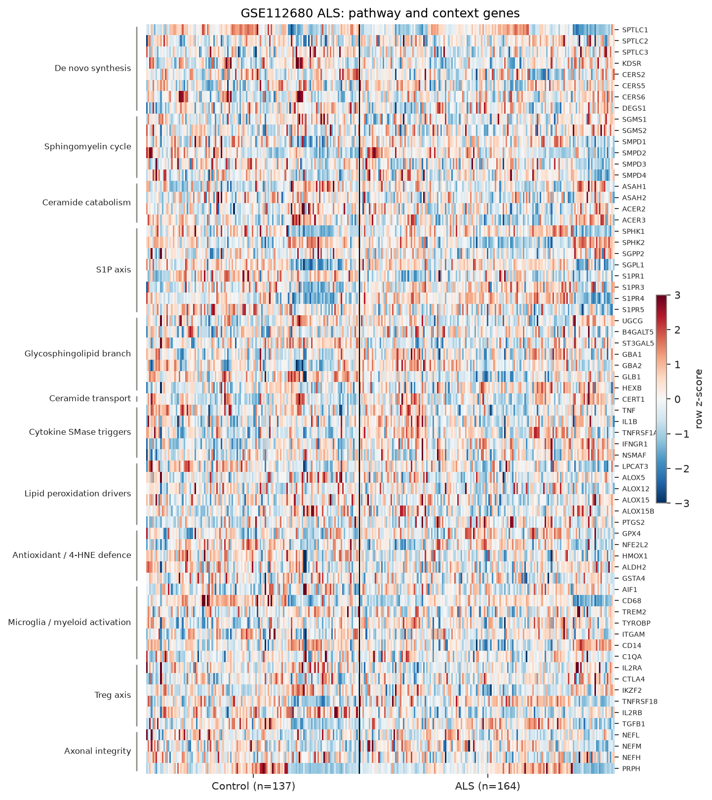

# sphingomap-CNS report: GSE112680 ALS

_sphingomap-CNS v0.1.0, generated 2026-11-11_

Source: ALS whole blood, replication set (Illumina HT-12 v4) (van Rheenen W. et al., PLoS One 13, e0198874 (2018))

## Design

- ALS: **164**, Control: **137**
- Model: linear model
- Genes tested: 67 (not in data / not expressed: CERS1, CERS3, CERS4, DEGS2, ACER1, SGPP1, SPNS2, S1PR2, B4GALT6, A4GALT, GLA, HEXA, IFNG, IL1R1, ACSL4, CYBB, NCF1, SLC7A11, AIFM2, AKR1C1, FOXP3, IL10, INA)

## Gene-level changes

2 genes with FDR < 0.05 and |log2FC| >= 0.25.

- Up: IFNGR1
- Down: IL2RB

### Proposal focus genes

| Gene | log2FC | FDR |
|---|---:|---:|
| SMPD1 | +0.03 | 1.96e-01 |
| SMPD2 | +0.05 | 2.18e-01 |
| SMPD3 | -0.03 | 3.22e-02 |
| CERS2 | -0.06 | 1.59e-02 |
| CERS5 | +0.04 | 1.83e-01 |
| CERS6 | +0.01 | 8.50e-01 |
| ASAH1 | +0.01 | 6.31e-01 |
| SGMS1 | -0.01 | 2.82e-01 |
| SGMS2 | +0.01 | 4.73e-01 |
| UGCG | -0.04 | 1.26e-01 |
| SPHK1 | +0.03 | 1.26e-01 |
| S1PR1 | -0.18 | 1.90e-07 |
| GPX4 | +0.11 | 4.09e-03 |

### Top 25 genes

| Gene | Module | log2FC | FDR |
|---|---|---:|---:|
| IL2RB | Treg axis | -0.33 | 4.98e-08 |
| GLB1 | Glycosphingolipid branch | -0.16 | 4.98e-08 |
| S1PR1 | S1P axis | -0.18 | 1.90e-07 |
| IFNGR1 | Cytokine SMase triggers | +0.34 | 5.97e-07 |
| S1PR4 | S1P axis | +0.23 | 7.63e-06 |
| CD68 | Microglia / myeloid activation | -0.23 | 1.68e-05 |
| HMOX1 | Antioxidant / 4-HNE defence | -0.14 | 4.91e-05 |
| TNFRSF1A | Cytokine SMase triggers | +0.18 | 1.81e-04 |
| S1PR5 | S1P axis | -0.21 | 1.86e-04 |
| ST3GAL5 | Glycosphingolipid branch | -0.09 | 1.91e-04 |
| S1PR3 | S1P axis | +0.06 | 1.02e-03 |
| GBA2 | Glycosphingolipid branch | +0.08 | 1.71e-03 |
| IL2RA | Treg axis | -0.05 | 2.72e-03 |
| SPTLC1 | De novo synthesis | -0.25 | 3.74e-03 |
| TNFRSF18 | Treg axis | +0.05 | 4.09e-03 |
| GPX4 | Antioxidant / 4-HNE defence | +0.11 | 4.09e-03 |
| TYROBP | Microglia / myeloid activation | +0.11 | 4.70e-03 |
| HEXB | Glycosphingolipid branch | +0.09 | 8.14e-03 |
| CERS2 | De novo synthesis | -0.06 | 1.59e-02 |
| GBA1 | Glycosphingolipid branch | +0.09 | 3.22e-02 |
| SMPD3 | Sphingomyelin cycle | -0.03 | 3.22e-02 |
| PTGS2 | Lipid peroxidation drivers | +0.12 | 3.85e-02 |
| NFE2L2 | Antioxidant / 4-HNE defence | -0.10 | 4.15e-02 |
| SPHK2 | S1P axis | -0.07 | 4.55e-02 |
| SPTLC2 | De novo synthesis | +0.04 | 4.55e-02 |

## Module scores and indices

Scores are mean z-scores relative to the control group. The rheostat index is pro-survival (S1P/GSL) minus pro-ceramide genes; the ceramide-peroxidation (CPA) index is ceramide-generation + peroxidation-driver genes minus ceramide-clearance + antioxidant genes.

| Score | Mean difference | Hedges' g | FDR |
|---|---:|---:|---:|
| Cytokine SMase triggers | +0.27 | +0.47 | 9.26e-04 |
| Rheostat index | -0.19 | -0.38 | 6.30e-03 |
| Antioxidant / 4-HNE defence | -0.17 | -0.37 | 6.91e-03 |
| Treg axis | -0.10 | -0.25 | 1.04e-01 |
| De novo synthesis | -0.08 | -0.23 | 1.18e-01 |
| Ceramide catabolism | -0.12 | -0.22 | 1.27e-01 |
| Lipid peroxidation drivers | -0.07 | -0.18 | 2.17e-01 |
| Microglia / myeloid activation | -0.04 | -0.08 | 7.65e-01 |
| Axonal integrity | -0.03 | -0.06 | 8.11e-01 |
| Sphingomyelin cycle | +0.02 | +0.06 | 8.11e-01 |
| Glycosphingolipid branch | -0.01 | -0.03 | 9.22e-01 |
| S1P axis | -0.01 | -0.02 | 9.22e-01 |
| Ceramide-peroxidation index | +0.01 | +0.01 | 9.22e-01 |

## Caveats

- mRNA / protein abundance is not enzyme activity or lipid concentration; confirm with lipidomics (LC-MS/MS, HPTLC).
- Module scores and indices are exploratory transcript-level heuristics, not validated biomarkers.
- Post-mortem bulk tissue mixes cell types; changes can reflect cell-composition shifts (e.g. neuron loss, gliosis) rather than per-cell regulation.
