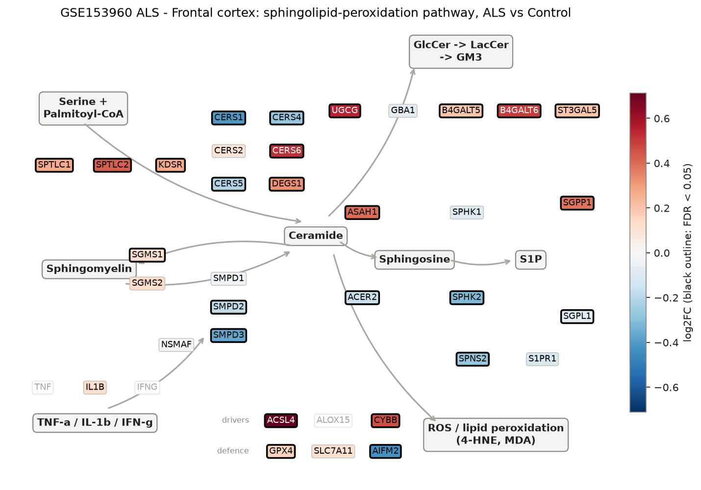
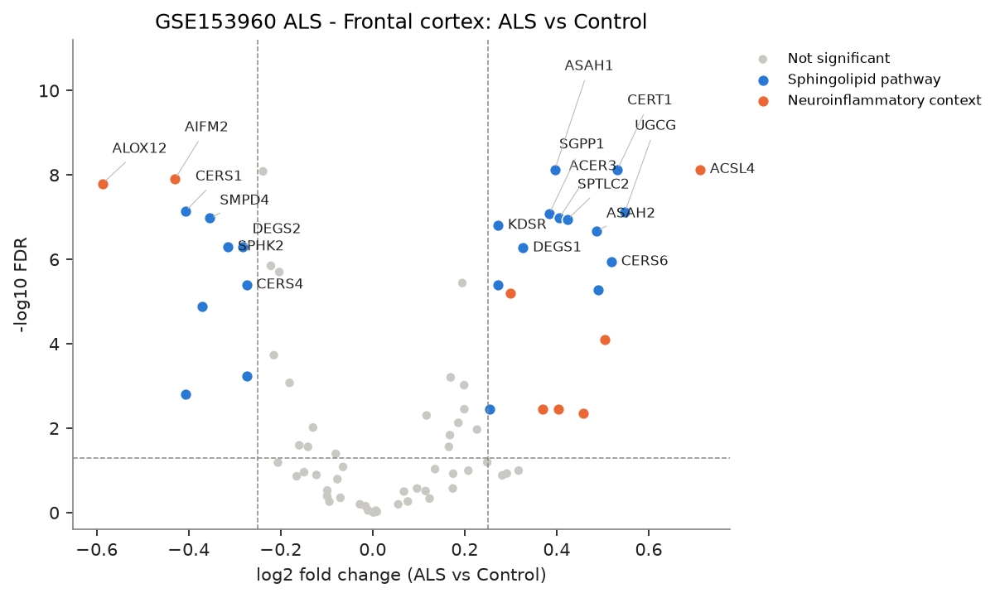
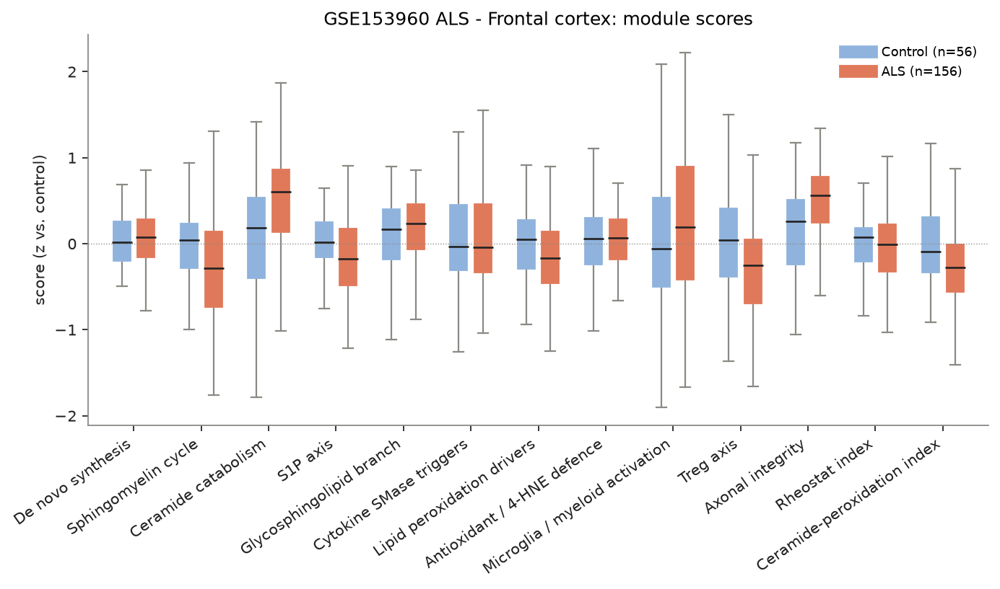
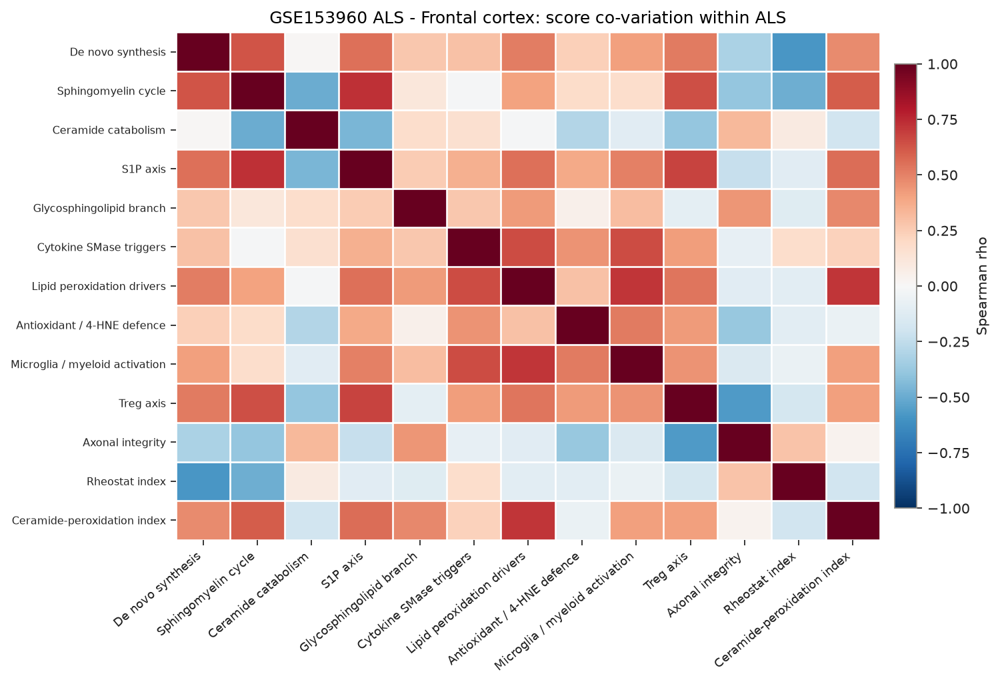
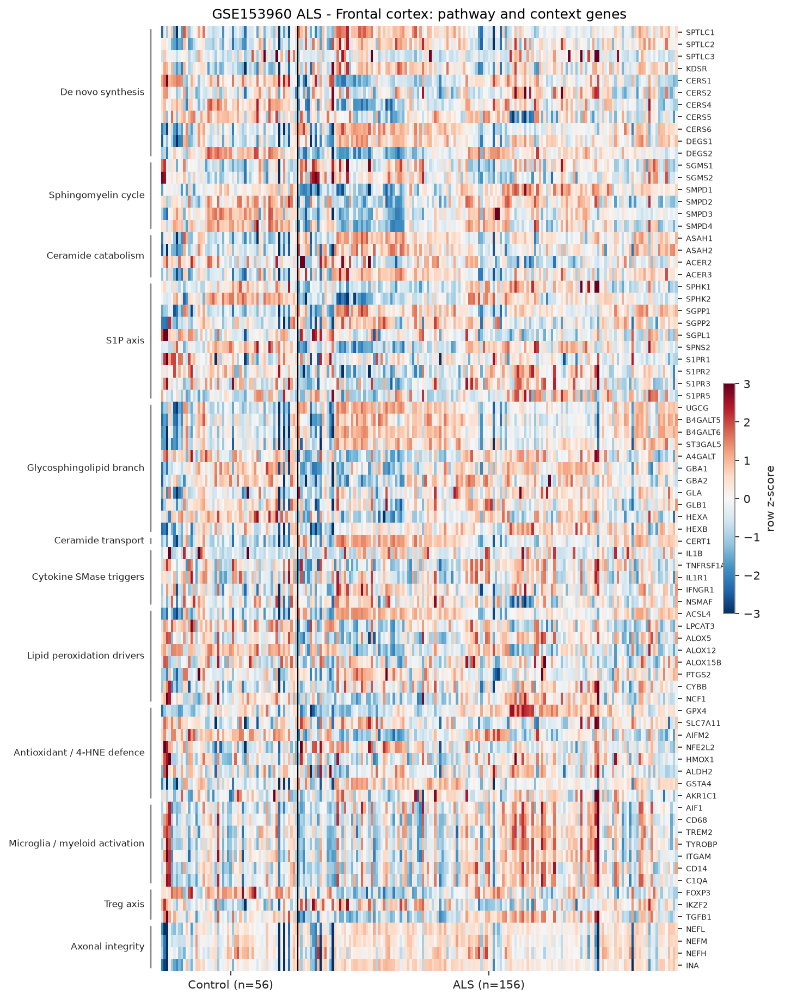

# sphingomap-CNS report: GSE153960 ALS - Frontal cortex

_sphingomap-CNS v0.1.0, generated 2026-11-11_

Source: NYGC ALS Consortium / Target ALS post-mortem CNS RNA-seq (New York Genome Center ALS Consortium (GEO GSE153960))

## Design

- ALS: **156**, Control: **56**
- Model: linear model
- Genes tested: 78 (not in data / not expressed: CERS3, ACER1, S1PR4, TNF, IFNG, ALOX15, IL2RA, CTLA4, TNFRSF18, IL2RB, IL10, PRPH)

## Gene-level changes

29 genes with FDR < 0.05 and |log2FC| >= 0.25.

- Up: ACSL4, UGCG, CERT1, CERS6, INA, B4GALT6, ASAH2, CYBB, SPTLC2, ACER3, AIF1, ASAH1, SGPP1, NEFL, DEGS1, GSTA4, KDSR, SPTLC1, HEXB
- Down: ALOX12, AIFM2, A4GALT, CERS1, SMPD3, SMPD4, SPHK2, DEGS2, CERS4, SPNS2

### Proposal focus genes

| Gene | log2FC | FDR |
|---|---:|---:|
| SMPD1 | -0.03 | 6.38e-01 |
| SMPD2 | -0.18 | 8.46e-04 |
| SMPD3 | -0.37 | 1.33e-05 |
| CERS1 | -0.41 | 7.22e-08 |
| CERS2 | +0.10 | 2.69e-01 |
| CERS4 | -0.27 | 4.04e-06 |
| CERS5 | -0.21 | 1.87e-04 |
| CERS6 | +0.52 | 1.14e-06 |
| ASAH1 | +0.40 | 7.42e-09 |
| SGMS1 | +0.12 | 5.01e-03 |
| SGMS2 | +0.14 | 9.35e-02 |
| UGCG | +0.55 | 7.56e-08 |
| SPHK1 | -0.10 | 3.00e-01 |
| S1PR1 | -0.12 | 1.28e-01 |
| GPX4 | +0.17 | 2.77e-02 |
| ACSL4 | +0.71 | 7.42e-09 |

### Top 25 genes

| Gene | Module | log2FC | FDR |
|---|---|---:|---:|
| CERT1 | Ceramide transport | +0.53 | 7.42e-09 |
| ACSL4 | Lipid peroxidation drivers | +0.71 | 7.42e-09 |
| ASAH1 | Ceramide catabolism | +0.40 | 7.42e-09 |
| FOXP3 | Treg axis | -0.24 | 8.25e-09 |
| AIFM2 | Antioxidant / 4-HNE defence | -0.43 | 1.26e-08 |
| ALOX12 | Lipid peroxidation drivers | -0.59 | 1.60e-08 |
| CERS1 | De novo synthesis | -0.41 | 7.22e-08 |
| UGCG | Glycosphingolipid branch | +0.55 | 7.56e-08 |
| SGPP1 | S1P axis | +0.38 | 8.21e-08 |
| SMPD4 | Sphingomyelin cycle | -0.35 | 1.05e-07 |
| ACER3 | Ceramide catabolism | +0.41 | 1.05e-07 |
| SPTLC2 | De novo synthesis | +0.42 | 1.13e-07 |
| KDSR | De novo synthesis | +0.27 | 1.56e-07 |
| ASAH2 | Ceramide catabolism | +0.49 | 2.14e-07 |
| SPHK2 | S1P axis | -0.31 | 5.04e-07 |
| DEGS2 | De novo synthesis | -0.28 | 5.04e-07 |
| DEGS1 | De novo synthesis | +0.33 | 5.35e-07 |
| CERS6 | De novo synthesis | +0.52 | 1.14e-06 |
| HEXA | Glycosphingolipid branch | -0.22 | 1.43e-06 |
| LPCAT3 | Lipid peroxidation drivers | -0.20 | 2.00e-06 |
| ST3GAL5 | Glycosphingolipid branch | +0.19 | 3.64e-06 |
| CERS4 | De novo synthesis | -0.27 | 4.04e-06 |
| SPTLC1 | De novo synthesis | +0.27 | 4.04e-06 |
| B4GALT6 | Glycosphingolipid branch | +0.49 | 5.33e-06 |
| GSTA4 | Antioxidant / 4-HNE defence | +0.30 | 6.37e-06 |

## Module scores and indices

Scores are mean z-scores relative to the control group. The rheostat index is pro-survival (S1P/GSL) minus pro-ceramide genes; the ceramide-peroxidation (CPA) index is ceramide-generation + peroxidation-driver genes minus ceramide-clearance + antioxidant genes.

| Score | Mean difference | Hedges' g | FDR |
|---|---:|---:|---:|
| Ceramide catabolism | +0.51 | +0.82 | 4.74e-06 |
| Ceramide-peroxidation index | -0.30 | -0.62 | 6.32e-04 |
| Treg axis | -0.31 | -0.50 | 5.72e-03 |
| Sphingomyelin cycle | -0.30 | -0.49 | 5.72e-03 |
| Axonal integrity | +0.36 | +0.43 | 1.51e-02 |
| S1P axis | -0.16 | -0.37 | 4.21e-02 |
| Lipid peroxidation drivers | -0.15 | -0.34 | 5.64e-02 |
| Glycosphingolipid branch | +0.14 | +0.26 | 1.63e-01 |
| Microglia / myeloid activation | +0.23 | +0.24 | 1.72e-01 |
| Antioxidant / 4-HNE defence | +0.05 | +0.12 | 5.12e-01 |
| De novo synthesis | +0.05 | +0.12 | 5.12e-01 |
| Cytokine SMase triggers | +0.06 | +0.11 | 5.20e-01 |
| Rheostat index | -0.03 | -0.08 | 6.26e-01 |

## Caveats

- mRNA / protein abundance is not enzyme activity or lipid concentration; confirm with lipidomics (LC-MS/MS, HPTLC).
- Module scores and indices are exploratory transcript-level heuristics, not validated biomarkers.
- Post-mortem bulk tissue mixes cell types; changes can reflect cell-composition shifts (e.g. neuron loss, gliosis) rather than per-cell regulation.
