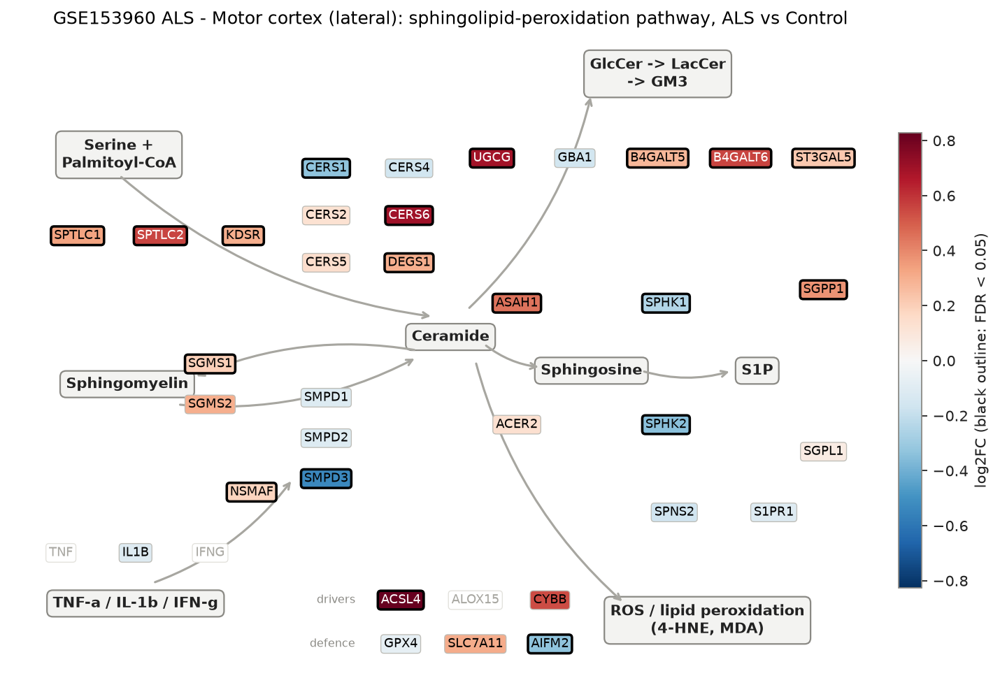
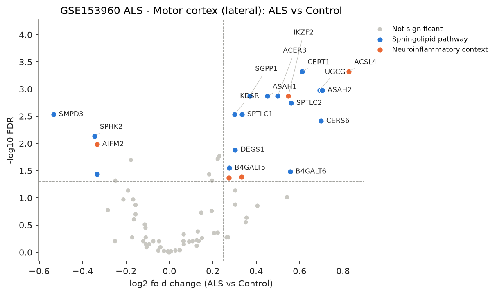
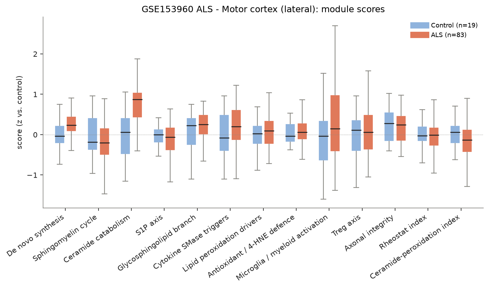
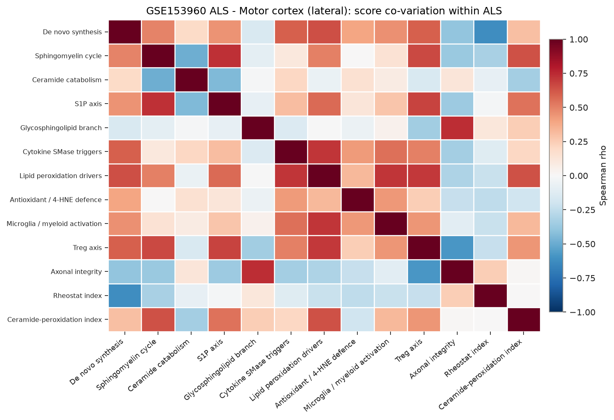
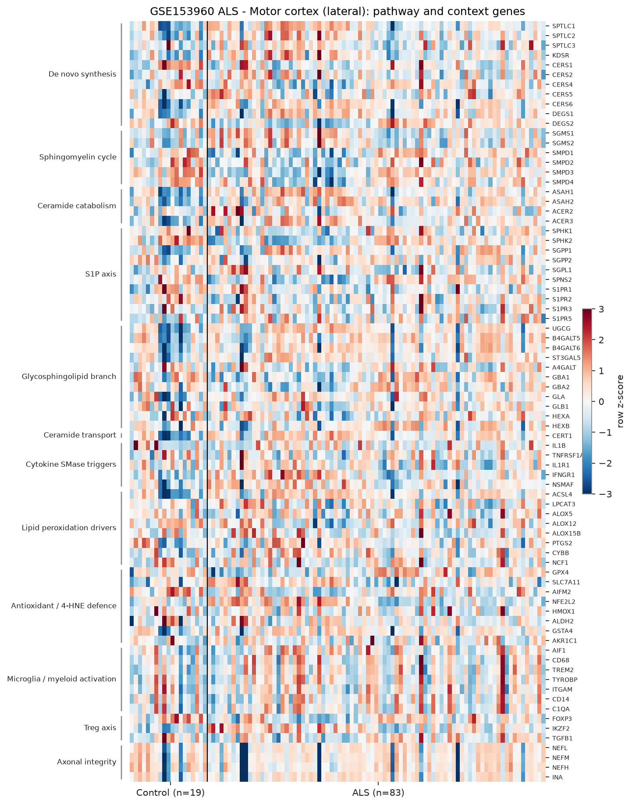

# sphingomap-CNS report: GSE153960 ALS - Motor cortex (lateral)

_sphingomap-CNS v0.1.0, generated 2026-11-11_

Source: NYGC ALS Consortium / Target ALS post-mortem CNS RNA-seq (New York Genome Center ALS Consortium (GEO GSE153960))

## Design

- ALS: **83**, Control: **19**
- Model: linear model
- Genes tested: 78 (not in data / not expressed: CERS3, ACER1, S1PR4, TNF, IFNG, ALOX15, IL2RA, CTLA4, TNFRSF18, IL2RB, IL10, PRPH)

## Gene-level changes

21 genes with FDR < 0.05 and |log2FC| >= 0.25.

- Up: ACSL4, ASAH2, CERS6, UGCG, CERT1, SPTLC2, B4GALT6, IKZF2, ACER3, ASAH1, SGPP1, SPTLC1, GSTA4, DEGS1, KDSR, B4GALT5, IFNGR1
- Down: SMPD3, SPHK2, AIFM2, CERS1

### Proposal focus genes

| Gene | log2FC | FDR |
|---|---:|---:|
| SMPD1 | -0.11 | 3.56e-01 |
| SMPD2 | -0.11 | 3.09e-01 |
| SMPD3 | -0.53 | 2.91e-03 |
| CERS1 | -0.33 | 3.68e-02 |
| CERS2 | +0.13 | 6.01e-01 |
| CERS4 | -0.16 | 2.01e-01 |
| CERS5 | +0.15 | 1.87e-01 |
| CERS6 | +0.70 | 3.86e-03 |
| ASAH1 | +0.45 | 1.35e-03 |
| SGMS1 | +0.20 | 4.81e-02 |
| SGMS2 | +0.30 | 7.34e-02 |
| UGCG | +0.69 | 1.05e-03 |
| SPHK1 | -0.25 | 4.81e-02 |
| S1PR1 | -0.11 | 5.33e-01 |
| GPX4 | -0.07 | 6.26e-01 |
| ACSL4 | +0.83 | 4.75e-04 |

### Top 25 genes

| Gene | Module | log2FC | FDR |
|---|---|---:|---:|
| ACSL4 | Lipid peroxidation drivers | +0.83 | 4.75e-04 |
| CERT1 | Ceramide transport | +0.61 | 4.75e-04 |
| UGCG | Glycosphingolipid branch | +0.69 | 1.05e-03 |
| ASAH2 | Ceramide catabolism | +0.70 | 1.05e-03 |
| ASAH1 | Ceramide catabolism | +0.45 | 1.35e-03 |
| SGPP1 | S1P axis | +0.37 | 1.35e-03 |
| ACER3 | Ceramide catabolism | +0.50 | 1.35e-03 |
| IKZF2 | Treg axis | +0.55 | 1.35e-03 |
| SPTLC2 | De novo synthesis | +0.56 | 1.79e-03 |
| KDSR | De novo synthesis | +0.30 | 2.91e-03 |
| SMPD3 | Sphingomyelin cycle | -0.53 | 2.91e-03 |
| SPTLC1 | De novo synthesis | +0.33 | 2.91e-03 |
| CERS6 | De novo synthesis | +0.70 | 3.86e-03 |
| SPHK2 | S1P axis | -0.35 | 7.30e-03 |
| AIFM2 | Antioxidant / 4-HNE defence | -0.33 | 1.03e-02 |
| DEGS1 | De novo synthesis | +0.30 | 1.31e-02 |
| GLA | Glycosphingolipid branch | +0.23 | 1.71e-02 |
| ST3GAL5 | Glycosphingolipid branch | +0.22 | 1.93e-02 |
| FOXP3 | Treg axis | -0.18 | 2.01e-02 |
| B4GALT5 | Glycosphingolipid branch | +0.28 | 2.81e-02 |
| B4GALT6 | Glycosphingolipid branch | +0.56 | 3.30e-02 |
| CERS1 | De novo synthesis | -0.33 | 3.68e-02 |
| NSMAF | Cytokine SMase triggers | +0.18 | 3.68e-02 |
| GSTA4 | Antioxidant / 4-HNE defence | +0.33 | 4.11e-02 |
| IFNGR1 | Cytokine SMase triggers | +0.27 | 4.26e-02 |

## Module scores and indices

Scores are mean z-scores relative to the control group. The rheostat index is pro-survival (S1P/GSL) minus pro-ceramide genes; the ceramide-peroxidation (CPA) index is ceramide-generation + peroxidation-driver genes minus ceramide-clearance + antioxidant genes.

| Score | Mean difference | Hedges' g | FDR |
|---|---:|---:|---:|
| Ceramide catabolism | +0.74 | +1.47 | 9.68e-07 |
| De novo synthesis | +0.27 | +0.83 | 9.57e-03 |
| Cytokine SMase triggers | +0.24 | +0.46 | 2.98e-01 |
| Glycosphingolipid branch | +0.20 | +0.43 | 2.98e-01 |
| Ceramide-peroxidation index | -0.17 | -0.38 | 3.56e-01 |
| Microglia / myeloid activation | +0.28 | +0.32 | 4.14e-01 |
| Sphingomyelin cycle | -0.17 | -0.31 | 4.14e-01 |
| Antioxidant / 4-HNE defence | +0.10 | +0.29 | 4.14e-01 |
| S1P axis | -0.08 | -0.21 | 5.20e-01 |
| Treg axis | +0.12 | +0.20 | 5.20e-01 |
| Lipid peroxidation drivers | +0.10 | +0.20 | 5.20e-01 |
| Rheostat index | -0.07 | -0.17 | 5.46e-01 |
| Axonal integrity | +0.00 | +0.00 | 9.91e-01 |

## Caveats

- mRNA / protein abundance is not enzyme activity or lipid concentration; confirm with lipidomics (LC-MS/MS, HPTLC).
- Module scores and indices are exploratory transcript-level heuristics, not validated biomarkers.
- Post-mortem bulk tissue mixes cell types; changes can reflect cell-composition shifts (e.g. neuron loss, gliosis) rather than per-cell regulation.
