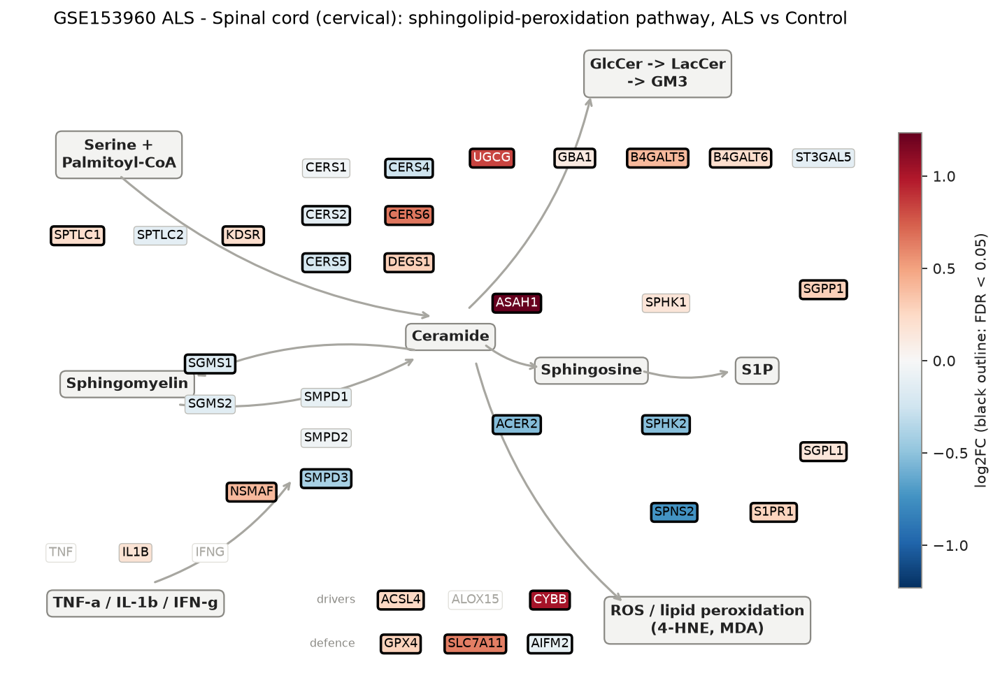
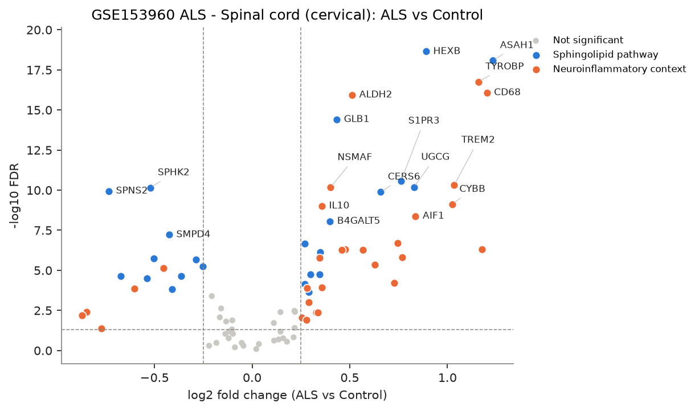
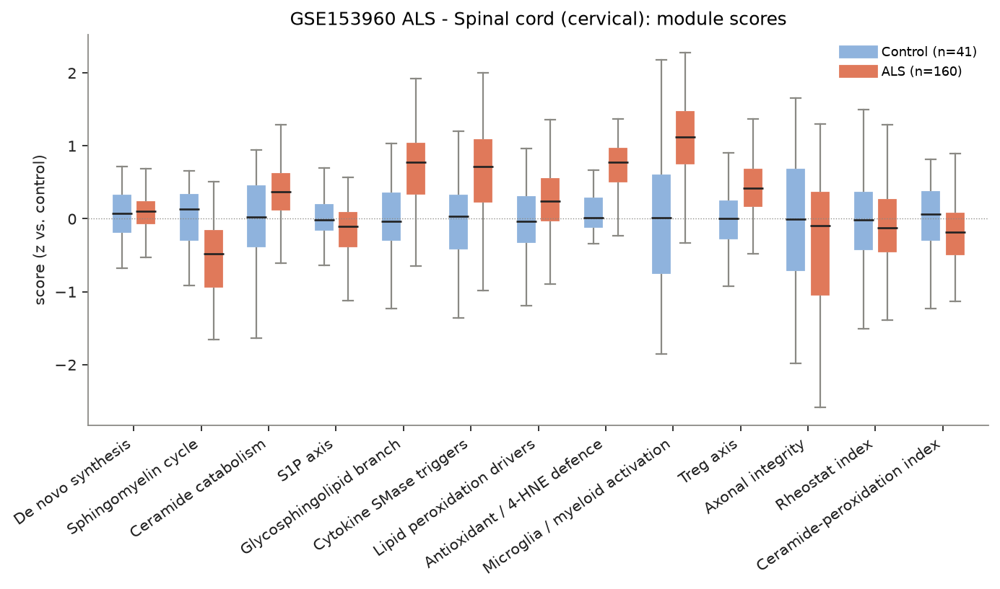
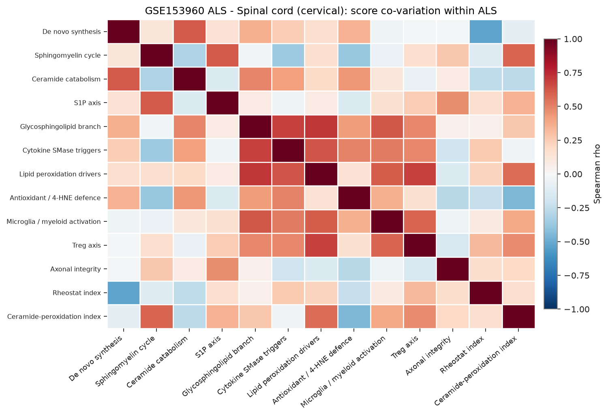
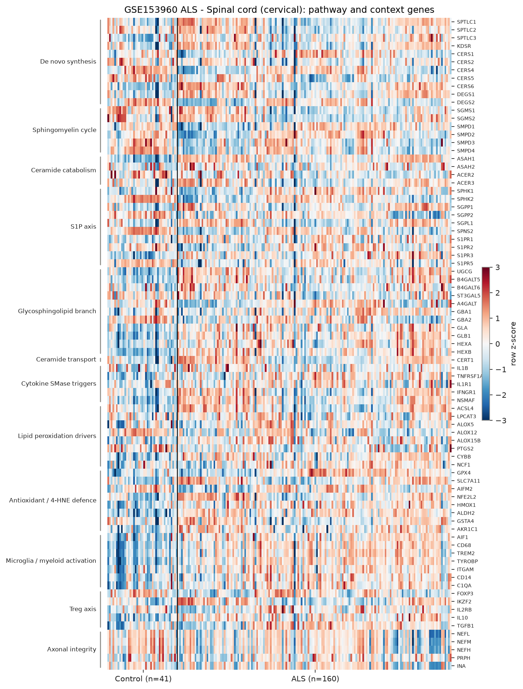

# sphingomap-CNS report: GSE153960 ALS - Spinal cord (cervical)

_sphingomap-CNS v0.1.0, generated 2026-11-11_

Source: NYGC ALS Consortium / Target ALS post-mortem CNS RNA-seq (New York Genome Center ALS Consortium (GEO GSE153960))

## Design

- ALS: **160**, Control: **41**
- Model: linear model
- Genes tested: 81 (not in data / not expressed: CERS3, ACER1, S1PR4, TNF, IFNG, ALOX15, IL2RA, CTLA4, TNFRSF18)

## Gene-level changes

53 genes with FDR < 0.05 and |log2FC| >= 0.25.

- Up: ASAH1, CD68, ALOX15B, TYROBP, TREM2, CYBB, HEXB, AIF1, UGCG, C1QA, S1PR3, AKR1C1, CD14, CERS6, SLC7A11, SPTLC3, HMOX1, ALDH2, ITGAM, TNFRSF1A, GLB1, NSMAF, B4GALT5, TGFB1, IL10, GLA, CERT1, NFE2L2, IKZF2, ALOX5, SGPP1, DEGS1, IFNGR1, GPX4, NCF1, S1PR1, HEXA, ACSL4
- Down: NEFH, NEFM, NEFL, SPNS2, SGPP2, PTGS2, ACER2, SPHK2, S1PR5, ALOX12, SMPD4, SMPD3, DEGS2, GBA2, CERS4

### Proposal focus genes

| Gene | log2FC | FDR |
|---|---:|---:|
| SMPD1 | -0.10 | 9.19e-02 |
| SMPD2 | -0.05 | 3.34e-01 |
| SMPD3 | -0.41 | 1.47e-04 |
| CERS1 | -0.04 | 5.06e-01 |
| CERS2 | -0.13 | 1.55e-02 |
| CERS4 | -0.25 | 5.60e-06 |
| CERS5 | -0.21 | 4.05e-04 |
| CERS6 | +0.66 | 1.32e-10 |
| ASAH1 | +1.23 | 8.34e-19 |
| SGMS1 | -0.16 | 2.38e-03 |
| SGMS2 | -0.14 | 9.19e-02 |
| UGCG | +0.83 | 6.56e-11 |
| SPHK1 | +0.16 | 1.73e-01 |
| S1PR1 | +0.27 | 7.42e-05 |
| GPX4 | +0.28 | 1.25e-04 |
| ACSL4 | +0.25 | 9.15e-03 |

### Top 25 genes

| Gene | Module | log2FC | FDR |
|---|---|---:|---:|
| HEXB | Glycosphingolipid branch | +0.89 | 2.28e-19 |
| ASAH1 | Ceramide catabolism | +1.23 | 8.34e-19 |
| TYROBP | Microglia / myeloid activation | +1.16 | 1.78e-17 |
| CD68 | Microglia / myeloid activation | +1.20 | 8.47e-17 |
| ALDH2 | Antioxidant / 4-HNE defence | +0.51 | 1.17e-16 |
| GLB1 | Glycosphingolipid branch | +0.43 | 3.95e-15 |
| S1PR3 | S1P axis | +0.76 | 2.65e-11 |
| TREM2 | Microglia / myeloid activation | +1.03 | 4.85e-11 |
| UGCG | Glycosphingolipid branch | +0.83 | 6.56e-11 |
| NSMAF | Cytokine SMase triggers | +0.40 | 6.89e-11 |
| SPHK2 | S1P axis | -0.52 | 7.07e-11 |
| SPNS2 | S1P axis | -0.73 | 1.14e-10 |
| CERS6 | De novo synthesis | +0.66 | 1.32e-10 |
| CYBB | Lipid peroxidation drivers | +1.02 | 7.65e-10 |
| IL10 | Treg axis | +0.36 | 9.74e-10 |
| AIF1 | Microglia / myeloid activation | +0.84 | 4.21e-09 |
| B4GALT5 | Glycosphingolipid branch | +0.40 | 8.73e-09 |
| SMPD4 | Sphingomyelin cycle | -0.42 | 6.05e-08 |
| AKR1C1 | Antioxidant / 4-HNE defence | +0.75 | 2.06e-07 |
| HEXA | Glycosphingolipid branch | +0.27 | 2.11e-07 |
| ITGAM | Microglia / myeloid activation | +0.48 | 5.01e-07 |
| ALOX15B | Lipid peroxidation drivers | +1.18 | 5.01e-07 |
| TNFRSF1A | Cytokine SMase triggers | +0.46 | 5.17e-07 |
| HMOX1 | Antioxidant / 4-HNE defence | +0.57 | 5.17e-07 |
| GLA | Glycosphingolipid branch | +0.35 | 7.17e-07 |

## Module scores and indices

Scores are mean z-scores relative to the control group. The rheostat index is pro-survival (S1P/GSL) minus pro-ceramide genes; the ceramide-peroxidation (CPA) index is ceramide-generation + peroxidation-driver genes minus ceramide-clearance + antioxidant genes.

| Score | Mean difference | Hedges' g | FDR |
|---|---:|---:|---:|
| Antioxidant / 4-HNE defence | +0.70 | +1.62 | 3.86e-16 |
| Microglia / myeloid activation | +1.03 | +1.40 | 4.82e-13 |
| Glycosphingolipid branch | +0.72 | +1.34 | 3.08e-12 |
| Sphingomyelin cycle | -0.53 | -1.07 | 1.54e-08 |
| Cytokine SMase triggers | +0.65 | +1.02 | 4.64e-08 |
| Treg axis | +0.40 | +0.89 | 1.56e-06 |
| Ceramide catabolism | +0.35 | +0.67 | 2.97e-04 |
| Lipid peroxidation drivers | +0.25 | +0.52 | 5.20e-03 |
| Ceramide-peroxidation index | -0.18 | -0.42 | 2.27e-02 |
| S1P axis | -0.17 | -0.41 | 2.59e-02 |
| Axonal integrity | -0.35 | -0.37 | 4.13e-02 |
| De novo synthesis | +0.05 | +0.12 | 5.39e-01 |
| Rheostat index | -0.05 | -0.09 | 6.12e-01 |

## Caveats

- mRNA / protein abundance is not enzyme activity or lipid concentration; confirm with lipidomics (LC-MS/MS, HPTLC).
- Module scores and indices are exploratory transcript-level heuristics, not validated biomarkers.
- Post-mortem bulk tissue mixes cell types; changes can reflect cell-composition shifts (e.g. neuron loss, gliosis) rather than per-cell regulation.
