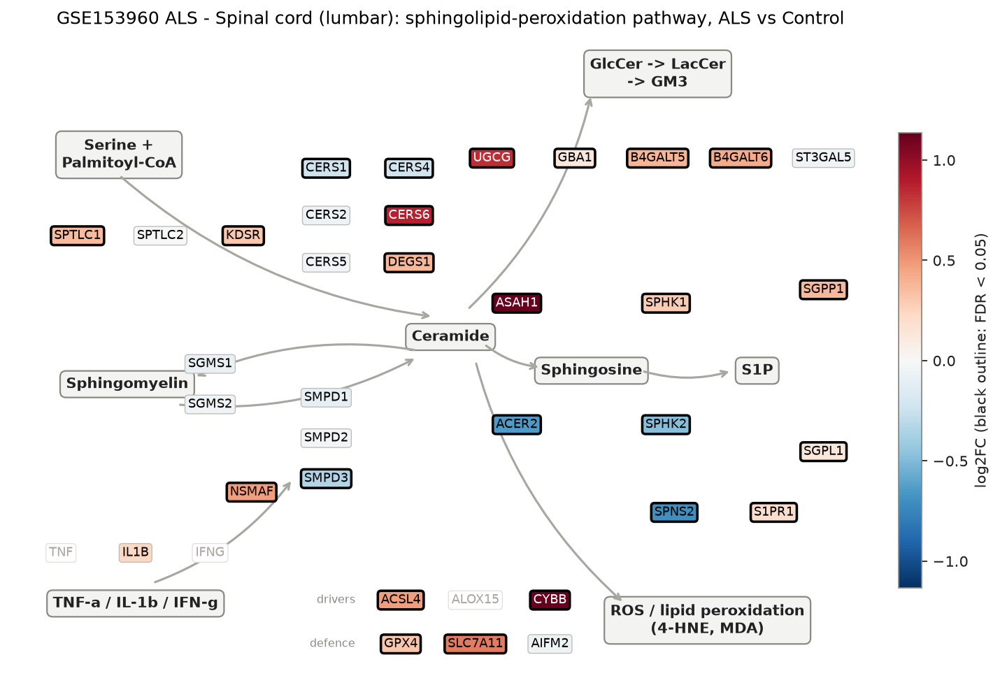
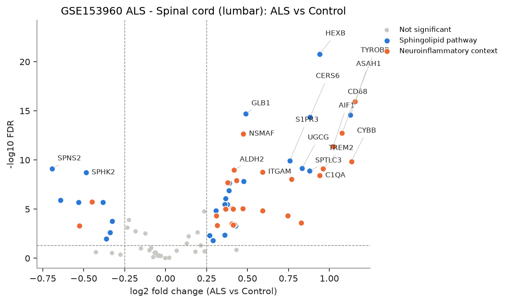
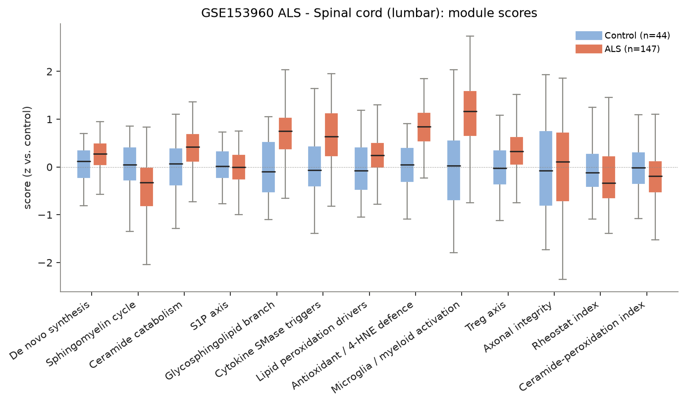
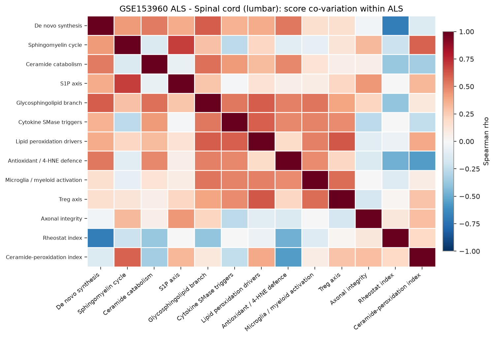
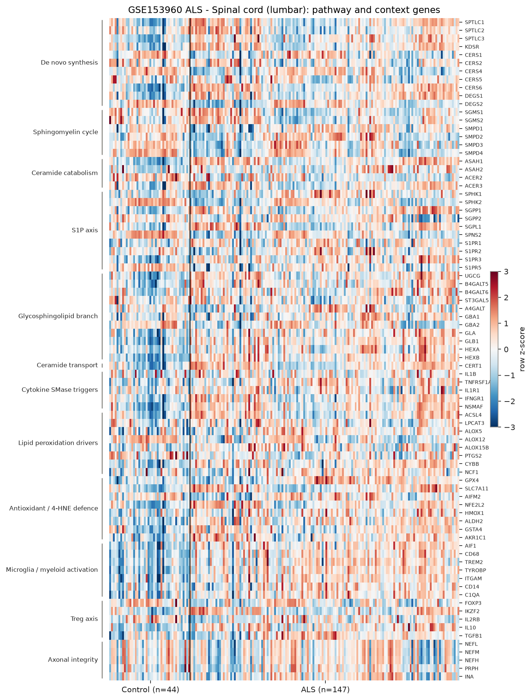

# sphingomap-CNS report: GSE153960 ALS - Spinal cord (lumbar)

_sphingomap-CNS v0.1.0, generated 2026-11-11_

Source: NYGC ALS Consortium / Target ALS post-mortem CNS RNA-seq (New York Genome Center ALS Consortium (GEO GSE153960))

## Design

- ALS: **147**, Control: **44**
- Model: linear model
- Genes tested: 81 (not in data / not expressed: CERS3, ACER1, S1PR4, TNF, IFNG, ALOX15, IL2RA, CTLA4, TNFRSF18)

## Gene-level changes

52 genes with FDR < 0.05 and |log2FC| >= 0.25.

- Up: TYROBP, CYBB, ASAH1, CD68, AIF1, TREM2, HEXB, C1QA, CERS6, SPTLC3, UGCG, ALOX15B, AKR1C1, S1PR3, CD14, ITGAM, SLC7A11, GLB1, CERT1, NSMAF, ACSL4, NFE2L2, B4GALT6, HMOX1, ALDH2, TNFRSF1A, IKZF2, IFNGR1, ALOX5, GLA, B4GALT5, IL10, DEGS1, SGPP1, GSTA4, ASAH2, SPTLC1, TGFB1, GPX4, KDSR, SPHK1, ACER3
- Down: SPNS2, ACER2, S1PR5, PTGS2, SPHK2, ALOX12, SMPD4, SGPP2, SMPD3, DEGS2

### Proposal focus genes

| Gene | log2FC | FDR |
|---|---:|---:|
| SMPD1 | -0.10 | 1.56e-01 |
| SMPD2 | -0.03 | 5.86e-01 |
| SMPD3 | -0.34 | 2.39e-03 |
| CERS1 | -0.23 | 7.84e-04 |
| CERS2 | -0.07 | 2.83e-01 |
| CERS4 | -0.22 | 1.31e-04 |
| CERS5 | -0.04 | 5.15e-01 |
| CERS6 | +0.88 | 4.29e-15 |
| ASAH1 | +1.13 | 2.75e-15 |
| SGMS1 | -0.09 | 9.10e-02 |
| SGMS2 | -0.05 | 5.77e-01 |
| UGCG | +0.83 | 7.09e-10 |
| SPHK1 | +0.29 | 1.59e-02 |
| S1PR1 | +0.20 | 2.37e-03 |
| GPX4 | +0.31 | 4.71e-05 |
| ACSL4 | +0.47 | 8.50e-06 |

### Top 25 genes

| Gene | Module | log2FC | FDR |
|---|---|---:|---:|
| HEXB | Glycosphingolipid branch | +0.94 | 1.66e-21 |
| TYROBP | Microglia / myeloid activation | +1.16 | 1.13e-16 |
| GLB1 | Glycosphingolipid branch | +0.49 | 1.96e-15 |
| ASAH1 | Ceramide catabolism | +1.13 | 2.75e-15 |
| CERS6 | De novo synthesis | +0.88 | 4.29e-15 |
| CD68 | Microglia / myeloid activation | +1.08 | 1.77e-13 |
| NSMAF | Cytokine SMase triggers | +0.47 | 2.18e-13 |
| AIF1 | Microglia / myeloid activation | +1.02 | 4.40e-12 |
| S1PR3 | S1P axis | +0.76 | 1.20e-10 |
| CYBB | Lipid peroxidation drivers | +1.13 | 1.42e-10 |
| UGCG | Glycosphingolipid branch | +0.83 | 7.09e-10 |
| TREM2 | Microglia / myeloid activation | +0.96 | 7.58e-10 |
| SPNS2 | S1P axis | -0.69 | 7.89e-10 |
| ALDH2 | Antioxidant / 4-HNE defence | +0.42 | 1.03e-09 |
| SPTLC3 | De novo synthesis | +0.88 | 1.29e-09 |
| ITGAM | Microglia / myeloid activation | +0.59 | 1.64e-09 |
| SPHK2 | S1P axis | -0.49 | 1.90e-09 |
| C1QA | Microglia / myeloid activation | +0.94 | 3.81e-09 |
| AKR1C1 | Antioxidant / 4-HNE defence | +0.77 | 8.80e-09 |
| NFE2L2 | Antioxidant / 4-HNE defence | +0.43 | 1.27e-08 |
| CERT1 | Ceramide transport | +0.48 | 1.49e-08 |
| IL10 | Treg axis | +0.38 | 2.06e-08 |
| GLA | Glycosphingolipid branch | +0.39 | 2.29e-08 |
| B4GALT5 | Glycosphingolipid branch | +0.39 | 1.36e-07 |
| SGPP1 | S1P axis | +0.37 | 8.34e-07 |

## Module scores and indices

Scores are mean z-scores relative to the control group. The rheostat index is pro-survival (S1P/GSL) minus pro-ceramide genes; the ceramide-peroxidation (CPA) index is ceramide-generation + peroxidation-driver genes minus ceramide-clearance + antioxidant genes.

| Score | Mean difference | Hedges' g | FDR |
|---|---:|---:|---:|
| Antioxidant / 4-HNE defence | +0.77 | +1.45 | 8.35e-14 |
| Microglia / myeloid activation | +1.10 | +1.41 | 1.73e-13 |
| Glycosphingolipid branch | +0.67 | +1.21 | 1.50e-10 |
| Cytokine SMase triggers | +0.63 | +0.99 | 8.46e-08 |
| Ceramide catabolism | +0.39 | +0.78 | 2.34e-05 |
| Sphingomyelin cycle | -0.44 | -0.69 | 1.57e-04 |
| Treg axis | +0.32 | +0.66 | 2.99e-04 |
| Lipid peroxidation drivers | +0.26 | +0.54 | 3.29e-03 |
| De novo synthesis | +0.19 | +0.41 | 2.36e-02 |
| Ceramide-peroxidation index | -0.19 | -0.41 | 2.36e-02 |
| Rheostat index | -0.22 | -0.34 | 5.61e-02 |
| S1P axis | -0.07 | -0.14 | 4.42e-01 |
| Axonal integrity | -0.06 | -0.06 | 7.27e-01 |

## Caveats

- mRNA / protein abundance is not enzyme activity or lipid concentration; confirm with lipidomics (LC-MS/MS, HPTLC).
- Module scores and indices are exploratory transcript-level heuristics, not validated biomarkers.
- Post-mortem bulk tissue mixes cell types; changes can reflect cell-composition shifts (e.g. neuron loss, gliosis) rather than per-cell regulation.
