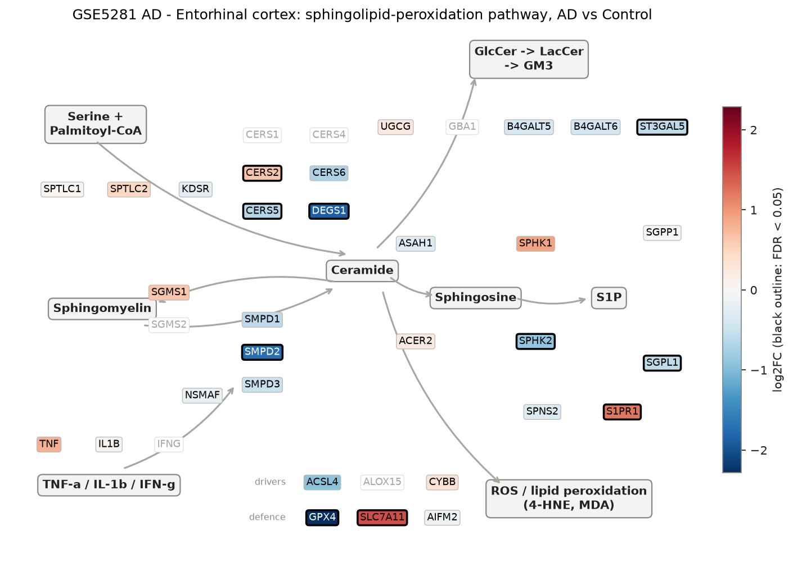
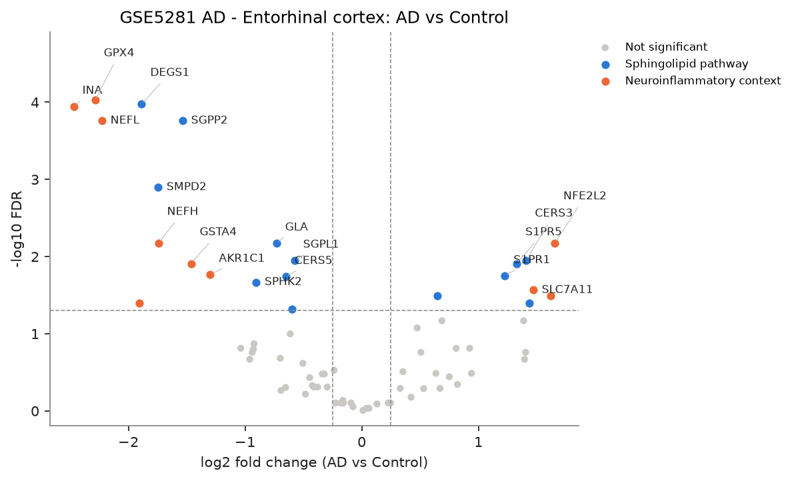
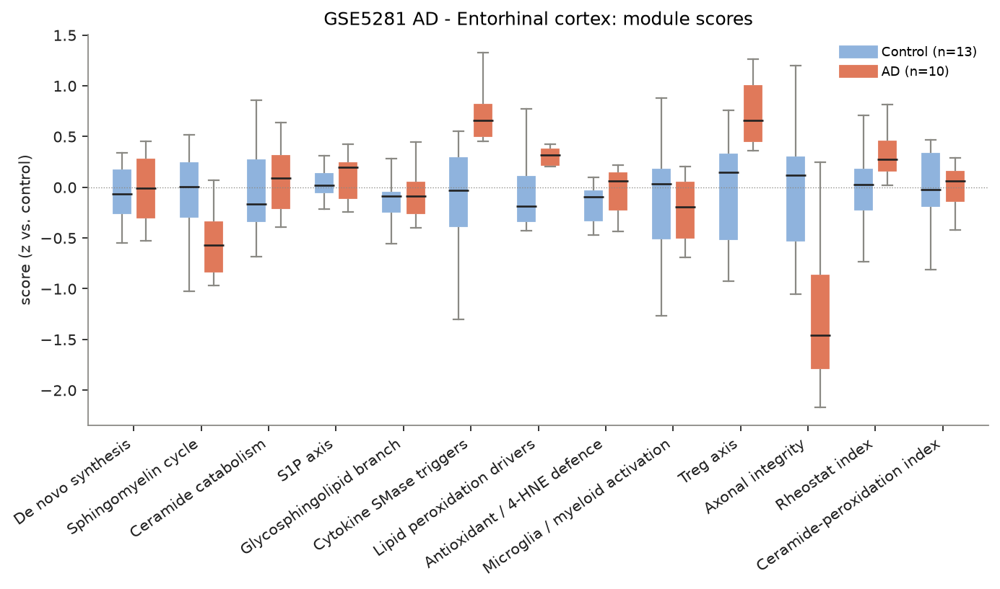
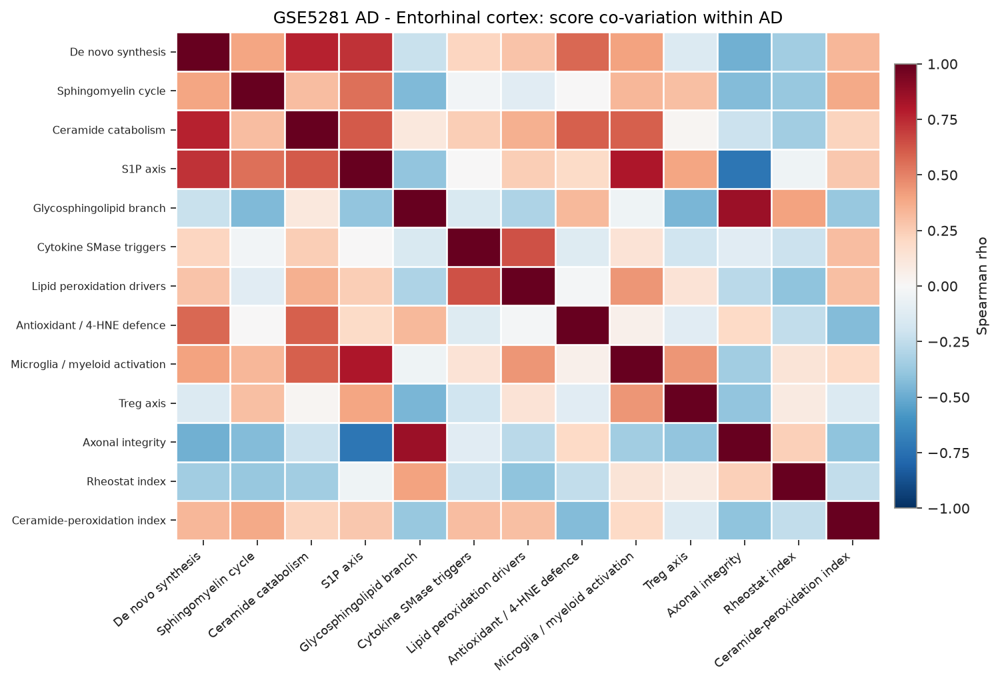
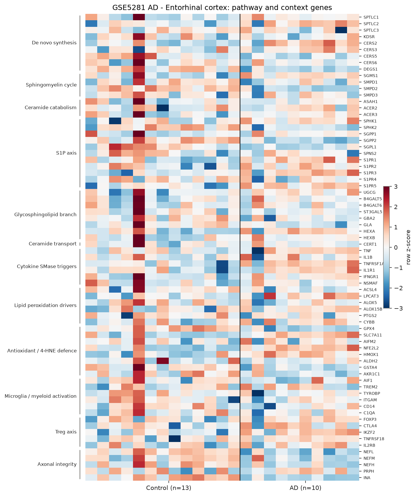

# sphingomap-CNS report: GSE5281 AD - Entorhinal cortex

_sphingomap-CNS v0.1.0, generated 2026-11-11_

Source: Alzheimer's disease, six brain regions, laser-captured neurons (Affymetrix U133 Plus 2) (Liang W. S. et al., Physiol Genomics 28, 311 (2007))

## Design

- AD: **10**, Control: **13**
- Model: linear model, adjusted for sex_male, age
- Genes tested: 72 (not in data / not expressed: CERS1, CERS4, DEGS2, SGMS2, SMPD4, ASAH2, ACER1, A4GALT, GBA1, GLB1, IFNG, ALOX12, ALOX15, NCF1, CD68, IL2RA, IL10, TGFB1)

## Gene-level changes

23 genes with FDR < 0.05 and |log2FC| >= 0.25.

- Up: NFE2L2, TNFRSF1A, SLC7A11, S1PR3, CERS3, S1PR5, S1PR1, CERS2
- Down: INA, GPX4, NEFL, NEFM, DEGS1, SMPD2, NEFH, SGPP2, GSTA4, AKR1C1, SPHK2, GLA, CERS5, ST3GAL5, SGPL1

### Proposal focus genes

| Gene | log2FC | FDR |
|---|---:|---:|
| SMPD1 | -0.61 | 1.00e-01 |
| SMPD2 | -1.75 | 1.26e-03 |
| SMPD3 | -0.50 | 2.42e-01 |
| CERS2 | +0.65 | 3.25e-02 |
| CERS3 | +1.41 | 1.12e-02 |
| CERS5 | -0.65 | 1.82e-02 |
| CERS6 | -0.70 | 2.08e-01 |
| ASAH1 | -0.30 | 4.91e-01 |
| SGMS1 | +0.64 | 3.26e-01 |
| UGCG | +0.25 | 7.89e-01 |
| SPHK1 | +0.93 | 1.54e-01 |
| S1PR1 | +1.23 | 1.77e-02 |
| GPX4 | -2.28 | 9.37e-05 |
| ACSL4 | -0.93 | 1.58e-01 |

### Top 25 genes

| Gene | Module | log2FC | FDR |
|---|---|---:|---:|
| GPX4 | Antioxidant / 4-HNE defence | -2.28 | 9.37e-05 |
| DEGS1 | De novo synthesis | -1.89 | 1.06e-04 |
| INA | Axonal integrity | -2.47 | 1.13e-04 |
| SGPP2 | S1P axis | -1.54 | 1.74e-04 |
| NEFL | Axonal integrity | -2.23 | 1.74e-04 |
| SMPD2 | Sphingomyelin cycle | -1.75 | 1.26e-03 |
| GLA | Glycosphingolipid branch | -0.73 | 6.69e-03 |
| NFE2L2 | Antioxidant / 4-HNE defence | +1.65 | 6.69e-03 |
| NEFH | Axonal integrity | -1.74 | 6.69e-03 |
| SGPL1 | S1P axis | -0.58 | 1.12e-02 |
| CERS3 | De novo synthesis | +1.41 | 1.12e-02 |
| S1PR5 | S1P axis | +1.33 | 1.23e-02 |
| GSTA4 | Antioxidant / 4-HNE defence | -1.46 | 1.23e-02 |
| AKR1C1 | Antioxidant / 4-HNE defence | -1.30 | 1.70e-02 |
| S1PR1 | S1P axis | +1.23 | 1.77e-02 |
| CERS5 | De novo synthesis | -0.65 | 1.82e-02 |
| SPHK2 | S1P axis | -0.91 | 2.15e-02 |
| SLC7A11 | Antioxidant / 4-HNE defence | +1.47 | 2.72e-02 |
| CERS2 | De novo synthesis | +0.65 | 3.25e-02 |
| TNFRSF1A | Cytokine SMase triggers | +1.62 | 3.25e-02 |
| S1PR3 | S1P axis | +1.44 | 3.99e-02 |
| NEFM | Axonal integrity | -1.91 | 4.04e-02 |
| ST3GAL5 | Glycosphingolipid branch | -0.60 | 4.82e-02 |
| IKZF2 | Treg axis | +1.39 | 6.80e-02 |
| HMOX1 | Antioxidant / 4-HNE defence | +0.69 | 6.80e-02 |

## Module scores and indices

Scores are mean z-scores relative to the control group. The rheostat index is pro-survival (S1P/GSL) minus pro-ceramide genes; the ceramide-peroxidation (CPA) index is ceramide-generation + peroxidation-driver genes minus ceramide-clearance + antioxidant genes.

| Score | Mean difference | Hedges' g | FDR |
|---|---:|---:|---:|
| Axonal integrity | -1.55 | -1.69 | 9.42e-04 |
| Sphingomyelin cycle | -0.86 | -1.08 | 1.27e-02 |
| Rheostat index | +0.47 | +0.99 | 1.54e-02 |
| Treg axis | +0.60 | +1.03 | 1.10e-01 |
| Microglia / myeloid activation | -0.54 | -0.48 | 2.89e-01 |
| Cytokine SMase triggers | +0.48 | +0.80 | 2.93e-01 |
| Glycosphingolipid branch | -0.39 | -0.10 | 2.93e-01 |
| Antioxidant / 4-HNE defence | -0.24 | -0.06 | 4.51e-01 |
| De novo synthesis | -0.11 | -0.05 | 7.71e-01 |
| Ceramide catabolism | -0.08 | +0.13 | 8.97e-01 |
| Ceramide-peroxidation index | -0.05 | -0.10 | 8.97e-01 |
| S1P axis | -0.04 | +0.08 | 8.97e-01 |
| Lipid peroxidation drivers | +0.01 | +0.27 | 9.57e-01 |

## Caveats

- mRNA / protein abundance is not enzyme activity or lipid concentration; confirm with lipidomics (LC-MS/MS, HPTLC).
- Module scores and indices are exploratory transcript-level heuristics, not validated biomarkers.
- Post-mortem bulk tissue mixes cell types; changes can reflect cell-composition shifts (e.g. neuron loss, gliosis) rather than per-cell regulation.
