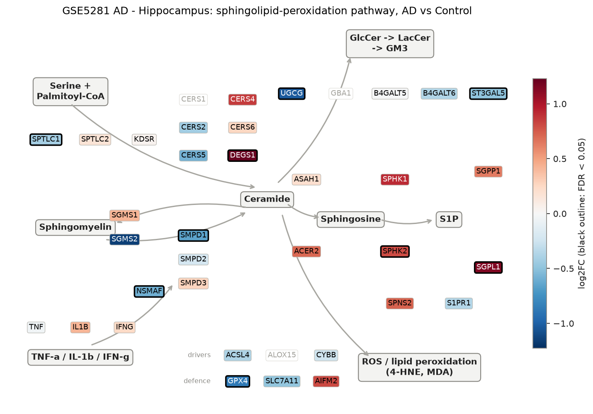
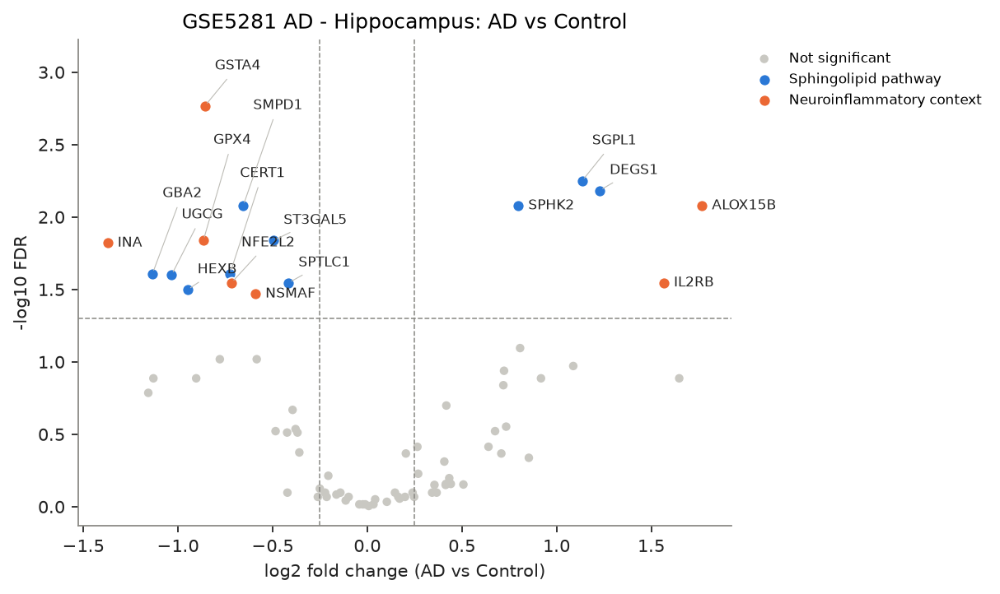
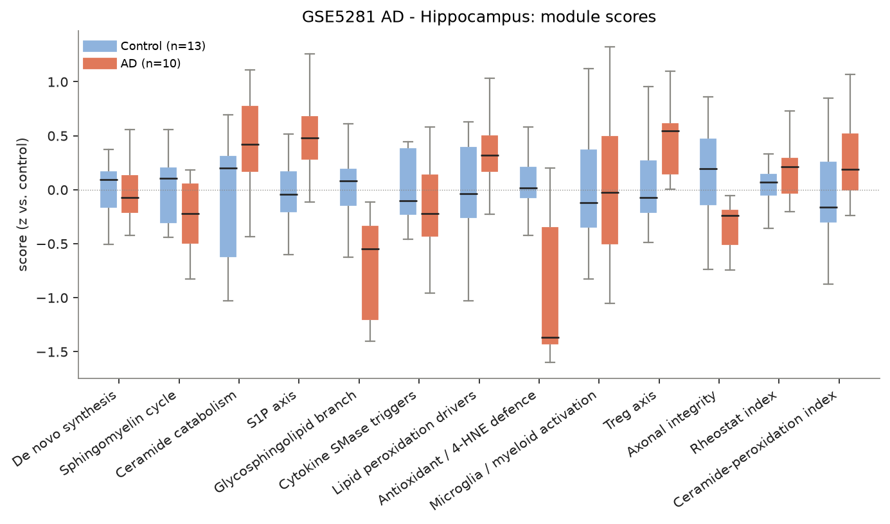
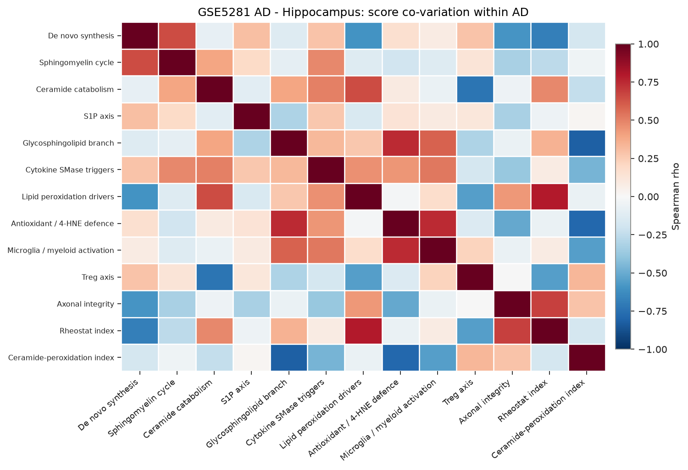
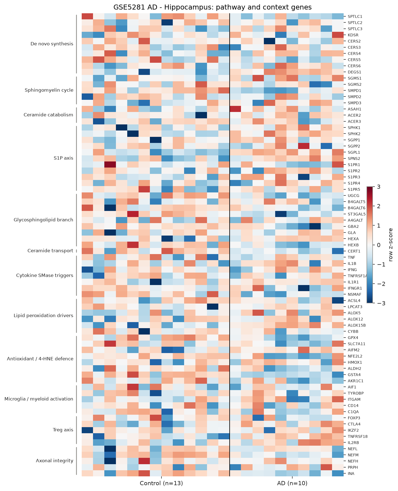

# sphingomap-CNS report: GSE5281 AD - Hippocampus

_sphingomap-CNS v0.1.0, generated 2026-11-11_

Source: Alzheimer's disease, six brain regions, laser-captured neurons (Affymetrix U133 Plus 2) (Liang W. S. et al., Physiol Genomics 28, 311 (2007))

## Design

- AD: **10**, Control: **13**
- Model: linear model, adjusted for sex_male, age
- Genes tested: 75 (not in data / not expressed: CERS1, DEGS2, SMPD4, ASAH2, ACER1, GBA1, GLB1, ALOX15, PTGS2, NCF1, CD68, TREM2, IL2RA, IL10, TGFB1)

## Gene-level changes

17 genes with FDR < 0.05 and |log2FC| >= 0.25.

- Up: ALOX15B, IL2RB, DEGS1, SGPL1, SPHK2
- Down: INA, GBA2, UGCG, HEXB, GPX4, GSTA4, CERT1, NFE2L2, SMPD1, NSMAF, ST3GAL5, SPTLC1

### Proposal focus genes

| Gene | log2FC | FDR |
|---|---:|---:|
| SMPD1 | -0.66 | 8.37e-03 |
| SMPD2 | -0.21 | 8.56e-01 |
| SMPD3 | +0.27 | 5.93e-01 |
| CERS2 | -0.42 | 3.08e-01 |
| CERS3 | -0.02 | 9.64e-01 |
| CERS4 | +0.85 | 4.60e-01 |
| CERS5 | -0.58 | 9.60e-02 |
| CERS6 | +0.26 | 3.86e-01 |
| ASAH1 | +0.20 | 4.30e-01 |
| SGMS1 | +0.42 | 2.00e-01 |
| SGMS2 | -1.16 | 1.64e-01 |
| UGCG | -1.03 | 2.51e-02 |
| SPHK1 | +0.92 | 1.30e-01 |
| S1PR1 | -0.36 | 4.22e-01 |
| GPX4 | -0.87 | 1.45e-02 |
| ACSL4 | -0.38 | 2.91e-01 |

### Top 25 genes

| Gene | Module | log2FC | FDR |
|---|---|---:|---:|
| GSTA4 | Antioxidant / 4-HNE defence | -0.86 | 1.71e-03 |
| SGPL1 | S1P axis | +1.13 | 5.63e-03 |
| DEGS1 | De novo synthesis | +1.23 | 6.56e-03 |
| SMPD1 | Sphingomyelin cycle | -0.66 | 8.37e-03 |
| ALOX15B | Lipid peroxidation drivers | +1.77 | 8.37e-03 |
| SPHK2 | S1P axis | +0.80 | 8.37e-03 |
| GPX4 | Antioxidant / 4-HNE defence | -0.87 | 1.45e-02 |
| ST3GAL5 | Glycosphingolipid branch | -0.50 | 1.45e-02 |
| INA | Axonal integrity | -1.37 | 1.51e-02 |
| CERT1 | Ceramide transport | -0.73 | 2.46e-02 |
| GBA2 | Glycosphingolipid branch | -1.13 | 2.46e-02 |
| UGCG | Glycosphingolipid branch | -1.03 | 2.51e-02 |
| NFE2L2 | Antioxidant / 4-HNE defence | -0.72 | 2.85e-02 |
| SPTLC1 | De novo synthesis | -0.42 | 2.85e-02 |
| IL2RB | Treg axis | +1.57 | 2.85e-02 |
| HEXB | Glycosphingolipid branch | -0.95 | 3.18e-02 |
| NSMAF | Cytokine SMase triggers | -0.59 | 3.40e-02 |
| AIFM2 | Antioxidant / 4-HNE defence | +0.81 | 8.04e-02 |
| CERS5 | De novo synthesis | -0.58 | 9.60e-02 |
| AKR1C1 | Antioxidant / 4-HNE defence | -0.78 | 9.60e-02 |
| TNFRSF18 | Treg axis | +1.09 | 1.07e-01 |
| SPNS2 | S1P axis | +0.72 | 1.15e-01 |
| CTLA4 | Treg axis | +1.65 | 1.30e-01 |
| NEFM | Axonal integrity | -0.90 | 1.30e-01 |
| SPHK1 | S1P axis | +0.92 | 1.30e-01 |

## Module scores and indices

Scores are mean z-scores relative to the control group. The rheostat index is pro-survival (S1P/GSL) minus pro-ceramide genes; the ceramide-peroxidation (CPA) index is ceramide-generation + peroxidation-driver genes minus ceramide-clearance + antioxidant genes.

| Score | Mean difference | Hedges' g | FDR |
|---|---:|---:|---:|
| Antioxidant / 4-HNE defence | -0.99 | -1.69 | 7.03e-03 |
| Glycosphingolipid branch | -0.80 | -1.44 | 7.03e-03 |
| S1P axis | +0.50 | +1.23 | 4.45e-02 |
| Treg axis | +0.47 | +0.93 | 1.42e-01 |
| Sphingomyelin cycle | -0.27 | -0.68 | 2.60e-01 |
| Lipid peroxidation drivers | +0.27 | +0.80 | 2.62e-01 |
| Ceramide-peroxidation index | +0.34 | +0.51 | 2.62e-01 |
| Axonal integrity | -0.37 | -0.50 | 2.96e-01 |
| Rheostat index | +0.16 | +0.74 | 2.96e-01 |
| Ceramide catabolism | +0.27 | +0.50 | 4.38e-01 |
| Cytokine SMase triggers | -0.17 | -0.38 | 4.39e-01 |
| Microglia / myeloid activation | -0.04 | +0.00 | 9.20e-01 |
| De novo synthesis | +0.01 | -0.07 | 9.20e-01 |

## Caveats

- mRNA / protein abundance is not enzyme activity or lipid concentration; confirm with lipidomics (LC-MS/MS, HPTLC).
- Module scores and indices are exploratory transcript-level heuristics, not validated biomarkers.
- Post-mortem bulk tissue mixes cell types; changes can reflect cell-composition shifts (e.g. neuron loss, gliosis) rather than per-cell regulation.
