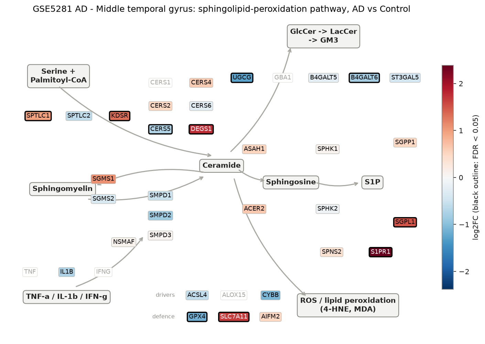
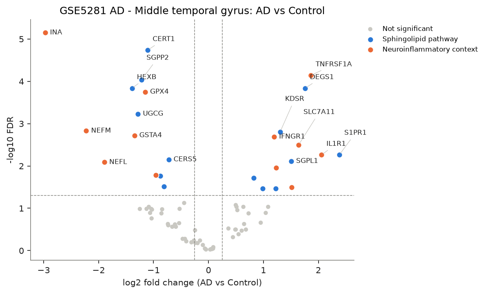
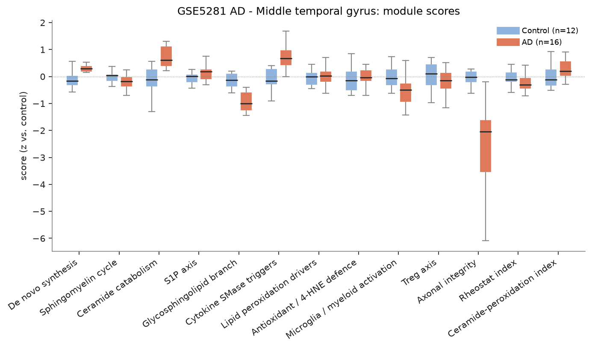
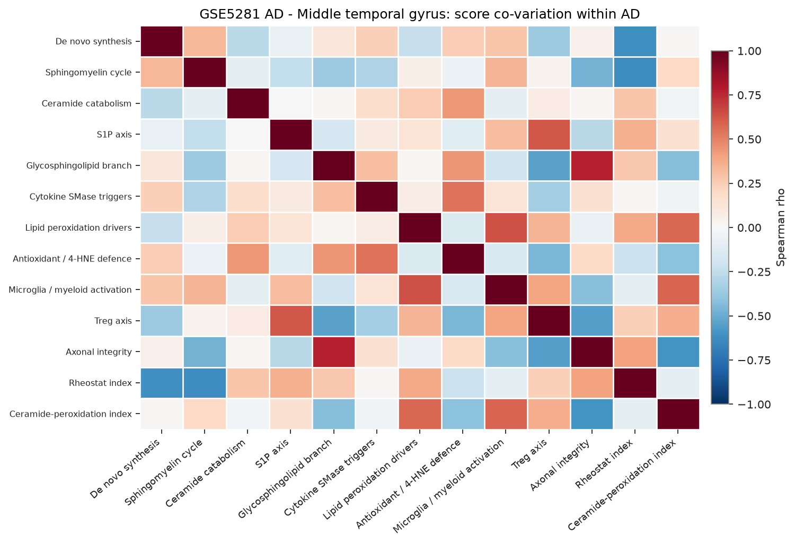
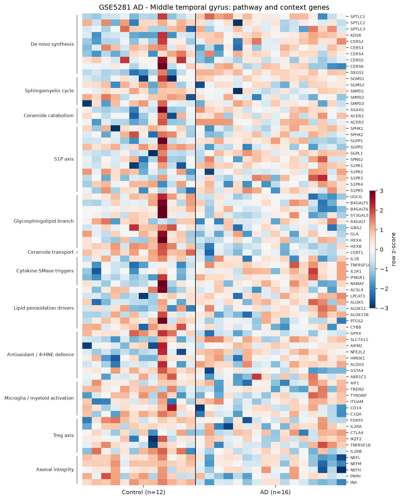

# sphingomap-CNS report: GSE5281 AD - Middle temporal gyrus

_sphingomap-CNS v0.1.0, generated 2026-11-11_

Source: Alzheimer's disease, six brain regions, laser-captured neurons (Affymetrix U133 Plus 2) (Liang W. S. et al., Physiol Genomics 28, 311 (2007))

## Design

- AD: **16**, Control: **12**
- Model: linear model, adjusted for sex_male, age
- Genes tested: 76 (not in data / not expressed: CERS1, DEGS2, SMPD4, ASAH2, ACER1, GBA1, GLB1, TNF, IFNG, ALOX15, NCF1, CD68, IL10, TGFB1)

## Gene-level changes

26 genes with FDR < 0.05 and |log2FC| >= 0.25.

- Up: S1PR1, IL1R1, TNFRSF1A, DEGS1, SLC7A11, ALOX5, SGPL1, KDSR, NFE2L2, S1PR5, IFNGR1, SPTLC1, ACER3
- Down: INA, NEFM, NEFL, HEXB, GSTA4, UGCG, SGPP2, GPX4, CERT1, PTGS2, GBA2, B4GALT6, CERS5

### Proposal focus genes

| Gene | log2FC | FDR |
|---|---:|---:|
| SMPD1 | -0.53 | 2.25e-01 |
| SMPD2 | -0.84 | 1.06e-01 |
| SMPD3 | +0.05 | 9.17e-01 |
| CERS2 | +0.50 | 8.39e-02 |
| CERS3 | -1.06 | 1.29e-01 |
| CERS4 | +0.60 | 3.39e-01 |
| CERS5 | -0.72 | 7.04e-03 |
| CERS6 | -0.26 | 5.81e-01 |
| ASAH1 | +0.53 | 1.11e-01 |
| SGMS1 | +1.09 | 9.26e-02 |
| SGMS2 | -0.40 | 6.04e-01 |
| UGCG | -1.28 | 5.87e-04 |
| SPHK1 | +0.08 | 8.96e-01 |
| S1PR1 | +2.38 | 5.44e-03 |
| GPX4 | -1.15 | 1.77e-04 |
| ACSL4 | -0.59 | 2.73e-01 |

### Top 25 genes

| Gene | Module | log2FC | FDR |
|---|---|---:|---:|
| INA | Axonal integrity | -2.97 | 7.07e-06 |
| CERT1 | Ceramide transport | -1.11 | 1.84e-05 |
| TNFRSF1A | Cytokine SMase triggers | +1.86 | 7.26e-05 |
| SGPP2 | S1P axis | -1.22 | 9.18e-05 |
| DEGS1 | De novo synthesis | +1.76 | 1.46e-04 |
| HEXB | Glycosphingolipid branch | -1.39 | 1.46e-04 |
| GPX4 | Antioxidant / 4-HNE defence | -1.15 | 1.77e-04 |
| UGCG | Glycosphingolipid branch | -1.28 | 5.87e-04 |
| NEFM | Axonal integrity | -2.23 | 1.48e-03 |
| KDSR | De novo synthesis | +1.31 | 1.56e-03 |
| GSTA4 | Antioxidant / 4-HNE defence | -1.35 | 1.90e-03 |
| IFNGR1 | Cytokine SMase triggers | +1.20 | 2.04e-03 |
| SLC7A11 | Antioxidant / 4-HNE defence | +1.64 | 3.19e-03 |
| S1PR1 | S1P axis | +2.38 | 5.44e-03 |
| IL1R1 | Cytokine SMase triggers | +2.06 | 5.49e-03 |
| CERS5 | De novo synthesis | -0.72 | 7.04e-03 |
| SGPL1 | S1P axis | +1.51 | 7.70e-03 |
| NEFL | Axonal integrity | -1.90 | 8.16e-03 |
| NFE2L2 | Antioxidant / 4-HNE defence | +1.23 | 1.09e-02 |
| PTGS2 | Lipid peroxidation drivers | -0.96 | 1.64e-02 |
| GBA2 | Glycosphingolipid branch | -0.88 | 1.72e-02 |
| ACER3 | Ceramide catabolism | +0.82 | 1.92e-02 |
| B4GALT6 | Glycosphingolipid branch | -0.81 | 3.07e-02 |
| ALOX5 | Lipid peroxidation drivers | +1.51 | 3.17e-02 |
| S1PR5 | S1P axis | +1.22 | 3.45e-02 |

## Module scores and indices

Scores are mean z-scores relative to the control group. The rheostat index is pro-survival (S1P/GSL) minus pro-ceramide genes; the ceramide-peroxidation (CPA) index is ceramide-generation + peroxidation-driver genes minus ceramide-clearance + antioxidant genes.

| Score | Mean difference | Hedges' g | FDR |
|---|---:|---:|---:|
| Glycosphingolipid branch | -0.96 | -1.77 | 5.08e-04 |
| Axonal integrity | -2.65 | -1.80 | 5.08e-04 |
| Cytokine SMase triggers | +0.68 | +1.17 | 3.38e-03 |
| Ceramide catabolism | +0.69 | +1.04 | 4.15e-02 |
| Microglia / myeloid activation | -0.47 | -0.80 | 1.25e-01 |
| Ceramide-peroxidation index | +0.27 | +0.67 | 2.21e-01 |
| De novo synthesis | +0.24 | +0.56 | 2.76e-01 |
| Sphingomyelin cycle | -0.23 | -0.52 | 2.76e-01 |
| Rheostat index | -0.19 | -0.48 | 2.76e-01 |
| S1P axis | +0.14 | +0.40 | 3.12e-01 |
| Treg axis | -0.15 | -0.28 | 5.82e-01 |
| Antioxidant / 4-HNE defence | -0.06 | -0.06 | 8.35e-01 |
| Lipid peroxidation drivers | -0.04 | -0.04 | 8.35e-01 |

## Caveats

- mRNA / protein abundance is not enzyme activity or lipid concentration; confirm with lipidomics (LC-MS/MS, HPTLC).
- Module scores and indices are exploratory transcript-level heuristics, not validated biomarkers.
- Post-mortem bulk tissue mixes cell types; changes can reflect cell-composition shifts (e.g. neuron loss, gliosis) rather than per-cell regulation.
