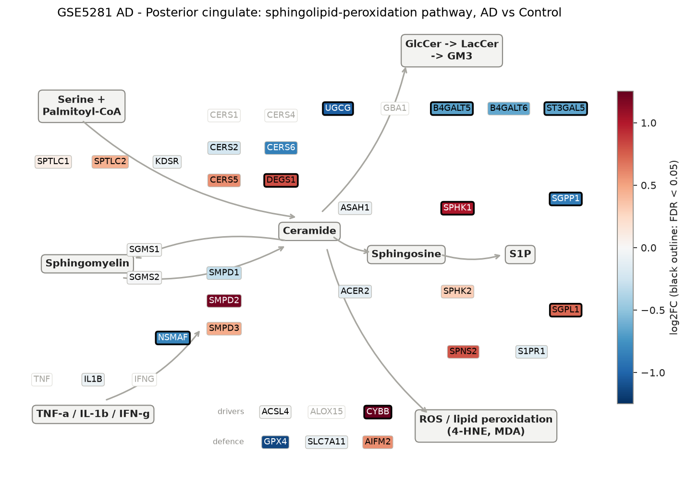
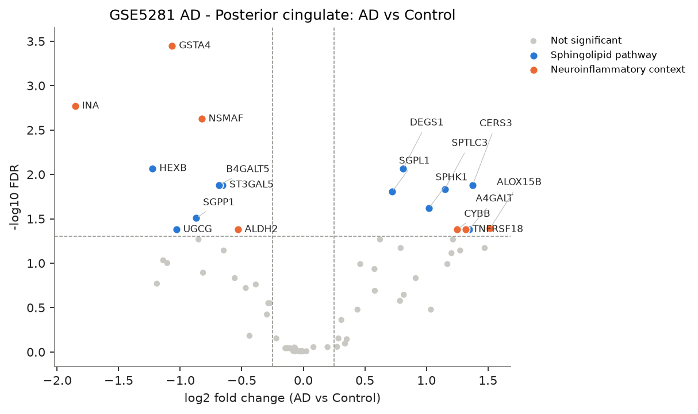
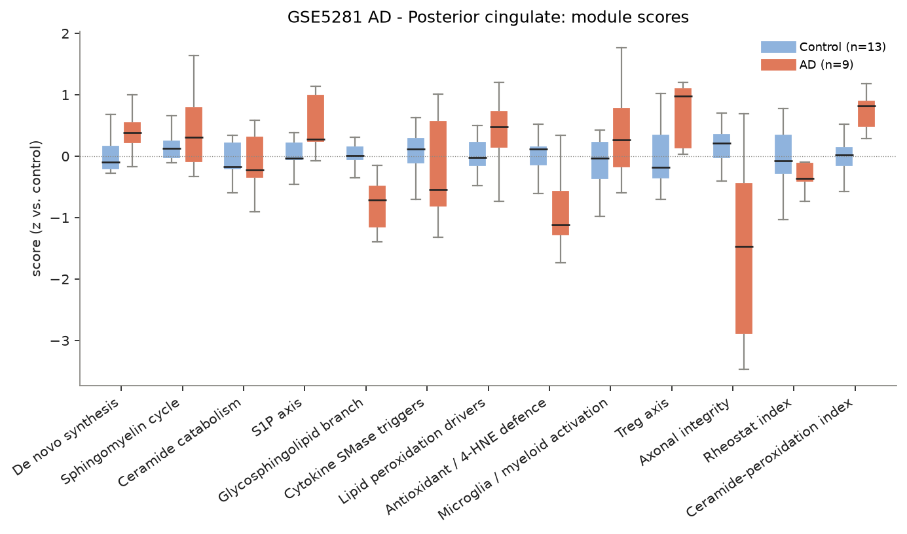
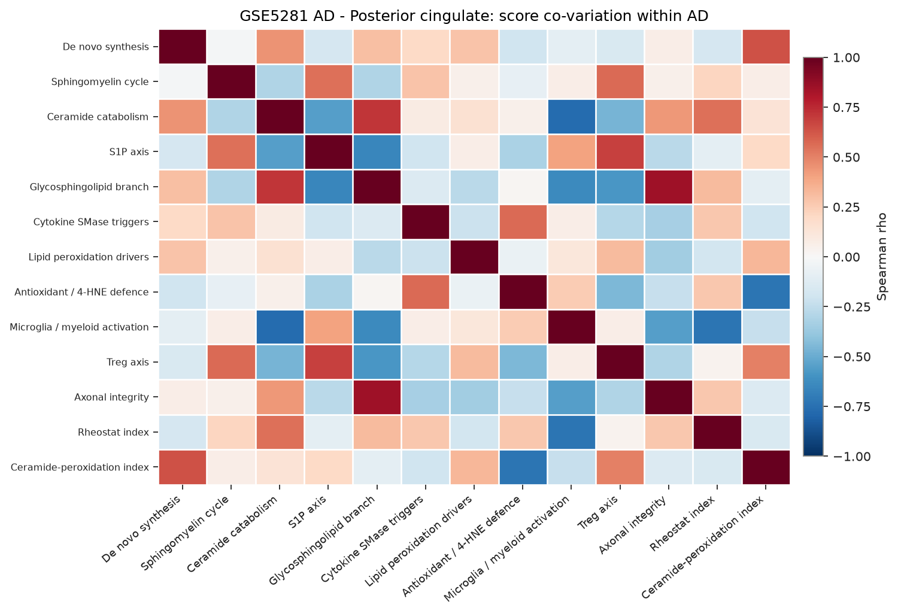
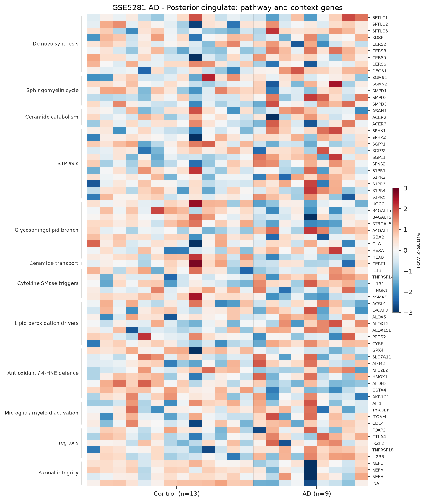

# sphingomap-CNS report: GSE5281 AD - Posterior cingulate

_sphingomap-CNS v0.1.0, generated 2026-11-11_

Source: Alzheimer's disease, six brain regions, laser-captured neurons (Affymetrix U133 Plus 2) (Liang W. S. et al., Physiol Genomics 28, 311 (2007))

## Design

- AD: **9**, Control: **13**
- Model: linear model, adjusted for sex_male, age
- Genes tested: 71 (not in data / not expressed: CERS1, CERS4, DEGS2, SMPD4, ASAH2, ACER1, GBA1, GLB1, TNF, IFNG, ALOX15, NCF1, CD68, TREM2, C1QA, IL2RA, IL10, TGFB1, PRPH)

## Gene-level changes

18 genes with FDR < 0.05 and |log2FC| >= 0.25.

- Up: ALOX15B, CERS3, A4GALT, TNFRSF18, CYBB, SPTLC3, SPHK1, DEGS1, SGPL1
- Down: INA, HEXB, GSTA4, UGCG, SGPP1, NSMAF, B4GALT5, ST3GAL5, ALDH2

### Proposal focus genes

| Gene | log2FC | FDR |
|---|---:|---:|
| SMPD1 | -0.30 | 3.79e-01 |
| SMPD2 | +1.20 | 7.71e-02 |
| SMPD3 | +0.46 | 1.02e-01 |
| CERS2 | -0.22 | 7.05e-01 |
| CERS3 | +1.38 | 1.32e-02 |
| CERS5 | +0.58 | 2.04e-01 |
| CERS6 | -0.85 | 5.41e-02 |
| ASAH1 | -0.07 | 9.08e-01 |
| SGMS1 | -0.01 | 9.82e-01 |
| SGMS2 | -0.01 | 9.83e-01 |
| UGCG | -1.03 | 4.18e-02 |
| SPHK1 | +1.02 | 2.41e-02 |
| S1PR1 | -0.15 | 9.08e-01 |
| GPX4 | -1.14 | 9.29e-02 |
| ACSL4 | -0.00 | 9.85e-01 |

### Top 25 genes

| Gene | Module | log2FC | FDR |
|---|---|---:|---:|
| GSTA4 | Antioxidant / 4-HNE defence | -1.07 | 3.57e-04 |
| INA | Axonal integrity | -1.85 | 1.70e-03 |
| NSMAF | Cytokine SMase triggers | -0.83 | 2.37e-03 |
| HEXB | Glycosphingolipid branch | -1.22 | 8.59e-03 |
| DEGS1 | De novo synthesis | +0.81 | 8.65e-03 |
| ST3GAL5 | Glycosphingolipid branch | -0.66 | 1.32e-02 |
| B4GALT5 | Glycosphingolipid branch | -0.68 | 1.32e-02 |
| CERS3 | De novo synthesis | +1.38 | 1.32e-02 |
| SPTLC3 | De novo synthesis | +1.15 | 1.47e-02 |
| SGPL1 | S1P axis | +0.72 | 1.57e-02 |
| SPHK1 | S1P axis | +1.02 | 2.41e-02 |
| SGPP1 | S1P axis | -0.87 | 3.11e-02 |
| ALOX15B | Lipid peroxidation drivers | +1.52 | 4.06e-02 |
| UGCG | Glycosphingolipid branch | -1.03 | 4.18e-02 |
| ALDH2 | Antioxidant / 4-HNE defence | -0.53 | 4.18e-02 |
| TNFRSF18 | Treg axis | +1.32 | 4.18e-02 |
| CYBB | Lipid peroxidation drivers | +1.25 | 4.18e-02 |
| A4GALT | Glycosphingolipid branch | +1.35 | 4.18e-02 |
| CERS6 | De novo synthesis | -0.85 | 5.41e-02 |
| HEXA | Glycosphingolipid branch | +0.62 | 5.41e-02 |
| CTLA4 | Treg axis | +1.22 | 5.41e-02 |
| TNFRSF1A | Cytokine SMase triggers | +1.47 | 6.75e-02 |
| SPNS2 | S1P axis | +0.79 | 6.75e-02 |
| IL2RB | Treg axis | +1.27 | 7.20e-02 |
| B4GALT6 | Glycosphingolipid branch | -0.65 | 7.20e-02 |

## Module scores and indices

Scores are mean z-scores relative to the control group. The rheostat index is pro-survival (S1P/GSL) minus pro-ceramide genes; the ceramide-peroxidation (CPA) index is ceramide-generation + peroxidation-driver genes minus ceramide-clearance + antioxidant genes.

| Score | Mean difference | Hedges' g | FDR |
|---|---:|---:|---:|
| Glycosphingolipid branch | -0.75 | -2.18 | 7.49e-04 |
| De novo synthesis | +0.43 | +1.71 | 4.41e-03 |
| Ceramide-peroxidation index | +0.82 | +1.63 | 4.50e-03 |
| Antioxidant / 4-HNE defence | -0.88 | -1.50 | 6.87e-03 |
| Treg axis | +0.78 | +1.33 | 1.33e-02 |
| S1P axis | +0.47 | +1.19 | 2.35e-02 |
| Axonal integrity | -2.13 | -1.04 | 4.23e-02 |
| Lipid peroxidation drivers | +0.42 | +0.88 | 8.10e-02 |
| Sphingomyelin cycle | +0.43 | +0.66 | 1.86e-01 |
| Rheostat index | -0.26 | -0.46 | 3.67e-01 |
| Microglia / myeloid activation | +0.30 | +0.42 | 3.91e-01 |
| Cytokine SMase triggers | -0.21 | -0.29 | 5.43e-01 |
| Ceramide catabolism | -0.14 | -0.21 | 6.22e-01 |

## Caveats

- mRNA / protein abundance is not enzyme activity or lipid concentration; confirm with lipidomics (LC-MS/MS, HPTLC).
- Module scores and indices are exploratory transcript-level heuristics, not validated biomarkers.
- Post-mortem bulk tissue mixes cell types; changes can reflect cell-composition shifts (e.g. neuron loss, gliosis) rather than per-cell regulation.
