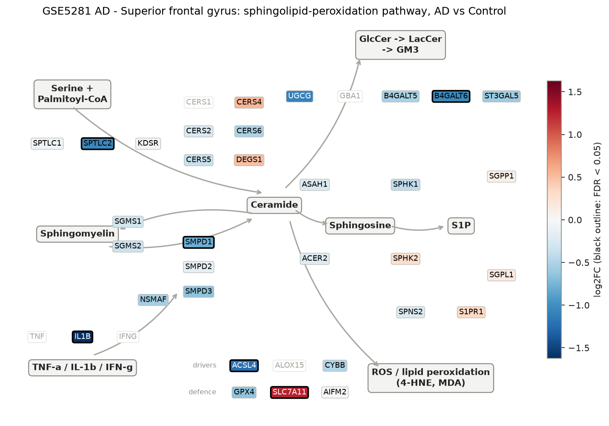
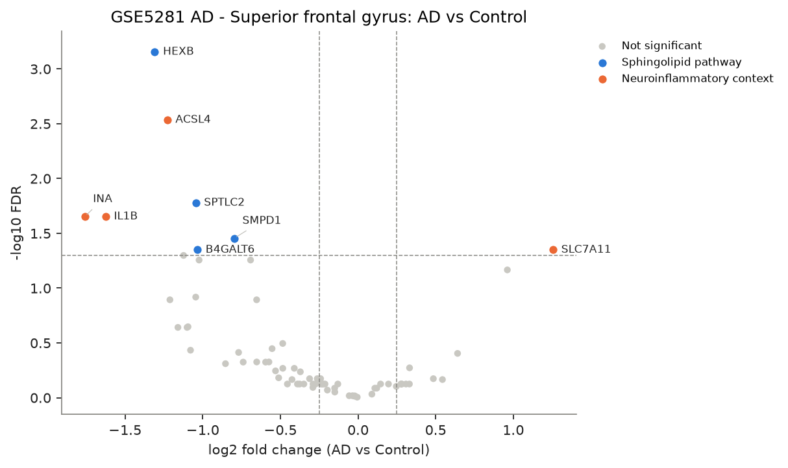
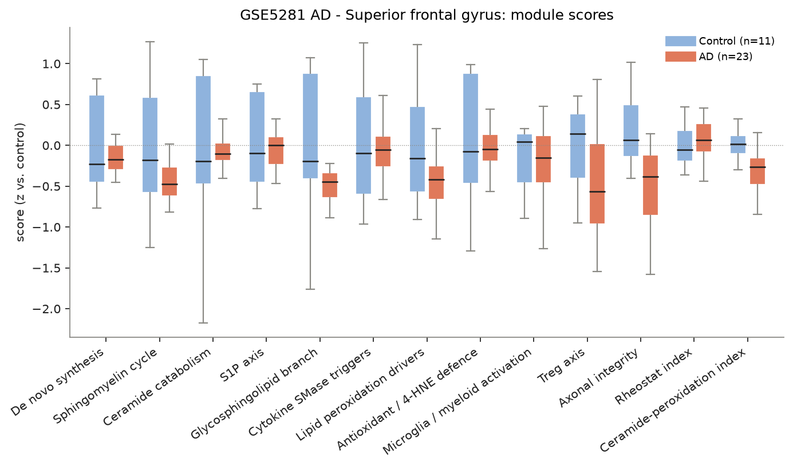
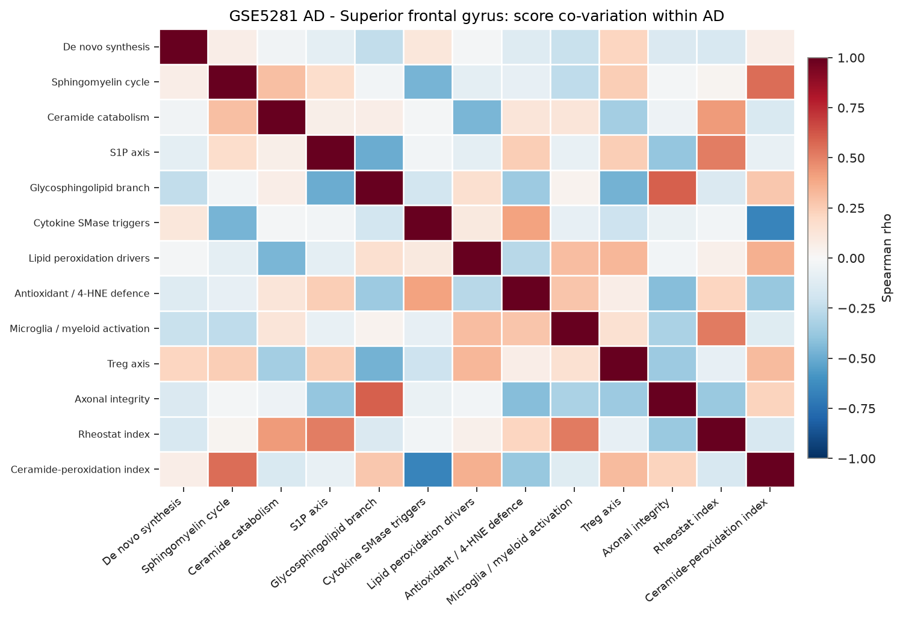
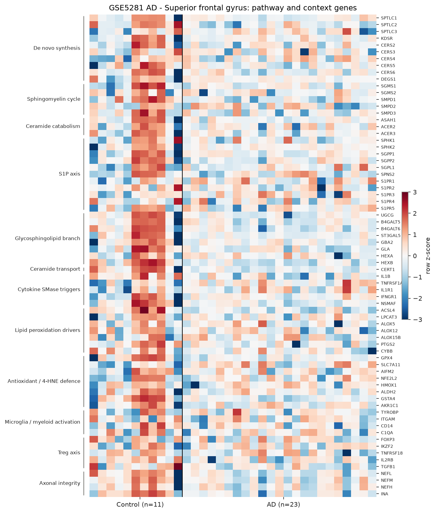

# sphingomap-CNS report: GSE5281 AD - Superior frontal gyrus

_sphingomap-CNS v0.1.0, generated 2026-11-11_

Source: Alzheimer's disease, six brain regions, laser-captured neurons (Affymetrix U133 Plus 2) (Liang W. S. et al., Physiol Genomics 28, 311 (2007))

## Design

- AD: **23**, Control: **11**
- Model: linear model, adjusted for sex_male, age
- Genes tested: 71 (not in data / not expressed: CERS1, DEGS2, SMPD4, ASAH2, ACER1, A4GALT, GBA1, GLB1, TNF, IFNG, ALOX15, NCF1, AIF1, CD68, TREM2, IL2RA, CTLA4, IL10, PRPH)

## Gene-level changes

8 genes with FDR < 0.05 and |log2FC| >= 0.25.

- Up: SLC7A11
- Down: INA, IL1B, HEXB, ACSL4, SPTLC2, B4GALT6, SMPD1

### Proposal focus genes

| Gene | log2FC | FDR |
|---|---:|---:|
| SMPD1 | -0.80 | 3.51e-02 |
| SMPD2 | -0.15 | 8.18e-01 |
| SMPD3 | -0.65 | 1.28e-01 |
| CERS2 | -0.26 | 6.71e-01 |
| CERS3 | -0.29 | 7.50e-01 |
| CERS4 | +0.54 | 6.83e-01 |
| CERS5 | -0.37 | 5.80e-01 |
| CERS6 | -0.51 | 6.58e-01 |
| ASAH1 | -0.23 | 7.50e-01 |
| SGMS1 | -0.31 | 6.71e-01 |
| SGMS2 | -0.35 | 7.50e-01 |
| UGCG | -1.09 | 2.25e-01 |
| SPHK1 | -0.41 | 5.39e-01 |
| S1PR1 | +0.33 | 5.34e-01 |
| GPX4 | -0.65 | 4.72e-01 |
| ACSL4 | -1.23 | 2.92e-03 |

### Top 25 genes

| Gene | Module | log2FC | FDR |
|---|---|---:|---:|
| HEXB | Glycosphingolipid branch | -1.31 | 6.99e-04 |
| ACSL4 | Lipid peroxidation drivers | -1.23 | 2.92e-03 |
| SPTLC2 | De novo synthesis | -1.04 | 1.67e-02 |
| IL1B | Cytokine SMase triggers | -1.62 | 2.23e-02 |
| INA | Axonal integrity | -1.76 | 2.23e-02 |
| SMPD1 | Sphingomyelin cycle | -0.80 | 3.51e-02 |
| B4GALT6 | Glycosphingolipid branch | -1.03 | 4.48e-02 |
| SLC7A11 | Antioxidant / 4-HNE defence | +1.26 | 4.48e-02 |
| PTGS2 | Lipid peroxidation drivers | -1.12 | 5.03e-02 |
| GSTA4 | Antioxidant / 4-HNE defence | -1.02 | 5.55e-02 |
| GLA | Glycosphingolipid branch | -0.69 | 5.55e-02 |
| TNFRSF1A | Cytokine SMase triggers | +0.96 | 6.82e-02 |
| CERT1 | Ceramide transport | -1.05 | 1.21e-01 |
| IL2RB | Treg axis | -1.21 | 1.28e-01 |
| SMPD3 | Sphingomyelin cycle | -0.65 | 1.28e-01 |
| UGCG | Glycosphingolipid branch | -1.09 | 2.25e-01 |
| NEFL | Axonal integrity | -1.16 | 2.28e-01 |
| TGFB1 | Treg axis | -1.10 | 2.28e-01 |
| CYBB | Lipid peroxidation drivers | -0.48 | 3.20e-01 |
| NSMAF | Cytokine SMase triggers | -0.55 | 3.57e-01 |
| NEFM | Axonal integrity | -1.08 | 3.69e-01 |
| S1PR2 | S1P axis | -0.77 | 3.86e-01 |
| IL1R1 | Cytokine SMase triggers | +0.64 | 3.94e-01 |
| GPX4 | Antioxidant / 4-HNE defence | -0.65 | 4.72e-01 |
| SGPP2 | S1P axis | -0.57 | 4.72e-01 |

## Module scores and indices

Scores are mean z-scores relative to the control group. The rheostat index is pro-survival (S1P/GSL) minus pro-ceramide genes; the ceramide-peroxidation (CPA) index is ceramide-generation + peroxidation-driver genes minus ceramide-clearance + antioxidant genes.

| Score | Mean difference | Hedges' g | FDR |
|---|---:|---:|---:|
| Ceramide-peroxidation index | -0.33 | -1.23 | 2.04e-02 |
| Glycosphingolipid branch | -0.50 | -0.95 | 7.80e-02 |
| Lipid peroxidation drivers | -0.46 | -0.91 | 7.80e-02 |
| Sphingomyelin cycle | -0.42 | -0.85 | 9.22e-02 |
| Axonal integrity | -0.50 | -0.73 | 1.05e-01 |
| Treg axis | -0.45 | -0.77 | 1.05e-01 |
| De novo synthesis | -0.16 | -0.43 | 4.39e-01 |
| Rheostat index | +0.08 | +0.29 | 5.91e-01 |
| Microglia / myeloid activation | -0.16 | -0.34 | 5.91e-01 |
| Ceramide catabolism | -0.14 | -0.24 | 7.02e-01 |
| S1P axis | -0.07 | -0.20 | 7.27e-01 |
| Cytokine SMase triggers | -0.06 | -0.15 | 8.28e-01 |
| Antioxidant / 4-HNE defence | -0.04 | -0.08 | 8.54e-01 |

## Caveats

- mRNA / protein abundance is not enzyme activity or lipid concentration; confirm with lipidomics (LC-MS/MS, HPTLC).
- Module scores and indices are exploratory transcript-level heuristics, not validated biomarkers.
- Post-mortem bulk tissue mixes cell types; changes can reflect cell-composition shifts (e.g. neuron loss, gliosis) rather than per-cell regulation.
