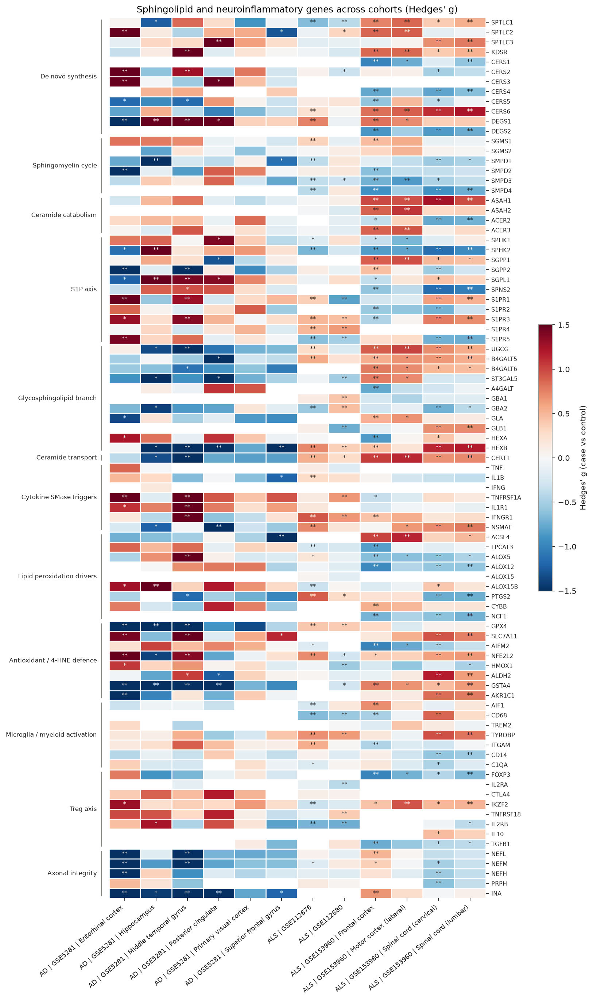
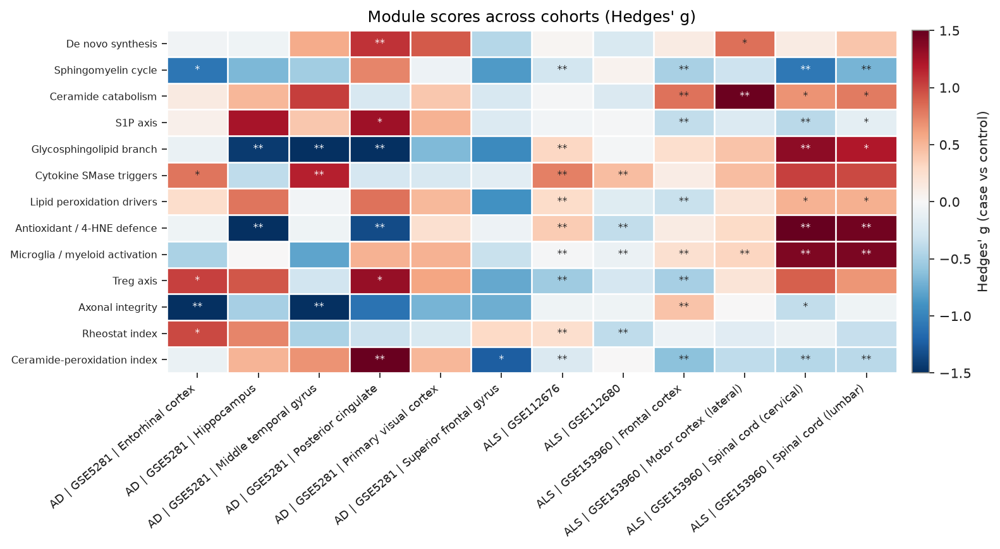
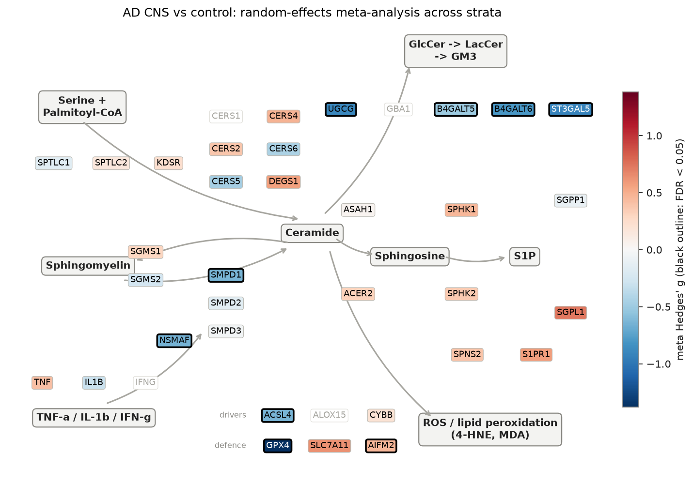
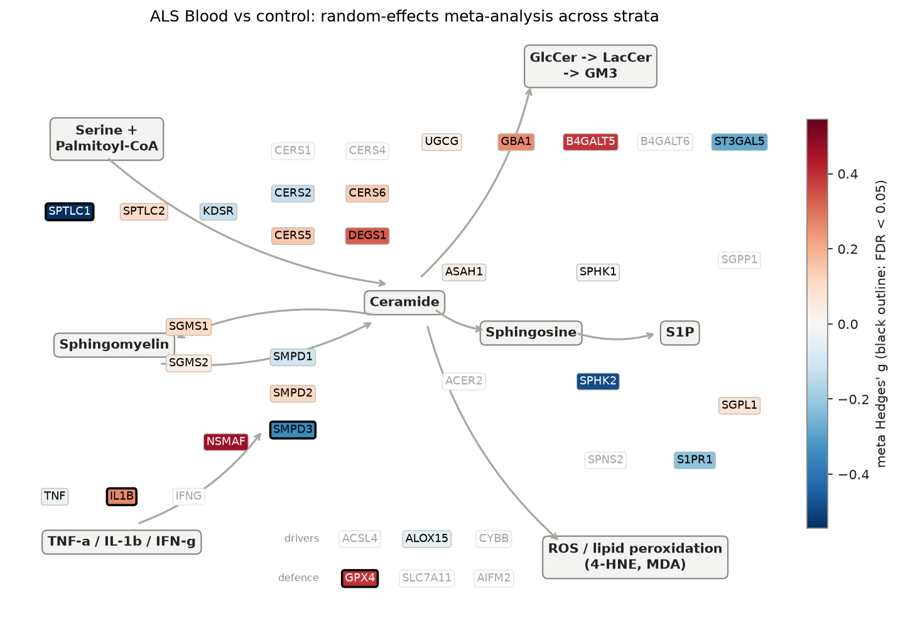
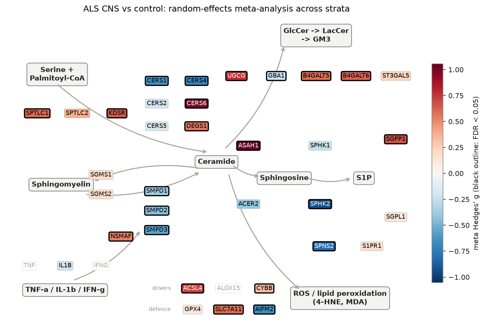

# sphingomap-CNS: Sphingolipid Pathway Atlas

_sphingomap-CNS v0.1.0_

Open `atlas.html` for the interactive version (sortable gene table, per-stratum reports).

## Comparisons

| Contrast | Cohort | Stratum | Case | Control | Covariates | Status |
|---|---|---|---:|---:|---|---|
| ALS | GSE153960 | [Spinal cord (cervical)](GSE153960/ALS_Spinal_cord_cervical/REPORT.md) | 160 | 41 | microglia_myeloid_score | ok |
| ALS | GSE153960 | [Spinal cord (lumbar)](GSE153960/ALS_Spinal_cord_lumbar/REPORT.md) | 147 | 44 | microglia_myeloid_score | ok |
| ALS | GSE153960 | [Motor cortex (lateral)](GSE153960/ALS_Motor_cortex_lateral/REPORT.md) | 83 | 19 | microglia_myeloid_score | ok |
| ALS | GSE153960 | [Frontal cortex](GSE153960/ALS_Frontal_cortex/REPORT.md) | 156 | 56 | microglia_myeloid_score | ok |
| AD | GSE5281 | [Entorhinal cortex](GSE5281/AD_Entorhinal_cortex/REPORT.md) | 10 | 13 | sex_male, age, microglia_myeloid_score | ok |
| AD | GSE5281 | [Hippocampus](GSE5281/AD_Hippocampus/REPORT.md) | 10 | 13 | sex_male, age, microglia_myeloid_score | ok |
| AD | GSE5281 | [Middle temporal gyrus](GSE5281/AD_Middle_temporal_gyrus/REPORT.md) | 16 | 12 | sex_male, age, microglia_myeloid_score | ok |
| AD | GSE5281 | [Posterior cingulate](GSE5281/AD_Posterior_cingulate/REPORT.md) | 9 | 13 | sex_male, age, microglia_myeloid_score | ok |
| AD | GSE5281 | [Superior frontal gyrus](GSE5281/AD_Superior_frontal_gyrus/REPORT.md) | 23 | 11 | sex_male, age, microglia_myeloid_score | ok |
| AD | GSE5281 | [Primary visual cortex](GSE5281/AD_Primary_visual_cortex/REPORT.md) | 19 | 12 | sex_male, age, microglia_myeloid_score | ok |
| ALS | GSE112676 | [All](GSE112676/ALS_All/REPORT.md) | 233 | 508 | sex_male, microglia_myeloid_score | ok |
| ALS | GSE112680 | [All](GSE112680/ALS_All/REPORT.md) | 164 | 137 | microglia_myeloid_score | ok |

## Atlas

## AD CNS vs control: random-effects meta-analysis

| Gene | Module | meta g | 95% CI | I² | strata up / down (FDR<0.05) | FDR |
|---|---|---:|---|---:|---|---:|
| ST3GAL5 | Glycosphingolipid branch | -0.93 | -1.26 to -0.59 | 0% | 0 / 2 of 6 | 3.70e-06 |
| GSTA4 | Antioxidant / 4-HNE defence | -1.55 | -2.12 to -0.98 | 58% | 0 / 4 of 6 | 3.70e-06 |
| INA | Axonal integrity | -1.83 | -2.55 to -1.11 | 72% | 0 / 5 of 6 | 1.83e-05 |
| B4GALT6 | Glycosphingolipid branch | -0.80 | -1.13 to -0.48 | 0% | 0 / 1 of 6 | 3.28e-05 |
| GPX4 | Antioxidant / 4-HNE defence | -1.38 | -1.96 to -0.80 | 61% | 0 / 3 of 6 | 4.17e-05 |
| NEFM | Axonal integrity | -1.03 | -1.47 to -0.59 | 39% | 0 / 2 of 6 | 5.61e-05 |
| PTGS2 | Lipid peroxidation drivers | -0.78 | -1.13 to -0.42 | 0% | 0 / 1 of 5 | 2.09e-04 |
| CERT1 | Ceramide transport | -1.02 | -1.50 to -0.55 | 49% | 0 / 2 of 6 | 2.69e-04 |
| IL1R1 | Cytokine SMase triggers | +0.82 | +0.43 to +1.20 | 25% | 2 / 0 of 6 | 2.72e-04 |
| HEXB | Glycosphingolipid branch | -1.26 | -1.87 to -0.66 | 66% | 0 / 4 of 6 | 3.37e-04 |
| ALOX15B | Lipid peroxidation drivers | +0.83 | +0.40 to +1.27 | 40% | 2 / 0 of 6 | 1.09e-03 |
| CTLA4 | Treg axis | +0.65 | +0.28 to +1.01 | 0% | 0 / 0 of 5 | 3.06e-03 |
| UGCG | Glycosphingolipid branch | -0.90 | -1.43 to -0.38 | 58% | 0 / 2 of 6 | 4.11e-03 |
| NEFL | Axonal integrity | -1.05 | -1.67 to -0.43 | 69% | 0 / 2 of 6 | 4.68e-03 |
| ACSL4 | Lipid peroxidation drivers | -0.65 | -1.05 to -0.24 | 35% | 0 / 1 of 6 | 9.28e-03 |
| SMPD1 | Sphingomyelin cycle | -0.64 | -1.13 to -0.15 | 54% | 0 / 2 of 6 | 3.48e-02 |
| SMPD2 | Sphingomyelin cycle | -0.16 | -0.89 to +0.57 | 79% | 0 / 1 of 6 | 7.46e-01 |
| SMPD3 | Sphingomyelin cycle | -0.04 | -0.50 to +0.42 | 51% | 0 / 0 of 6 | 8.99e-01 |
| CERS2 | De novo synthesis | +0.39 | -0.36 to +1.13 | 80% | 2 / 0 of 6 | 4.55e-01 |
| CERS3 | De novo synthesis | +0.46 | -0.28 to +1.19 | 79% | 2 / 0 of 6 | 3.54e-01 |
| CERS4 | De novo synthesis | +0.48 | +0.03 to +0.92 | 0% | 0 / 0 of 3 | 9.43e-02 |
| CERS5 | De novo synthesis | -0.47 | -1.04 to +0.10 | 66% | 0 / 2 of 6 | 1.89e-01 |
| CERS6 | De novo synthesis | -0.44 | -0.84 to -0.03 | 35% | 0 / 0 of 6 | 9.43e-02 |
| ASAH1 | Ceramide catabolism | +0.04 | -0.34 to +0.42 | 28% | 0 / 0 of 6 | 8.61e-01 |
| SGMS1 | Sphingomyelin cycle | +0.30 | -0.10 to +0.69 | 34% | 0 / 0 of 6 | 2.48e-01 |
| SGMS2 | Sphingomyelin cycle | -0.25 | -0.60 to +0.11 | 5% | 0 / 0 of 5 | 2.87e-01 |
| SPHK1 | S1P axis | +0.46 | -0.05 to +0.97 | 58% | 1 / 0 of 6 | 1.54e-01 |
| S1PR1 | S1P axis | +0.58 | -0.19 to +1.35 | 81% | 2 / 0 of 6 | 2.48e-01 |

## ALS Blood vs control: random-effects meta-analysis

| Gene | Module | meta g | 95% CI | I² | strata up / down (FDR<0.05) | FDR |
|---|---|---:|---|---:|---|---:|
| IL2RB | Treg axis | -0.71 | -0.84 to -0.58 | 0% | 0 / 2 of 2 | 2.07e-24 |
| TYROBP | Microglia / myeloid activation | +0.67 | +0.54 to +0.80 | 0% | 2 / 0 of 2 | 5.05e-22 |
| CD68 | Microglia / myeloid activation | -0.62 | -0.75 to -0.49 | 0% | 0 / 2 of 2 | 3.19e-19 |
| S1PR5 | S1P axis | -0.59 | -0.72 to -0.46 | 0% | 0 / 2 of 2 | 1.08e-17 |
| S1PR4 | S1P axis | +0.54 | +0.41 to +0.67 | 0% | 2 / 0 of 2 | 4.11e-15 |
| S1PR3 | S1P axis | +0.48 | +0.35 to +0.61 | 0% | 2 / 0 of 2 | 3.28e-12 |
| GPX4 | Antioxidant / 4-HNE defence | +0.39 | +0.26 to +0.52 | 0% | 2 / 0 of 2 | 2.32e-08 |
| IFNGR1 | Cytokine SMase triggers | +0.81 | +0.53 to +1.08 | 73% | 2 / 0 of 2 | 5.28e-08 |
| SMPD3 | Sphingomyelin cycle | -0.35 | -0.47 to -0.22 | 0% | 0 / 2 of 2 | 1.06e-06 |
| SPTLC1 | De novo synthesis | -0.54 | -0.78 to -0.31 | 65% | 0 / 2 of 2 | 2.91e-05 |
| IKZF2 | Treg axis | -0.29 | -0.41 to -0.16 | 0% | 0 / 1 of 2 | 7.83e-05 |
| IL1B | Cytokine SMase triggers | +0.26 | +0.13 to +0.39 | 0% | 1 / 0 of 2 | 3.13e-04 |
| LPCAT3 | Lipid peroxidation drivers | -0.26 | -0.39 to -0.13 | 0% | 0 / 1 of 2 | 3.57e-04 |
| CERT1 | Ceramide transport | +0.42 | +0.16 to +0.67 | 70% | 2 / 0 of 2 | 5.73e-03 |
| HEXB | Glycosphingolipid branch | +0.55 | +0.20 to +0.91 | 85% | 2 / 0 of 2 | 9.17e-03 |
| SMPD1 | Sphingomyelin cycle | -0.11 | -0.65 to +0.44 | 94% | 0 / 1 of 2 | 8.23e-01 |
| SMPD2 | Sphingomyelin cycle | +0.11 | -0.02 to +0.24 | 0% | 0 / 0 of 2 | 2.32e-01 |
| CERS2 | De novo synthesis | -0.12 | -0.50 to +0.25 | 86% | 0 / 1 of 2 | 7.94e-01 |
| CERS5 | De novo synthesis | +0.15 | +0.02 to +0.27 | 0% | 0 / 0 of 2 | 8.45e-02 |
| CERS6 | De novo synthesis | +0.14 | -0.07 to +0.35 | 59% | 1 / 0 of 2 | 4.15e-01 |
| ASAH1 | Ceramide catabolism | +0.03 | -0.10 to +0.16 | 0% | 0 / 0 of 2 | 8.23e-01 |
| SGMS1 | Sphingomyelin cycle | +0.11 | -0.36 to +0.58 | 91% | 1 / 0 of 2 | 8.23e-01 |
| SGMS2 | Sphingomyelin cycle | +0.04 | -0.09 to +0.17 | 0% | 0 / 0 of 2 | 7.94e-01 |
| UGCG | Glycosphingolipid branch | +0.03 | -0.45 to +0.51 | 92% | 1 / 0 of 2 | 9.28e-01 |
| SPHK1 | S1P axis | +0.00 | -0.43 to +0.44 | 90% | 0 / 1 of 2 | 9.87e-01 |
| S1PR1 | S1P axis | -0.22 | -1.36 to +0.91 | 98% | 1 / 1 of 2 | 8.23e-01 |

## ALS CNS vs control: random-effects meta-analysis

| Gene | Module | meta g | 95% CI | I² | strata up / down (FDR<0.05) | FDR |
|---|---|---:|---|---:|---|---:|
| ASAH1 | Ceramide catabolism | +1.05 | +0.87 to +1.24 | 0% | 4 / 0 of 4 | 4.89e-27 |
| CERS6 | De novo synthesis | +1.02 | +0.83 to +1.21 | 4% | 4 / 0 of 4 | 1.85e-24 |
| SPHK2 | S1P axis | -0.94 | -1.12 to -0.75 | 0% | 0 / 4 of 4 | 3.06e-22 |
| SMPD4 | Sphingomyelin cycle | -0.81 | -0.99 to -0.62 | 0% | 0 / 3 of 4 | 7.27e-17 |
| DEGS2 | De novo synthesis | -0.78 | -0.97 to -0.60 | 0% | 0 / 3 of 4 | 3.90e-16 |
| CERT1 | Ceramide transport | +0.87 | +0.66 to +1.08 | 20% | 4 / 0 of 4 | 2.83e-15 |
| UGCG | Glycosphingolipid branch | +0.77 | +0.58 to +0.96 | 5% | 4 / 0 of 4 | 8.90e-15 |
| CERS4 | De novo synthesis | -0.69 | -0.87 to -0.51 | 0% | 0 / 3 of 4 | 5.17e-13 |
| NCF1 | Lipid peroxidation drivers | -0.65 | -0.83 to -0.47 | 0% | 0 / 3 of 4 | 1.35e-11 |
| GSTA4 | Antioxidant / 4-HNE defence | +0.64 | +0.46 to +0.82 | 0% | 4 / 0 of 4 | 3.53e-11 |
| B4GALT6 | Glycosphingolipid branch | +0.61 | +0.43 to +0.79 | 0% | 4 / 0 of 4 | 2.08e-10 |
| B4GALT5 | Glycosphingolipid branch | +0.59 | +0.41 to +0.77 | 0% | 4 / 0 of 4 | 6.42e-10 |
| ALOX5 | Lipid peroxidation drivers | -0.58 | -0.76 to -0.40 | 0% | 0 / 4 of 4 | 1.10e-09 |
| SPTLC1 | De novo synthesis | +0.60 | +0.41 to +0.80 | 14% | 4 / 0 of 4 | 8.15e-09 |
| ALOX12 | Lipid peroxidation drivers | -0.67 | -0.89 to -0.44 | 33% | 0 / 3 of 4 | 2.63e-08 |
| SMPD1 | Sphingomyelin cycle | -0.37 | -0.55 to -0.20 | 0% | 0 / 2 of 4 | 1.19e-04 |
| SMPD2 | Sphingomyelin cycle | -0.44 | -0.62 to -0.26 | 0% | 0 / 1 of 4 | 4.83e-06 |
| SMPD3 | Sphingomyelin cycle | -0.57 | -0.77 to -0.37 | 19% | 0 / 3 of 4 | 1.24e-07 |
| CERS1 | De novo synthesis | -0.63 | -0.99 to -0.27 | 74% | 0 / 3 of 4 | 1.53e-03 |
| CERS2 | De novo synthesis | -0.18 | -0.49 to +0.13 | 65% | 0 / 1 of 4 | 3.20e-01 |
| CERS5 | De novo synthesis | -0.16 | -0.57 to +0.24 | 80% | 0 / 2 of 4 | 4.92e-01 |
| SGMS1 | Sphingomyelin cycle | +0.19 | -0.15 to +0.53 | 71% | 1 / 0 of 4 | 3.33e-01 |
| SGMS2 | Sphingomyelin cycle | +0.19 | -0.01 to +0.39 | 18% | 0 / 0 of 4 | 9.21e-02 |
| SPHK1 | S1P axis | -0.24 | -0.53 to +0.04 | 60% | 0 / 2 of 4 | 1.51e-01 |
| S1PR1 | S1P axis | +0.17 | -0.31 to +0.65 | 85% | 2 / 0 of 4 | 5.40e-01 |
| GPX4 | Antioxidant / 4-HNE defence | +0.11 | -0.08 to +0.29 | 8% | 0 / 0 of 4 | 3.20e-01 |
| ACSL4 | Lipid peroxidation drivers | +0.72 | +0.35 to +1.10 | 75% | 3 / 0 of 4 | 4.28e-04 |

## Module scores (Hedges' g, case vs control)

| Score | AD | GSE5281 | Entorhinal cortex | AD | GSE5281 | Hippocampus | AD | GSE5281 | Middle temporal gyrus | AD | GSE5281 | Posterior cingulate | AD | GSE5281 | Primary visual cortex | AD | GSE5281 | Superior frontal gyrus | ALS | GSE112676 | ALS | GSE112680 | ALS | GSE153960 | Frontal cortex | ALS | GSE153960 | Motor cortex (lateral) | ALS | GSE153960 | Spinal cord (cervical) | ALS | GSE153960 | Spinal cord (lumbar) |
|---|---:|---:|---:|---:|---:|---:|---:|---:|---:|---:|---:|---:|
| De novo synthesis | -0.05 | -0.07 | +0.56 | +1.08* | +0.92 | -0.43 | +0.03 | -0.23 | +0.12 | +0.83* | +0.12 | +0.41 |
| Sphingomyelin cycle | -1.08* | -0.68 | -0.52 | +0.73 | -0.08 | -0.85 | -0.28* | +0.06 | -0.49* | -0.31 | -1.07* | -0.69* |
| Ceramide catabolism | +0.13 | +0.50 | +1.04 | -0.23 | +0.40 | -0.24 | -0.02 | -0.22 | +0.82* | +1.47* | +0.67* | +0.78* |
| S1P axis | +0.08 | +1.23 | +0.40 | +1.27* | +0.52 | -0.20 | -0.04 | -0.02 | -0.37* | -0.21 | -0.41* | -0.14* |
| Glycosphingolipid branch | -0.10 | -1.44* | -1.77* | -2.29* | -0.66 | -0.95 | +0.31* | -0.03 | +0.26 | +0.43 | +1.34* | +1.21* |
| Cytokine SMase triggers | +0.80* | -0.38 | +1.17* | -0.25 | -0.24 | -0.15 | +0.76* | +0.47* | +0.11 | +0.46 | +1.02 | +0.99 |
| Lipid peroxidation drivers | +0.27 | +0.80 | -0.04 | +0.82 | +0.49 | -0.91 | +0.27* | -0.18 | -0.34* | +0.20 | +0.52* | +0.54* |
| Antioxidant / 4-HNE defence | -0.06 | -1.69* | -0.06 | -1.34* | +0.24 | -0.08 | +0.38* | -0.37* | +0.12 | +0.29 | +1.62* | +1.45* |
| Microglia / myeloid activation | -0.48 | +0.00 | -0.80 | +0.52 | +0.52 | -0.34 | -0.01* | -0.08* | +0.24* | +0.32* | +1.40* | +1.41* |
| Treg axis | +1.03* | +0.93 | -0.28 | +1.31* | +0.60 | -0.77 | -0.53* | -0.25 | -0.50* | +0.20 | +0.89 | +0.66 |
| Axonal integrity | -1.69* | -0.50 | -1.80* | -1.10 | -0.70 | -0.73 | -0.07 | -0.06 | +0.43* | +0.00 | -0.37* | -0.06 |
| Rheostat index | +0.99* | +0.74 | -0.48 | -0.33 | -0.23 | +0.29 | +0.25* | -0.38* | -0.08 | -0.17 | -0.09 | -0.34 |
| Ceramide-peroxidation index | -0.10 | +0.51 | +0.67 | +1.48* | +0.50 | -1.23* | -0.22* | +0.01 | -0.62* | -0.38 | -0.42* | -0.41* |

\* FDR < 0.05 within that stratum.

## How to read this

- **Hedges' g** is the standardised case-control difference (0.2 small, 0.5 medium, 0.8 large).
- **Meta-analysis** pools strata of the same disease with DerSimonian-Laird random effects. Brain regions from the same donors are not independent, so pooled p-values are optimistic; read the 'strata up/down' column and I² (between-stratum heterogeneity) alongside them.
- Bulk post-mortem tissue: neuron loss and gliosis shift cell composition, so a change can reflect which cells are present rather than per-cell regulation. Blood cohorts reflect circulating leukocytes, the compartment COYA 302 acts on directly.
- Transcript changes are hypotheses for lipid measurement (Phase 2), not lipid measurements.
