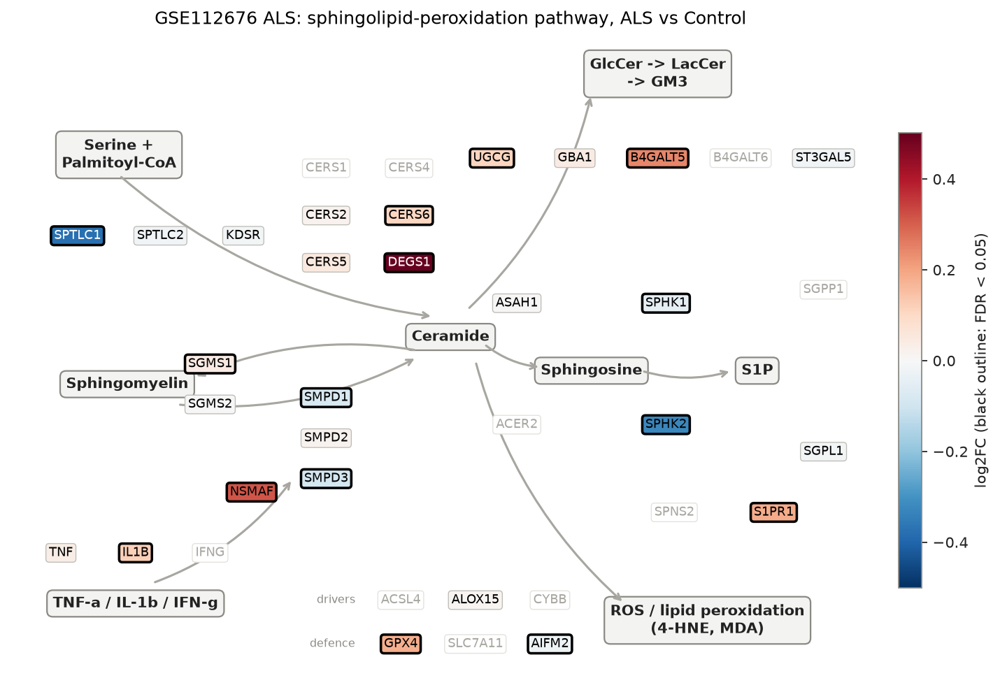
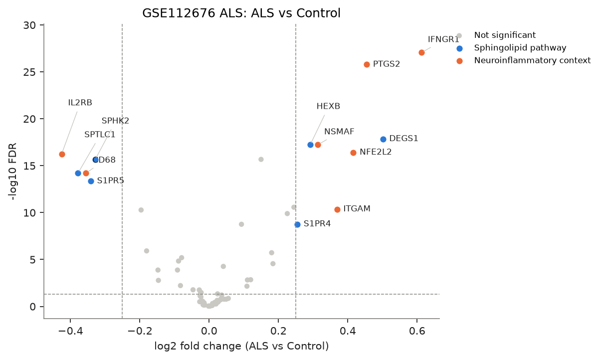
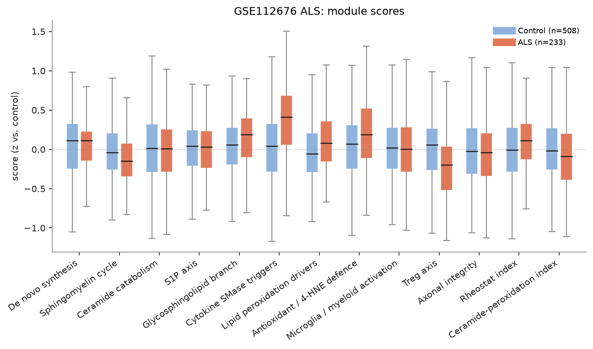
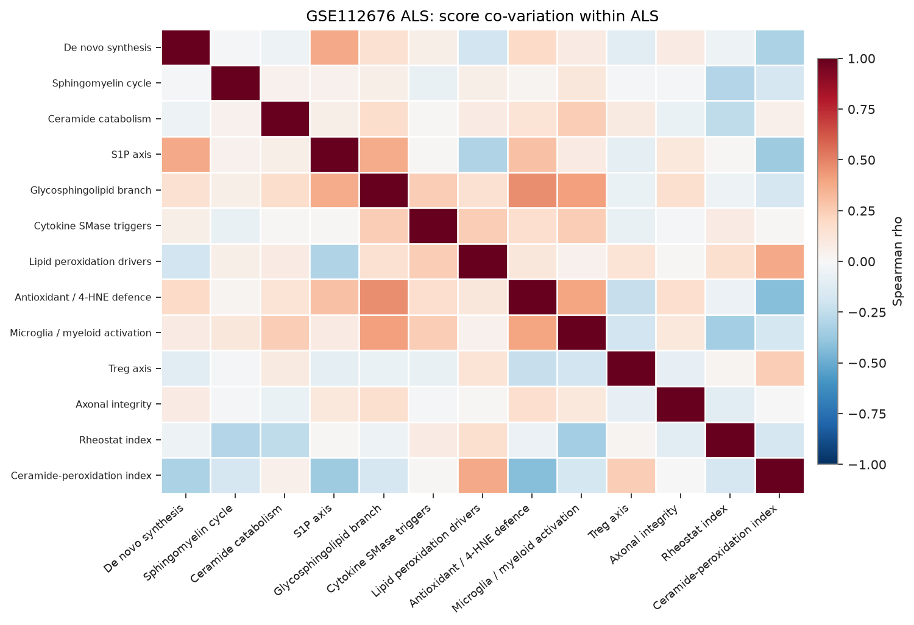
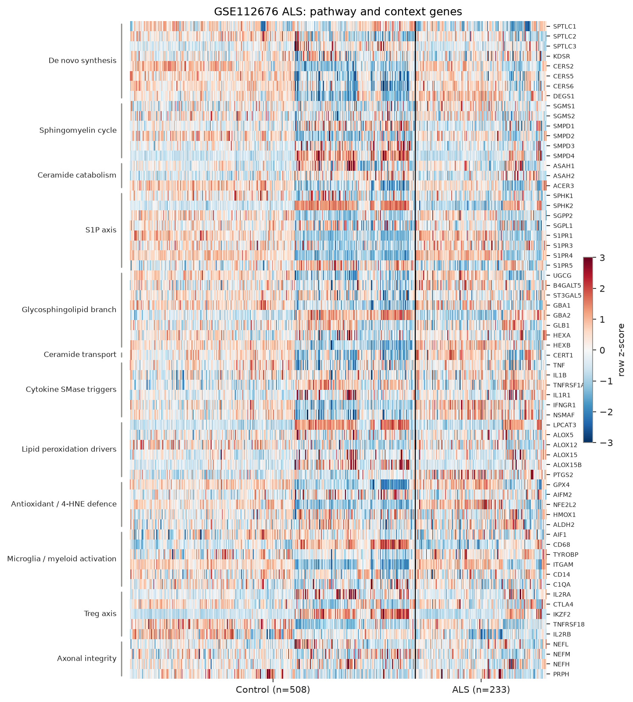

# sphingomap-CNS report: GSE112676 ALS

_sphingomap-CNS v0.1.0, generated 2026-11-11_

Source: ALS whole blood, discovery set (Illumina HT-12 v3) (van Rheenen W. et al., PLoS One 13, e0198874 (2018))

## Design

- ALS: **233**, Control: **508**
- Model: linear model, adjusted for sex_male, microglia_myeloid_score
- Genes tested: 66 (not in data / not expressed: CERS1, CERS3, CERS4, DEGS2, ACER1, ACER2, SGPP1, SPNS2, S1PR2, B4GALT6, A4GALT, GLA, IFNG, ACSL4, CYBB, NCF1, SLC7A11, GSTA4, AKR1C1, TREM2, FOXP3, IL10, TGFB1, INA)

## Gene-level changes

13 genes with FDR < 0.05 and |log2FC| >= 0.25.

- Up: IFNGR1, DEGS1, PTGS2, NFE2L2, ITGAM, NSMAF, HEXB, S1PR4
- Down: IL2RB, SPTLC1, CD68, S1PR5, SPHK2

### Proposal focus genes

| Gene | log2FC | FDR |
|---|---:|---:|
| SMPD1 | -0.08 | 6.43e-06 |
| SMPD2 | +0.02 | 3.69e-01 |
| SMPD3 | -0.09 | 1.47e-05 |
| CERS2 | +0.02 | 5.49e-01 |
| CERS5 | +0.05 | 1.70e-01 |
| CERS6 | +0.11 | 7.02e-03 |
| ASAH1 | +0.00 | 9.30e-01 |
| SGMS1 | +0.04 | 5.47e-05 |
| SGMS2 | +0.00 | 9.30e-01 |
| UGCG | +0.11 | 1.52e-03 |
| SPHK1 | -0.05 | 1.70e-02 |
| S1PR1 | +0.18 | 2.80e-05 |
| GPX4 | +0.18 | 1.90e-06 |

### Top 25 genes

| Gene | Module | log2FC | FDR |
|---|---|---:|---:|
| IFNGR1 | Cytokine SMase triggers | +0.61 | 8.93e-28 |
| PTGS2 | Lipid peroxidation drivers | +0.45 | 1.67e-26 |
| DEGS1 | De novo synthesis | +0.50 | 1.43e-18 |
| NSMAF | Cytokine SMase triggers | +0.31 | 6.05e-18 |
| HEXB | Glycosphingolipid branch | +0.29 | 6.05e-18 |
| NFE2L2 | Antioxidant / 4-HNE defence | +0.42 | 3.91e-17 |
| IL2RB | Treg axis | -0.43 | 5.63e-17 |
| TYROBP | Microglia / myeloid activation | +0.15 | 2.15e-16 |
| SPHK2 | S1P axis | -0.33 | 2.15e-16 |
| SPTLC1 | De novo synthesis | -0.38 | 6.30e-15 |
| CD68 | Microglia / myeloid activation | -0.35 | 6.30e-15 |
| S1PR5 | S1P axis | -0.34 | 4.46e-14 |
| B4GALT5 | Glycosphingolipid branch | +0.24 | 2.70e-11 |
| ITGAM | Microglia / myeloid activation | +0.37 | 4.38e-11 |
| GBA2 | Glycosphingolipid branch | -0.20 | 5.32e-11 |
| CERT1 | Ceramide transport | +0.23 | 1.27e-10 |
| S1PR4 | S1P axis | +0.25 | 1.72e-09 |
| S1PR3 | S1P axis | +0.09 | 1.77e-09 |
| SMPD4 | Sphingomyelin cycle | -0.18 | 1.22e-06 |
| GPX4 | Antioxidant / 4-HNE defence | +0.18 | 1.90e-06 |
| SMPD1 | Sphingomyelin cycle | -0.08 | 6.43e-06 |
| SMPD3 | Sphingomyelin cycle | -0.09 | 1.47e-05 |
| S1PR1 | S1P axis | +0.18 | 2.80e-05 |
| SGMS1 | Sphingomyelin cycle | +0.04 | 5.47e-05 |
| IKZF2 | Treg axis | -0.15 | 1.33e-04 |

## Module scores and indices

Scores are mean z-scores relative to the control group. The rheostat index is pro-survival (S1P/GSL) minus pro-ceramide genes; the ceramide-peroxidation (CPA) index is ceramide-generation + peroxidation-driver genes minus ceramide-clearance + antioxidant genes.

| Score | Mean difference | Hedges' g | FDR |
|---|---:|---:|---:|
| Cytokine SMase triggers | +0.39 | +0.83 | 3.58e-23 |
| Microglia / myeloid activation | +0.00 | +0.80 | 1.22e-21 |
| Treg axis | -0.22 | -0.54 | 1.15e-10 |
| Antioxidant / 4-HNE defence | +0.19 | +0.42 | 4.23e-07 |
| Glycosphingolipid branch | +0.14 | +0.35 | 2.51e-05 |
| Sphingomyelin cycle | -0.11 | -0.28 | 7.92e-04 |
| Lipid peroxidation drivers | +0.12 | +0.27 | 1.03e-03 |
| Rheostat index | +0.10 | +0.26 | 1.53e-03 |
| Ceramide-peroxidation index | -0.10 | -0.22 | 7.17e-03 |
| Axonal integrity | -0.03 | -0.07 | 4.78e-01 |
| S1P axis | -0.02 | -0.05 | 6.67e-01 |
| De novo synthesis | +0.02 | +0.04 | 6.72e-01 |
| Ceramide catabolism | -0.01 | -0.02 | 7.56e-01 |

## Caveats

- mRNA / protein abundance is not enzyme activity or lipid concentration; confirm with lipidomics (LC-MS/MS, HPTLC).
- Module scores and indices are exploratory transcript-level heuristics, not validated biomarkers.
- Post-mortem bulk tissue mixes cell types; changes can reflect cell-composition shifts (e.g. neuron loss, gliosis) rather than per-cell regulation.
