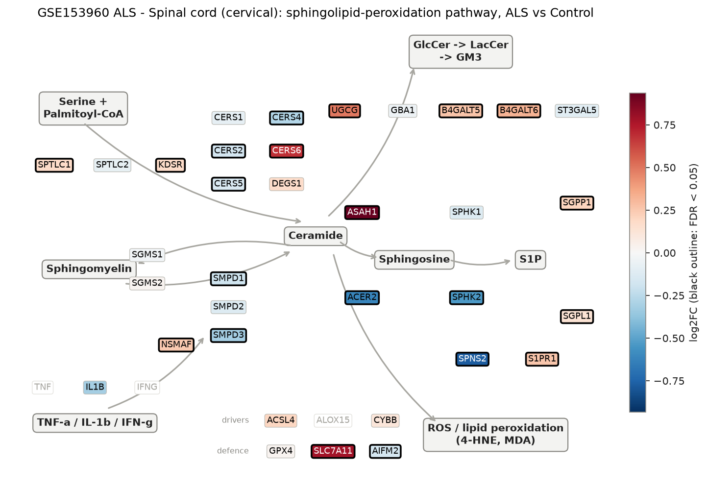
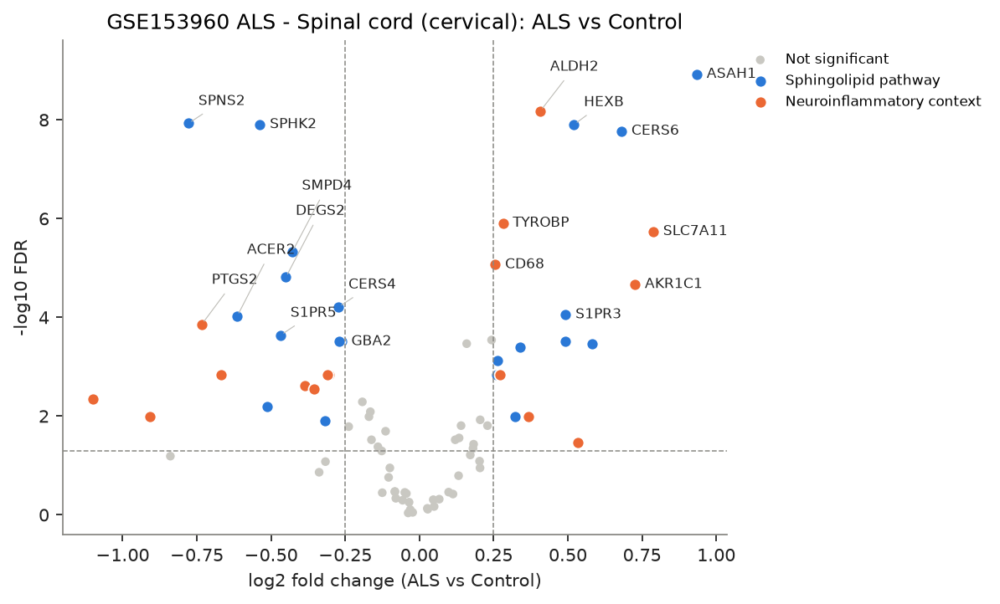
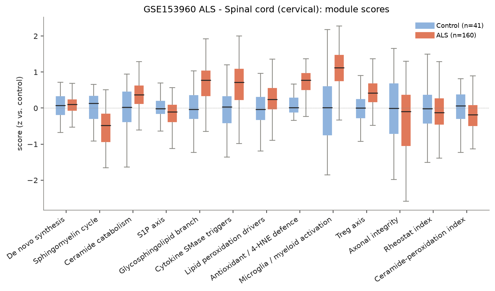
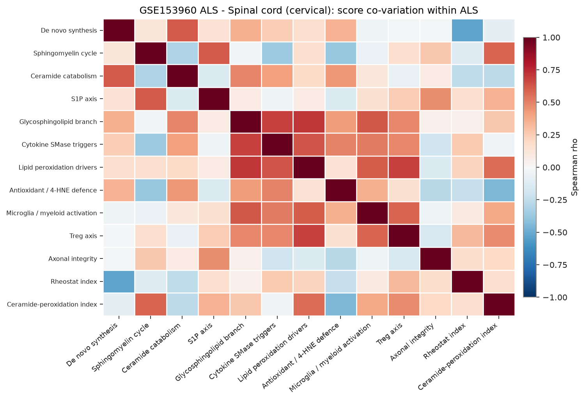
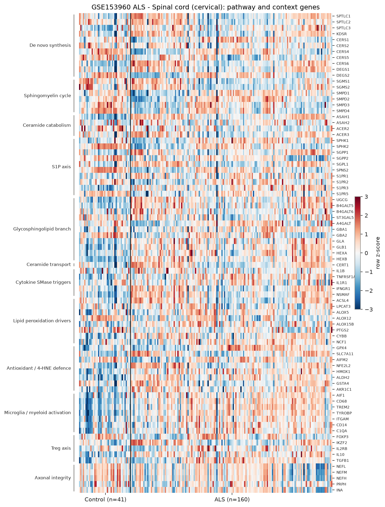

# sphingomap-CNS report: GSE153960 ALS - Spinal cord (cervical)

_sphingomap-CNS v0.1.0, generated 2026-11-11_

Source: NYGC ALS Consortium / Target ALS post-mortem CNS RNA-seq (New York Genome Center ALS Consortium (GEO GSE153960))

## Design

- ALS: **160**, Control: **41**
- Model: linear model, adjusted for microglia_myeloid_score
- Genes tested: 81 (not in data / not expressed: CERS3, ACER1, S1PR4, TNF, IFNG, ALOX15, IL2RA, CTLA4, TNFRSF18)

## Gene-level changes

37 genes with FDR < 0.05 and |log2FC| >= 0.25.

- Up: ASAH1, SLC7A11, AKR1C1, CERS6, SPTLC3, ALOX15B, HEXB, S1PR3, UGCG, ALDH2, IKZF2, CERT1, B4GALT6, TYROBP, NFE2L2, B4GALT5, S1PR1, CD68
- Down: NEFH, NEFM, SPNS2, PTGS2, PRPH, ACER2, SPHK2, SGPP2, S1PR5, DEGS2, SMPD4, CD14, ALOX12, SMPD3, NCF1, ALOX5, CERS4, S1PR2, GBA2

### Proposal focus genes

| Gene | log2FC | FDR |
|---|---:|---:|
| SMPD1 | -0.19 | 5.17e-03 |
| SMPD2 | -0.13 | 5.10e-02 |
| SMPD3 | -0.32 | 1.27e-02 |
| CERS1 | -0.08 | 3.39e-01 |
| CERS2 | -0.17 | 1.03e-02 |
| CERS4 | -0.27 | 6.17e-05 |
| CERS5 | -0.14 | 4.20e-02 |
| CERS6 | +0.68 | 1.69e-08 |
| ASAH1 | +0.93 | 1.20e-09 |
| SGMS1 | -0.03 | 5.57e-01 |
| SGMS2 | +0.03 | 7.73e-01 |
| UGCG | +0.49 | 3.11e-04 |
| SPHK1 | -0.13 | 3.58e-01 |
| S1PR1 | +0.26 | 1.45e-03 |
| GPX4 | +0.03 | 7.42e-01 |
| ACSL4 | +0.20 | 8.22e-02 |

### Top 25 genes

| Gene | Module | log2FC | FDR |
|---|---|---:|---:|
| ASAH1 | Ceramide catabolism | +0.93 | 1.20e-09 |
| ALDH2 | Antioxidant / 4-HNE defence | +0.41 | 6.67e-09 |
| SPNS2 | S1P axis | -0.78 | 1.18e-08 |
| SPHK2 | S1P axis | -0.54 | 1.25e-08 |
| HEXB | Glycosphingolipid branch | +0.52 | 1.25e-08 |
| CERS6 | De novo synthesis | +0.68 | 1.69e-08 |
| TYROBP | Microglia / myeloid activation | +0.28 | 1.24e-06 |
| SLC7A11 | Antioxidant / 4-HNE defence | +0.79 | 1.83e-06 |
| SMPD4 | Sphingomyelin cycle | -0.43 | 4.79e-06 |
| CD68 | Microglia / myeloid activation | +0.26 | 8.61e-06 |
| DEGS2 | De novo synthesis | -0.45 | 1.55e-05 |
| AKR1C1 | Antioxidant / 4-HNE defence | +0.73 | 2.16e-05 |
| CERS4 | De novo synthesis | -0.27 | 6.17e-05 |
| S1PR3 | S1P axis | +0.49 | 8.86e-05 |
| ACER2 | Ceramide catabolism | -0.61 | 9.53e-05 |
| PTGS2 | Lipid peroxidation drivers | -0.73 | 1.39e-04 |
| S1PR5 | S1P axis | -0.47 | 2.31e-04 |
| NSMAF | Cytokine SMase triggers | +0.24 | 2.89e-04 |
| GBA2 | Glycosphingolipid branch | -0.26 | 3.11e-04 |
| S1PR2 | S1P axis | -0.27 | 3.11e-04 |
| UGCG | Glycosphingolipid branch | +0.49 | 3.11e-04 |
| GLB1 | Glycosphingolipid branch | +0.16 | 3.43e-04 |
| SPTLC3 | De novo synthesis | +0.58 | 3.43e-04 |
| CERT1 | Ceramide transport | +0.34 | 3.98e-04 |
| B4GALT5 | Glycosphingolipid branch | +0.26 | 7.45e-04 |

## Module scores and indices

Scores are mean z-scores relative to the control group. The rheostat index is pro-survival (S1P/GSL) minus pro-ceramide genes; the ceramide-peroxidation (CPA) index is ceramide-generation + peroxidation-driver genes minus ceramide-clearance + antioxidant genes.

| Score | Mean difference | Hedges' g | FDR |
|---|---:|---:|---:|
| Microglia / myeloid activation | -0.00 | -2.28 | 2.23e-27 |
| Antioxidant / 4-HNE defence | +0.45 | +0.99 | 3.23e-07 |
| Ceramide-peroxidation index | -0.43 | -0.96 | 5.39e-07 |
| Sphingomyelin cycle | -0.50 | -0.87 | 4.58e-06 |
| S1P axis | -0.32 | -0.67 | 4.72e-04 |
| Glycosphingolipid branch | +0.28 | +0.55 | 3.69e-03 |
| Lipid peroxidation drivers | -0.18 | -0.43 | 2.47e-02 |
| Axonal integrity | -0.46 | -0.43 | 2.47e-02 |
| Ceramide catabolism | +0.23 | +0.39 | 4.05e-02 |
| Cytokine SMase triggers | +0.19 | +0.30 | 1.14e-01 |
| Rheostat index | -0.13 | -0.18 | 3.51e-01 |
| Treg axis | +0.04 | +0.10 | 6.03e-01 |
| De novo synthesis | -0.01 | -0.03 | 8.76e-01 |

## Caveats

- mRNA / protein abundance is not enzyme activity or lipid concentration; confirm with lipidomics (LC-MS/MS, HPTLC).
- Module scores and indices are exploratory transcript-level heuristics, not validated biomarkers.
- Post-mortem bulk tissue mixes cell types; changes can reflect cell-composition shifts (e.g. neuron loss, gliosis) rather than per-cell regulation.
