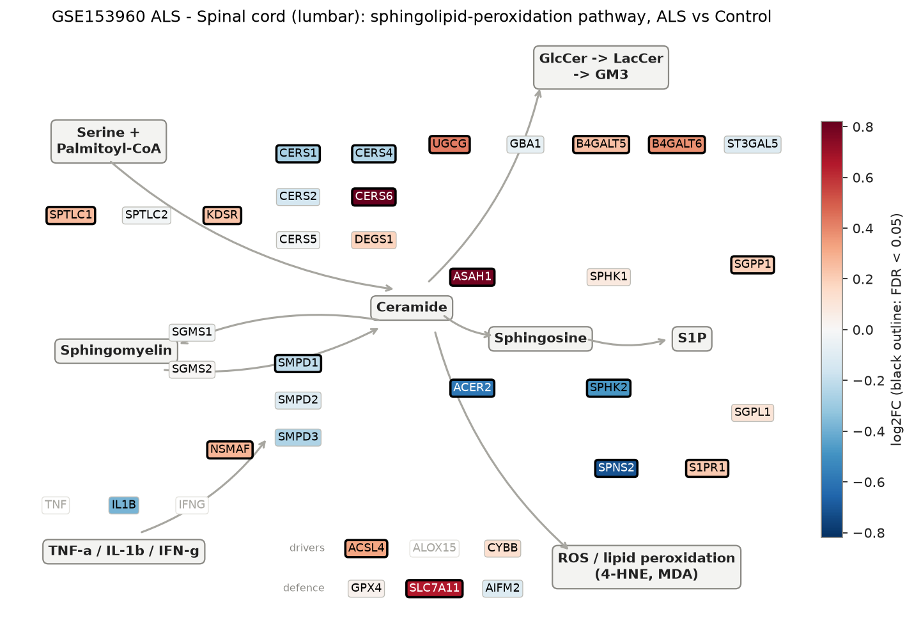
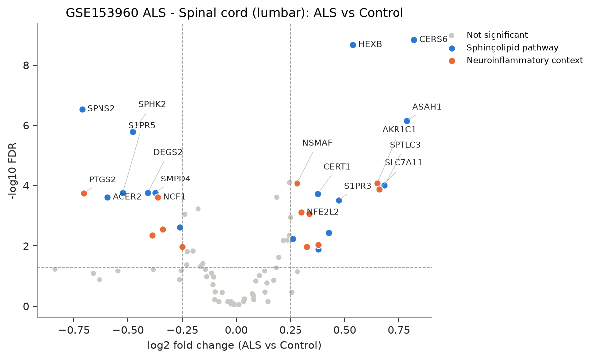
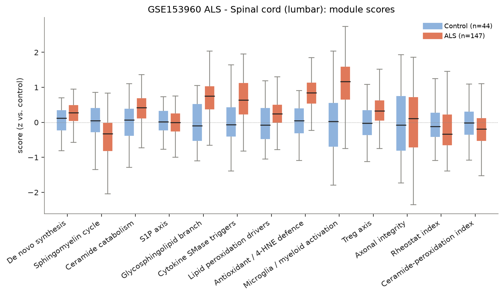
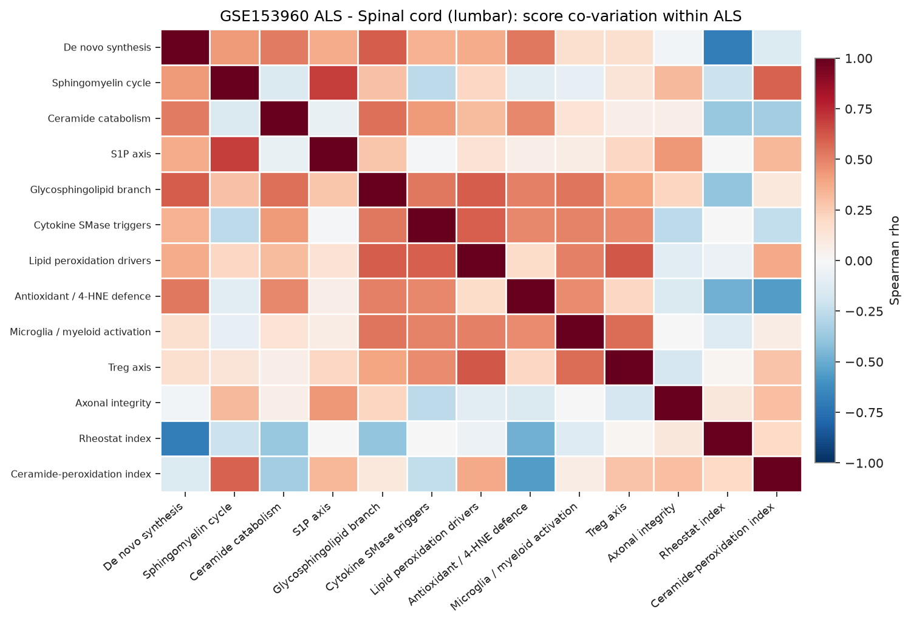
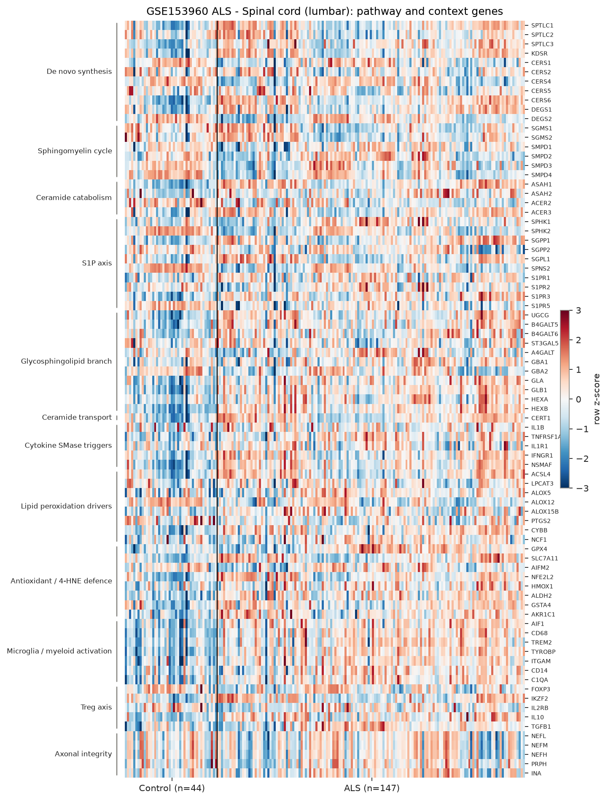

# sphingomap-CNS report: GSE153960 ALS - Spinal cord (lumbar)

_sphingomap-CNS v0.1.0, generated 2026-11-11_

Source: NYGC ALS Consortium / Target ALS post-mortem CNS RNA-seq (New York Genome Center ALS Consortium (GEO GSE153960))

## Design

- ALS: **147**, Control: **44**
- Model: linear model, adjusted for microglia_myeloid_score
- Genes tested: 81 (not in data / not expressed: CERS3, ACER1, S1PR4, TNF, IFNG, ALOX15, IL2RA, CTLA4, TNFRSF18)

## Gene-level changes

28 genes with FDR < 0.05 and |log2FC| >= 0.25.

- Up: CERS6, ASAH1, SPTLC3, SLC7A11, AKR1C1, HEXB, S1PR3, UGCG, IKZF2, B4GALT6, CERT1, GSTA4, ACSL4, NFE2L2, NSMAF, SPTLC1
- Down: SPNS2, PTGS2, ACER2, S1PR5, SPHK2, DEGS2, CD14, SMPD4, NCF1, ALOX12, CERS1, HMOX1

### Proposal focus genes

| Gene | log2FC | FDR |
|---|---:|---:|
| SMPD1 | -0.20 | 1.47e-02 |
| SMPD2 | -0.10 | 1.10e-01 |
| SMPD3 | -0.26 | 6.74e-02 |
| CERS1 | -0.26 | 2.39e-03 |
| CERS2 | -0.14 | 6.15e-02 |
| CERS4 | -0.24 | 8.97e-04 |
| CERS5 | -0.01 | 8.55e-01 |
| CERS6 | +0.82 | 1.47e-09 |
| ASAH1 | +0.79 | 7.19e-07 |
| SGMS1 | -0.02 | 7.14e-01 |
| SGMS2 | +0.01 | 8.92e-01 |
| UGCG | +0.43 | 3.73e-03 |
| SPHK1 | +0.08 | 6.13e-01 |
| S1PR1 | +0.22 | 6.69e-03 |
| GPX4 | +0.03 | 7.09e-01 |
| ACSL4 | +0.33 | 1.06e-02 |

### Top 25 genes

| Gene | Module | log2FC | FDR |
|---|---|---:|---:|
| CERS6 | De novo synthesis | +0.82 | 1.47e-09 |
| HEXB | Glycosphingolipid branch | +0.54 | 2.15e-09 |
| SPNS2 | S1P axis | -0.71 | 2.94e-07 |
| ASAH1 | Ceramide catabolism | +0.79 | 7.19e-07 |
| SPHK2 | S1P axis | -0.48 | 1.63e-06 |
| TYROBP | Microglia / myeloid activation | +0.24 | 8.16e-05 |
| NSMAF | Cytokine SMase triggers | +0.28 | 8.47e-05 |
| AKR1C1 | Antioxidant / 4-HNE defence | +0.65 | 8.47e-05 |
| SPTLC3 | De novo synthesis | +0.68 | 9.87e-05 |
| SLC7A11 | Antioxidant / 4-HNE defence | +0.66 | 1.36e-04 |
| DEGS2 | De novo synthesis | -0.41 | 1.72e-04 |
| S1PR5 | S1P axis | -0.52 | 1.72e-04 |
| SMPD4 | Sphingomyelin cycle | -0.37 | 1.72e-04 |
| PTGS2 | Lipid peroxidation drivers | -0.70 | 1.84e-04 |
| CERT1 | Ceramide transport | +0.38 | 1.87e-04 |
| ACER2 | Ceramide catabolism | -0.59 | 2.48e-04 |
| NCF1 | Lipid peroxidation drivers | -0.36 | 2.48e-04 |
| GLB1 | Glycosphingolipid branch | +0.19 | 2.48e-04 |
| S1PR3 | S1P axis | +0.47 | 3.05e-04 |
| FOXP3 | Treg axis | -0.18 | 5.99e-04 |
| NFE2L2 | Antioxidant / 4-HNE defence | +0.30 | 7.84e-04 |
| GSTA4 | Antioxidant / 4-HNE defence | +0.34 | 8.74e-04 |
| CERS4 | De novo synthesis | -0.24 | 8.97e-04 |
| ALDH2 | Antioxidant / 4-HNE defence | +0.25 | 1.14e-03 |
| CERS1 | De novo synthesis | -0.26 | 2.39e-03 |

## Module scores and indices

Scores are mean z-scores relative to the control group. The rheostat index is pro-survival (S1P/GSL) minus pro-ceramide genes; the ceramide-peroxidation (CPA) index is ceramide-generation + peroxidation-driver genes minus ceramide-clearance + antioxidant genes.

| Score | Mean difference | Hedges' g | FDR |
|---|---:|---:|---:|
| Microglia / myeloid activation | +0.00 | +1.41 | 1.59e-17 |
| Antioxidant / 4-HNE defence | +0.40 | +1.45 | 1.44e-04 |
| Ceramide-peroxidation index | -0.34 | -0.41 | 1.20e-03 |
| Sphingomyelin cycle | -0.45 | -0.69 | 1.58e-03 |
| Lipid peroxidation drivers | -0.18 | +0.54 | 3.30e-02 |
| Glycosphingolipid branch | +0.22 | +1.21 | 3.45e-02 |
| Ceramide catabolism | +0.23 | +0.78 | 4.04e-02 |
| S1P axis | -0.23 | -0.14 | 4.21e-02 |
| Axonal integrity | -0.28 | -0.06 | 2.04e-01 |
| Rheostat index | -0.18 | -0.34 | 2.25e-01 |
| Cytokine SMase triggers | +0.13 | +0.99 | 2.50e-01 |
| Treg axis | -0.09 | +0.66 | 2.52e-01 |
| De novo synthesis | +0.04 | +0.41 | 6.55e-01 |

## Caveats

- mRNA / protein abundance is not enzyme activity or lipid concentration; confirm with lipidomics (LC-MS/MS, HPTLC).
- Module scores and indices are exploratory transcript-level heuristics, not validated biomarkers.
- Post-mortem bulk tissue mixes cell types; changes can reflect cell-composition shifts (e.g. neuron loss, gliosis) rather than per-cell regulation.
