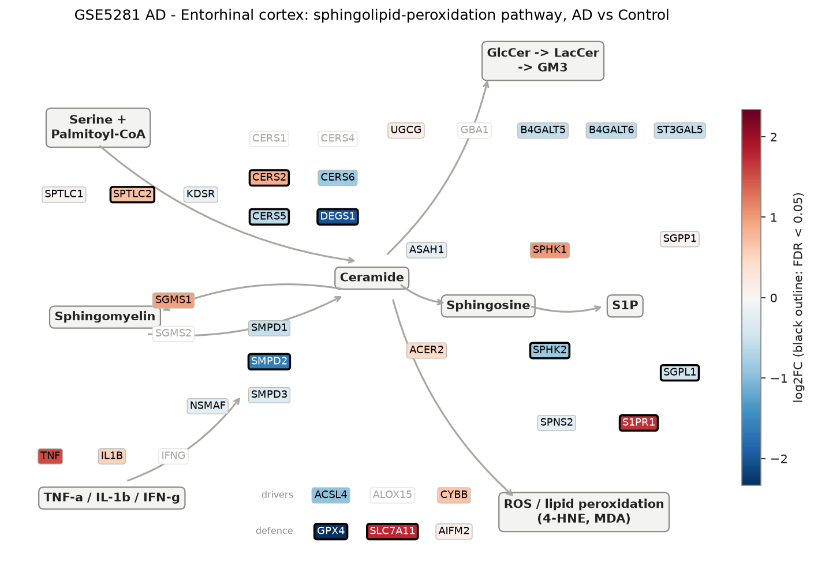
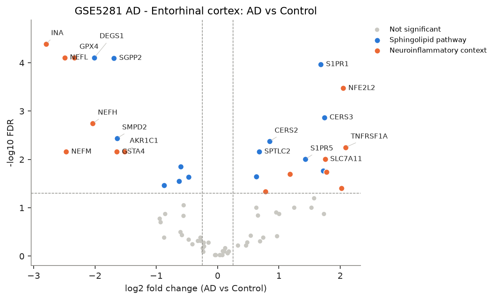
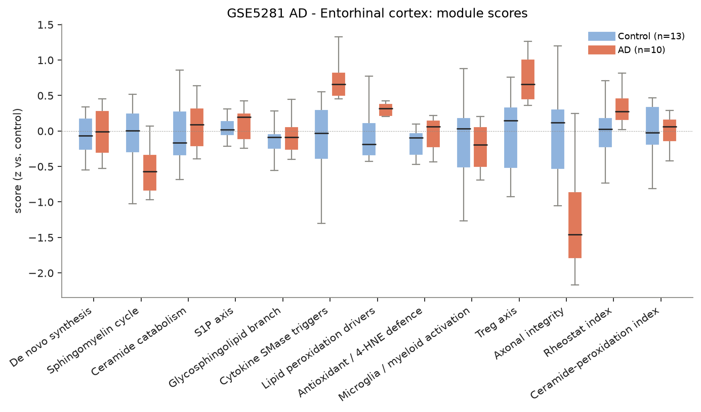
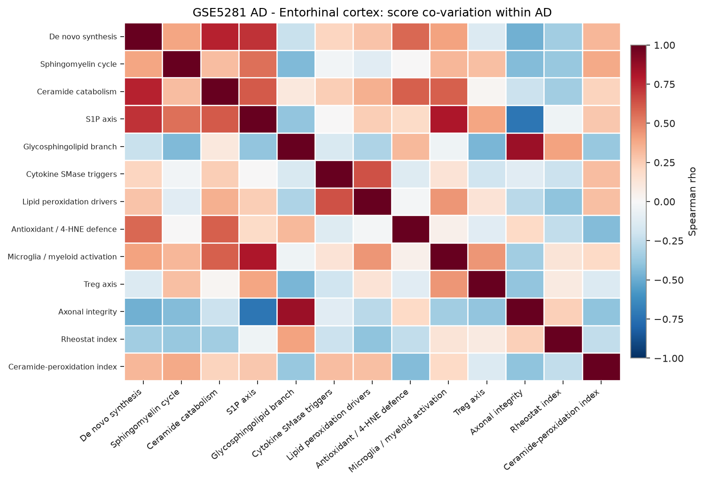
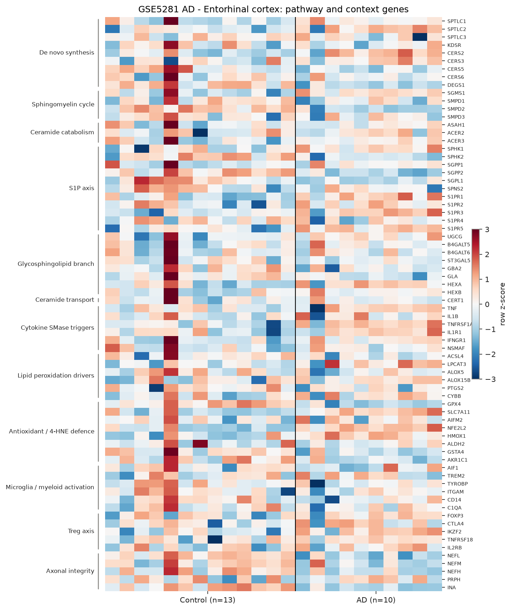

# sphingomap-CNS report: GSE5281 AD - Entorhinal cortex

_sphingomap-CNS v0.1.0, generated 2026-11-11_

Source: Alzheimer's disease, six brain regions, laser-captured neurons (Affymetrix U133 Plus 2) (Liang W. S. et al., Physiol Genomics 28, 311 (2007))

## Design

- AD: **10**, Control: **13**
- Model: linear model, adjusted for sex_male, age, microglia_myeloid_score
- Genes tested: 72 (not in data / not expressed: CERS1, CERS4, DEGS2, SGMS2, SMPD4, ASAH2, ACER1, A4GALT, GBA1, GLB1, IFNG, ALOX12, ALOX15, NCF1, CD68, IL2RA, IL10, TGFB1)

## Gene-level changes

28 genes with FDR < 0.05 and |log2FC| >= 0.25.

- Up: TNFRSF1A, NFE2L2, IL1R1, IKZF2, SLC7A11, CERS3, S1PR3, S1PR1, S1PR5, ALOX15B, CERS2, HMOX1, SPTLC2, HEXA
- Down: INA, NEFL, NEFM, GPX4, NEFH, DEGS1, SGPP2, GSTA4, SMPD2, AKR1C1, SPHK2, CERS5, GLA, SGPL1

### Proposal focus genes

| Gene | log2FC | FDR |
|---|---:|---:|
| SMPD1 | -0.56 | 1.47e-01 |
| SMPD2 | -1.64 | 3.64e-03 |
| SMPD3 | -0.32 | 4.86e-01 |
| CERS2 | +0.85 | 4.24e-03 |
| CERS3 | +1.74 | 1.36e-03 |
| CERS5 | -0.63 | 2.83e-02 |
| CERS6 | -0.85 | 1.34e-01 |
| ASAH1 | -0.22 | 6.31e-01 |
| SGMS1 | +0.96 | 1.25e-01 |
| UGCG | +0.17 | 8.73e-01 |
| SPHK1 | +1.00 | 1.34e-01 |
| S1PR1 | +1.68 | 1.08e-04 |
| GPX4 | -2.34 | 7.81e-05 |
| ACSL4 | -0.94 | 1.68e-01 |

### Top 25 genes

| Gene | Module | log2FC | FDR |
|---|---|---:|---:|
| INA | Axonal integrity | -2.80 | 4.07e-05 |
| NEFL | Axonal integrity | -2.49 | 7.81e-05 |
| DEGS1 | De novo synthesis | -2.01 | 7.81e-05 |
| GPX4 | Antioxidant / 4-HNE defence | -2.34 | 7.81e-05 |
| SGPP2 | S1P axis | -1.69 | 7.99e-05 |
| S1PR1 | S1P axis | +1.68 | 1.08e-04 |
| NFE2L2 | Antioxidant / 4-HNE defence | +2.05 | 3.36e-04 |
| CERS3 | De novo synthesis | +1.74 | 1.36e-03 |
| NEFH | Axonal integrity | -2.04 | 1.80e-03 |
| SMPD2 | Sphingomyelin cycle | -1.64 | 3.64e-03 |
| CERS2 | De novo synthesis | +0.85 | 4.24e-03 |
| TNFRSF1A | Cytokine SMase triggers | +2.09 | 5.62e-03 |
| SPTLC2 | De novo synthesis | +0.68 | 6.91e-03 |
| AKR1C1 | Antioxidant / 4-HNE defence | -1.52 | 6.91e-03 |
| GSTA4 | Antioxidant / 4-HNE defence | -1.64 | 6.94e-03 |
| NEFM | Axonal integrity | -2.47 | 6.94e-03 |
| S1PR5 | S1P axis | +1.43 | 9.90e-03 |
| SLC7A11 | Antioxidant / 4-HNE defence | +1.75 | 9.90e-03 |
| GLA | Glycosphingolipid branch | -0.60 | 1.41e-02 |
| S1PR3 | S1P axis | +1.72 | 1.71e-02 |
| IKZF2 | Treg axis | +1.78 | 1.82e-02 |
| ALOX15B | Lipid peroxidation drivers | +1.18 | 2.02e-02 |
| HEXA | Glycosphingolipid branch | +0.63 | 2.25e-02 |
| SGPL1 | S1P axis | -0.48 | 2.33e-02 |
| CERS5 | De novo synthesis | -0.63 | 2.83e-02 |

## Module scores and indices

Scores are mean z-scores relative to the control group. The rheostat index is pro-survival (S1P/GSL) minus pro-ceramide genes; the ceramide-peroxidation (CPA) index is ceramide-generation + peroxidation-driver genes minus ceramide-clearance + antioxidant genes.

| Score | Mean difference | Hedges' g | FDR |
|---|---:|---:|---:|
| Axonal integrity | -1.77 | -2.37 | 2.06e-04 |
| Treg axis | +0.84 | +1.39 | 1.91e-02 |
| Cytokine SMase triggers | +0.79 | +1.20 | 3.17e-02 |
| Sphingomyelin cycle | -0.69 | -1.17 | 3.17e-02 |
| Rheostat index | +0.42 | +1.12 | 3.33e-02 |
| Lipid peroxidation drivers | +0.26 | +0.57 | 3.87e-01 |
| Glycosphingolipid branch | -0.32 | -0.46 | 5.11e-01 |
| S1P axis | +0.14 | +0.37 | 5.98e-01 |
| Microglia / myeloid activation | -0.00 | -0.26 | 7.55e-01 |
| Antioxidant / 4-HNE defence | -0.12 | -0.22 | 7.68e-01 |
| Ceramide catabolism | +0.03 | +0.04 | 9.39e-01 |
| De novo synthesis | +0.01 | +0.03 | 9.39e-01 |
| Ceramide-peroxidation index | +0.02 | +0.03 | 9.39e-01 |

## Caveats

- mRNA / protein abundance is not enzyme activity or lipid concentration; confirm with lipidomics (LC-MS/MS, HPTLC).
- Module scores and indices are exploratory transcript-level heuristics, not validated biomarkers.
- Post-mortem bulk tissue mixes cell types; changes can reflect cell-composition shifts (e.g. neuron loss, gliosis) rather than per-cell regulation.
