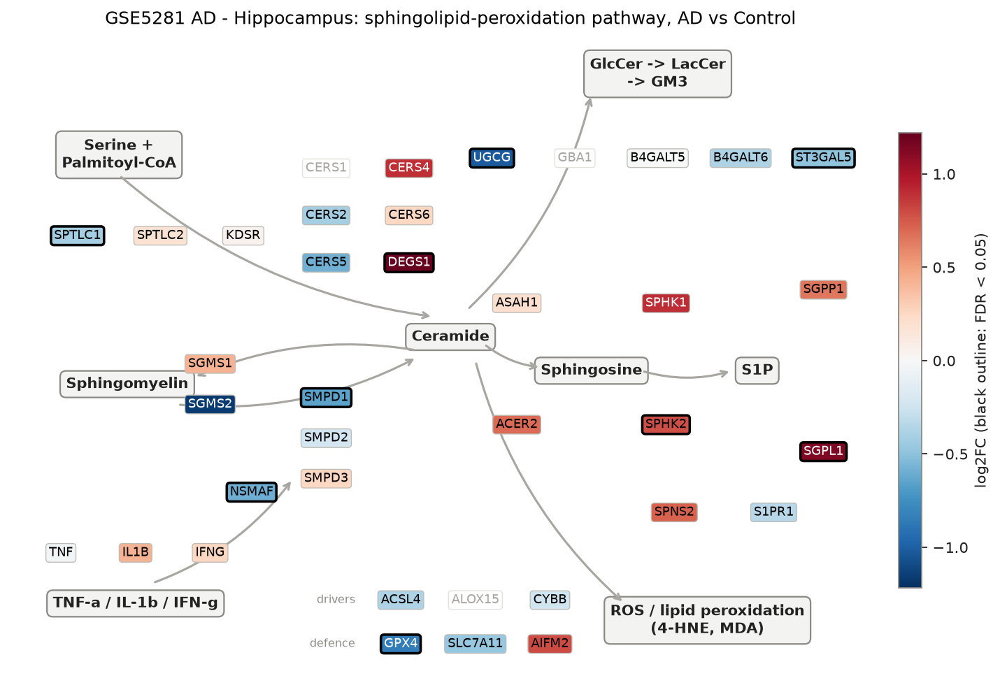
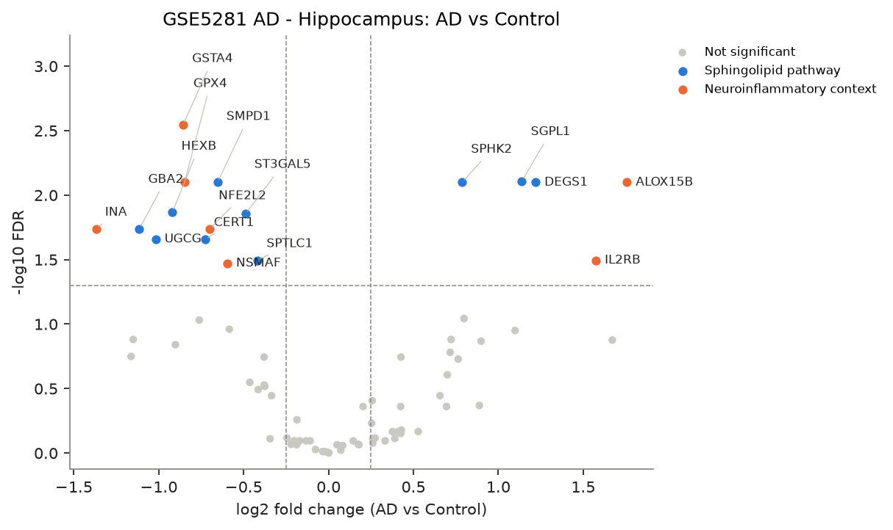
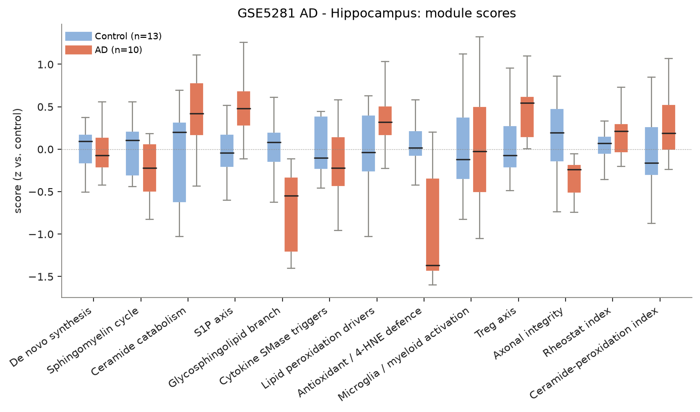
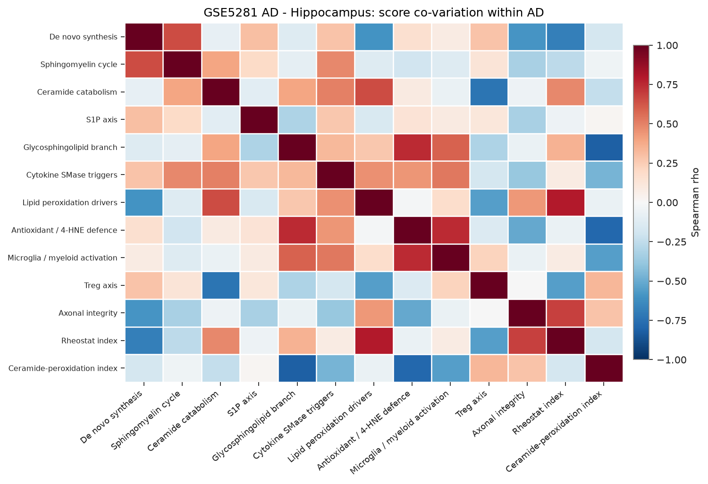
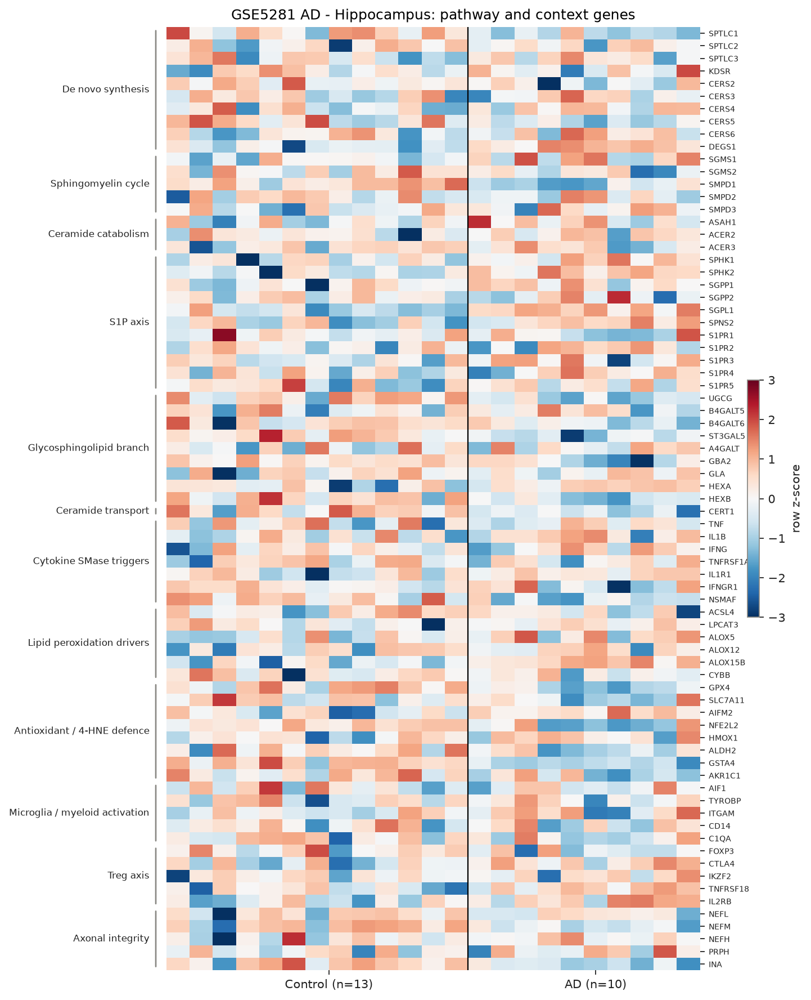

# sphingomap-CNS report: GSE5281 AD - Hippocampus

_sphingomap-CNS v0.1.0, generated 2026-11-11_

Source: Alzheimer's disease, six brain regions, laser-captured neurons (Affymetrix U133 Plus 2) (Liang W. S. et al., Physiol Genomics 28, 311 (2007))

## Design

- AD: **10**, Control: **13**
- Model: linear model, adjusted for sex_male, age, microglia_myeloid_score
- Genes tested: 75 (not in data / not expressed: CERS1, DEGS2, SMPD4, ASAH2, ACER1, GBA1, GLB1, ALOX15, PTGS2, NCF1, CD68, TREM2, IL2RA, IL10, TGFB1)

## Gene-level changes

17 genes with FDR < 0.05 and |log2FC| >= 0.25.

- Up: ALOX15B, IL2RB, DEGS1, SGPL1, SPHK2
- Down: INA, GBA2, UGCG, HEXB, GSTA4, GPX4, CERT1, NFE2L2, SMPD1, NSMAF, ST3GAL5, SPTLC1

### Proposal focus genes

| Gene | log2FC | FDR |
|---|---:|---:|
| SMPD1 | -0.65 | 7.97e-03 |
| SMPD2 | -0.22 | 8.56e-01 |
| SMPD3 | +0.25 | 5.88e-01 |
| CERS2 | -0.41 | 3.22e-01 |
| CERS3 | -0.02 | 9.73e-01 |
| CERS4 | +0.89 | 4.28e-01 |
| CERS5 | -0.58 | 1.10e-01 |
| CERS6 | +0.26 | 3.93e-01 |
| ASAH1 | +0.20 | 4.36e-01 |
| SGMS1 | +0.43 | 1.81e-01 |
| SGMS2 | -1.16 | 1.78e-01 |
| UGCG | -1.02 | 2.20e-02 |
| SPHK1 | +0.90 | 1.36e-01 |
| S1PR1 | -0.34 | 3.59e-01 |
| GPX4 | -0.85 | 7.97e-03 |
| ACSL4 | -0.38 | 2.98e-01 |

### Top 25 genes

| Gene | Module | log2FC | FDR |
|---|---|---:|---:|
| GSTA4 | Antioxidant / 4-HNE defence | -0.86 | 2.84e-03 |
| SGPL1 | S1P axis | +1.14 | 7.80e-03 |
| DEGS1 | De novo synthesis | +1.22 | 7.97e-03 |
| SPHK2 | S1P axis | +0.79 | 7.97e-03 |
| GPX4 | Antioxidant / 4-HNE defence | -0.85 | 7.97e-03 |
| SMPD1 | Sphingomyelin cycle | -0.65 | 7.97e-03 |
| ALOX15B | Lipid peroxidation drivers | +1.76 | 7.97e-03 |
| HEXB | Glycosphingolipid branch | -0.92 | 1.36e-02 |
| ST3GAL5 | Glycosphingolipid branch | -0.49 | 1.40e-02 |
| INA | Axonal integrity | -1.37 | 1.83e-02 |
| GBA2 | Glycosphingolipid branch | -1.11 | 1.83e-02 |
| NFE2L2 | Antioxidant / 4-HNE defence | -0.70 | 1.83e-02 |
| UGCG | Glycosphingolipid branch | -1.02 | 2.20e-02 |
| CERT1 | Ceramide transport | -0.73 | 2.20e-02 |
| IL2RB | Treg axis | +1.57 | 3.20e-02 |
| SPTLC1 | De novo synthesis | -0.42 | 3.20e-02 |
| NSMAF | Cytokine SMase triggers | -0.60 | 3.38e-02 |
| AIFM2 | Antioxidant / 4-HNE defence | +0.80 | 9.06e-02 |
| AKR1C1 | Antioxidant / 4-HNE defence | -0.76 | 9.32e-02 |
| CERS5 | De novo synthesis | -0.58 | 1.10e-01 |
| TNFRSF18 | Treg axis | +1.10 | 1.12e-01 |
| SPNS2 | S1P axis | +0.72 | 1.32e-01 |
| FOXP3 | Treg axis | -1.15 | 1.32e-01 |
| CTLA4 | Treg axis | +1.67 | 1.33e-01 |
| SPHK1 | S1P axis | +0.90 | 1.36e-01 |

## Module scores and indices

Scores are mean z-scores relative to the control group. The rheostat index is pro-survival (S1P/GSL) minus pro-ceramide genes; the ceramide-peroxidation (CPA) index is ceramide-generation + peroxidation-driver genes minus ceramide-clearance + antioxidant genes.

| Score | Mean difference | Hedges' g | FDR |
|---|---:|---:|---:|
| Antioxidant / 4-HNE defence | -0.97 | -2.11 | 7.71e-04 |
| Glycosphingolipid branch | -0.78 | -1.70 | 3.46e-03 |
| S1P axis | +0.51 | +1.14 | 5.13e-02 |
| Treg axis | +0.48 | +0.87 | 1.47e-01 |
| Sphingomyelin cycle | -0.28 | -0.69 | 2.43e-01 |
| Lipid peroxidation drivers | +0.27 | +0.66 | 2.43e-01 |
| Ceramide-peroxidation index | +0.32 | +0.64 | 2.43e-01 |
| Axonal integrity | -0.37 | -0.53 | 3.04e-01 |
| Rheostat index | +0.16 | +0.53 | 3.04e-01 |
| Cytokine SMase triggers | -0.15 | -0.43 | 3.91e-01 |
| Ceramide catabolism | +0.27 | +0.39 | 3.96e-01 |
| Microglia / myeloid activation | +0.00 | +0.38 | 3.96e-01 |
| De novo synthesis | +0.01 | +0.04 | 9.17e-01 |

## Caveats

- mRNA / protein abundance is not enzyme activity or lipid concentration; confirm with lipidomics (LC-MS/MS, HPTLC).
- Module scores and indices are exploratory transcript-level heuristics, not validated biomarkers.
- Post-mortem bulk tissue mixes cell types; changes can reflect cell-composition shifts (e.g. neuron loss, gliosis) rather than per-cell regulation.
