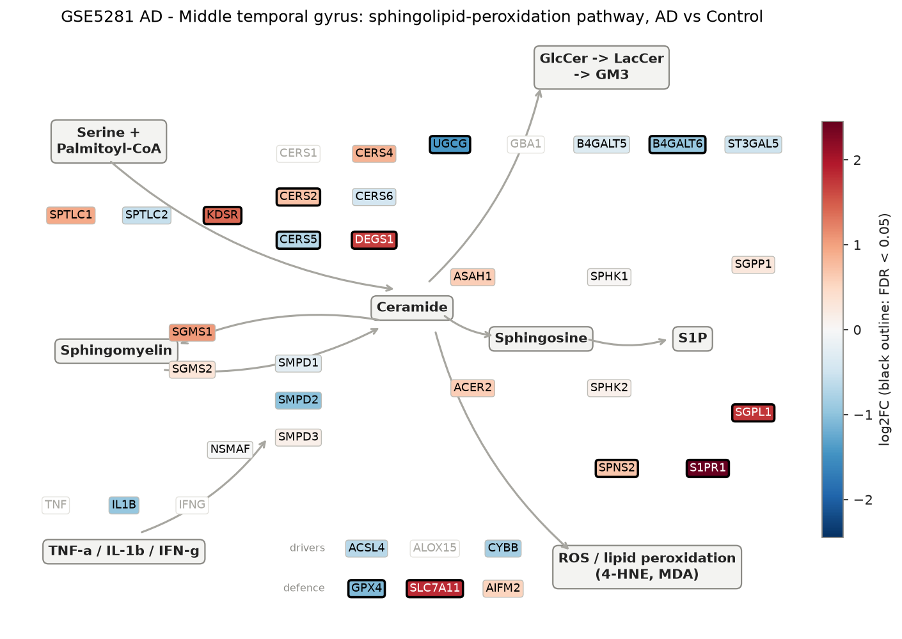
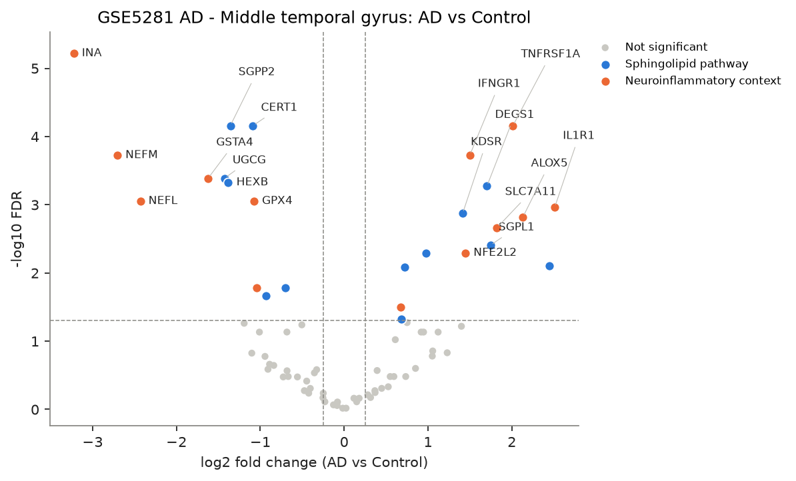
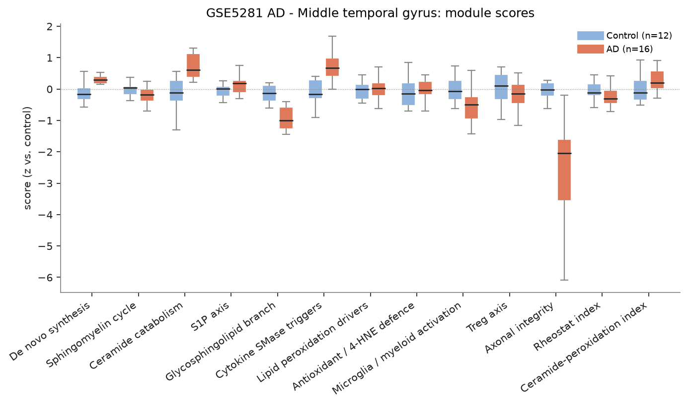
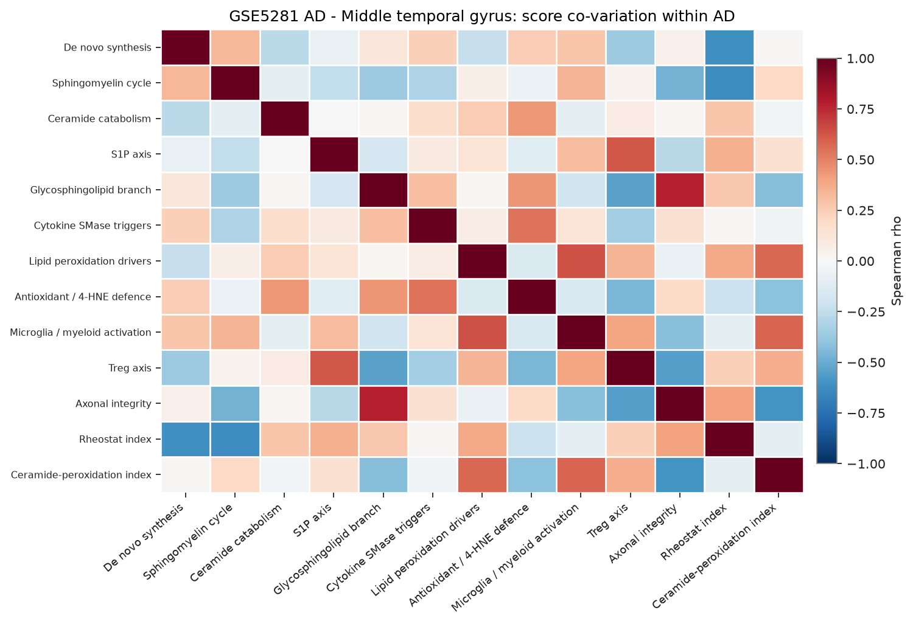
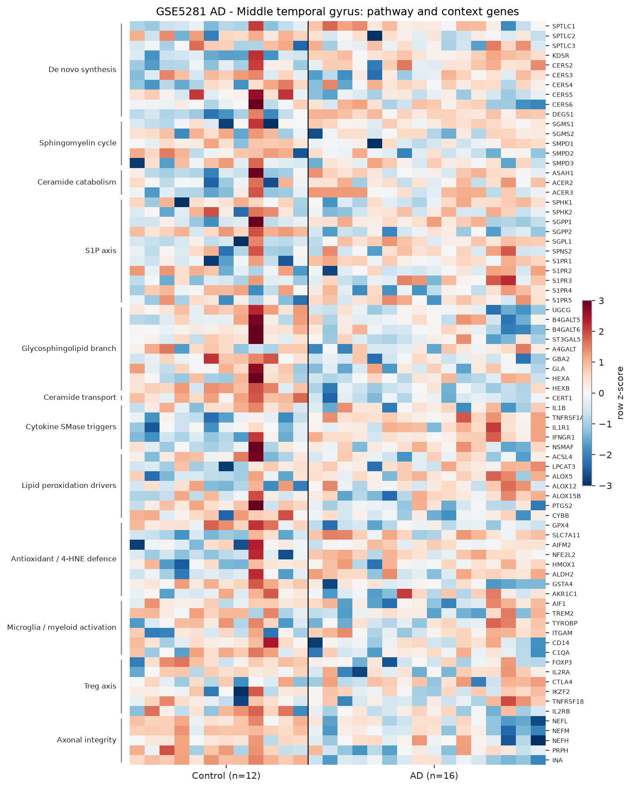

# sphingomap-CNS report: GSE5281 AD - Middle temporal gyrus

_sphingomap-CNS v0.1.0, generated 2026-11-11_

Source: Alzheimer's disease, six brain regions, laser-captured neurons (Affymetrix U133 Plus 2) (Liang W. S. et al., Physiol Genomics 28, 311 (2007))

## Design

- AD: **16**, Control: **12**
- Model: linear model, adjusted for sex_male, age, microglia_myeloid_score
- Genes tested: 76 (not in data / not expressed: CERS1, DEGS2, SMPD4, ASAH2, ACER1, GBA1, GLB1, TNF, IFNG, ALOX15, NCF1, CD68, IL10, TGFB1)

## Gene-level changes

26 genes with FDR < 0.05 and |log2FC| >= 0.25.

- Up: IL1R1, S1PR1, ALOX5, TNFRSF1A, SLC7A11, SGPL1, DEGS1, IFNGR1, NFE2L2, KDSR, S1PR3, CERS2, SPNS2, ALDH2
- Down: INA, NEFM, NEFL, GSTA4, UGCG, HEXB, SGPP2, CERT1, GPX4, PTGS2, B4GALT6, CERS5

### Proposal focus genes

| Gene | log2FC | FDR |
|---|---:|---:|
| SMPD1 | -0.25 | 5.80e-01 |
| SMPD2 | -1.01 | 7.36e-02 |
| SMPD3 | +0.15 | 7.74e-01 |
| CERS2 | +0.72 | 8.22e-03 |
| CERS3 | -0.91 | 2.58e-01 |
| CERS4 | +0.85 | 2.51e-01 |
| CERS5 | -0.70 | 1.66e-02 |
| CERS6 | -0.45 | 3.85e-01 |
| ASAH1 | +0.61 | 9.51e-02 |
| SGMS1 | +1.06 | 1.39e-01 |
| SGMS2 | +0.32 | 6.69e-01 |
| UGCG | -1.43 | 4.10e-04 |
| SPHK1 | +0.02 | 9.61e-01 |
| S1PR1 | +2.45 | 7.84e-03 |
| GPX4 | -1.08 | 8.84e-04 |
| ACSL4 | -0.68 | 2.72e-01 |

### Top 25 genes

| Gene | Module | log2FC | FDR |
|---|---|---:|---:|
| INA | Axonal integrity | -3.22 | 6.03e-06 |
| SGPP2 | S1P axis | -1.36 | 6.93e-05 |
| TNFRSF1A | Cytokine SMase triggers | +2.01 | 6.93e-05 |
| CERT1 | Ceramide transport | -1.09 | 6.93e-05 |
| IFNGR1 | Cytokine SMase triggers | +1.50 | 1.88e-04 |
| NEFM | Axonal integrity | -2.71 | 1.88e-04 |
| GSTA4 | Antioxidant / 4-HNE defence | -1.62 | 4.10e-04 |
| UGCG | Glycosphingolipid branch | -1.43 | 4.10e-04 |
| HEXB | Glycosphingolipid branch | -1.38 | 4.71e-04 |
| DEGS1 | De novo synthesis | +1.70 | 5.35e-04 |
| GPX4 | Antioxidant / 4-HNE defence | -1.08 | 8.84e-04 |
| NEFL | Axonal integrity | -2.43 | 8.84e-04 |
| IL1R1 | Cytokine SMase triggers | +2.51 | 1.09e-03 |
| KDSR | De novo synthesis | +1.41 | 1.34e-03 |
| ALOX5 | Lipid peroxidation drivers | +2.13 | 1.51e-03 |
| SLC7A11 | Antioxidant / 4-HNE defence | +1.82 | 2.17e-03 |
| SGPL1 | S1P axis | +1.74 | 3.93e-03 |
| NFE2L2 | Antioxidant / 4-HNE defence | +1.45 | 5.08e-03 |
| S1PR3 | S1P axis | +0.98 | 5.08e-03 |
| S1PR1 | S1P axis | +2.45 | 7.84e-03 |
| CERS2 | De novo synthesis | +0.72 | 8.22e-03 |
| CERS5 | De novo synthesis | -0.70 | 1.66e-02 |
| PTGS2 | Lipid peroxidation drivers | -1.04 | 1.66e-02 |
| B4GALT6 | Glycosphingolipid branch | -0.93 | 2.16e-02 |
| ALDH2 | Antioxidant / 4-HNE defence | +0.67 | 3.17e-02 |

## Module scores and indices

Scores are mean z-scores relative to the control group. The rheostat index is pro-survival (S1P/GSL) minus pro-ceramide genes; the ceramide-peroxidation (CPA) index is ceramide-generation + peroxidation-driver genes minus ceramide-clearance + antioxidant genes.

| Score | Mean difference | Hedges' g | FDR |
|---|---:|---:|---:|
| Axonal integrity | -3.11 | -1.80 | 1.92e-04 |
| Glycosphingolipid branch | -0.94 | -1.77 | 1.27e-03 |
| Cytokine SMase triggers | +0.75 | +1.17 | 3.00e-03 |
| Ceramide catabolism | +0.68 | +1.04 | 8.45e-02 |
| Ceramide-peroxidation index | +0.35 | +0.67 | 1.28e-01 |
| Rheostat index | -0.29 | -0.48 | 1.42e-01 |
| S1P axis | +0.21 | +0.40 | 1.81e-01 |
| De novo synthesis | +0.31 | +0.56 | 1.81e-01 |
| Lipid peroxidation drivers | +0.12 | -0.04 | 7.41e-01 |
| Sphingomyelin cycle | -0.07 | -0.52 | 8.67e-01 |
| Antioxidant / 4-HNE defence | +0.06 | -0.06 | 9.02e-01 |
| Treg axis | -0.03 | -0.28 | 9.02e-01 |
| Microglia / myeloid activation | +0.00 | -0.80 | 9.02e-01 |

## Caveats

- mRNA / protein abundance is not enzyme activity or lipid concentration; confirm with lipidomics (LC-MS/MS, HPTLC).
- Module scores and indices are exploratory transcript-level heuristics, not validated biomarkers.
- Post-mortem bulk tissue mixes cell types; changes can reflect cell-composition shifts (e.g. neuron loss, gliosis) rather than per-cell regulation.
