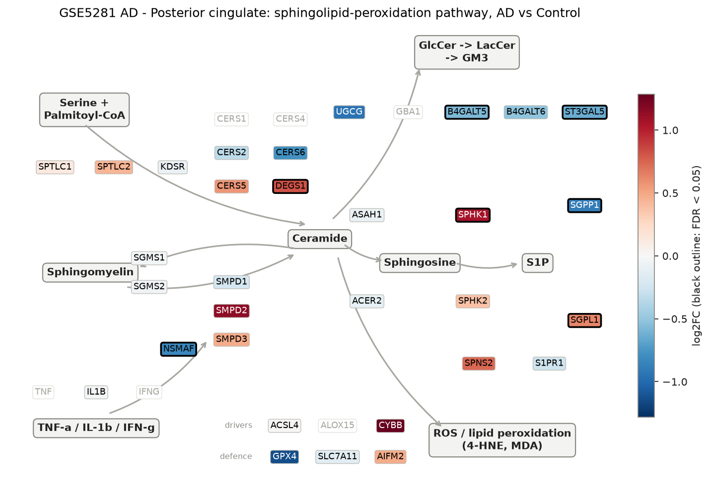
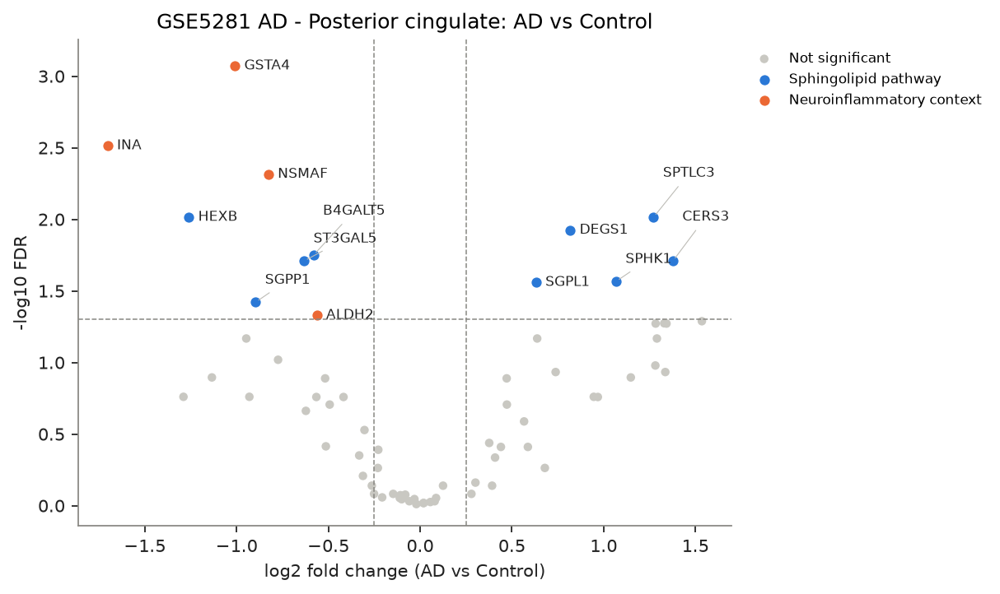
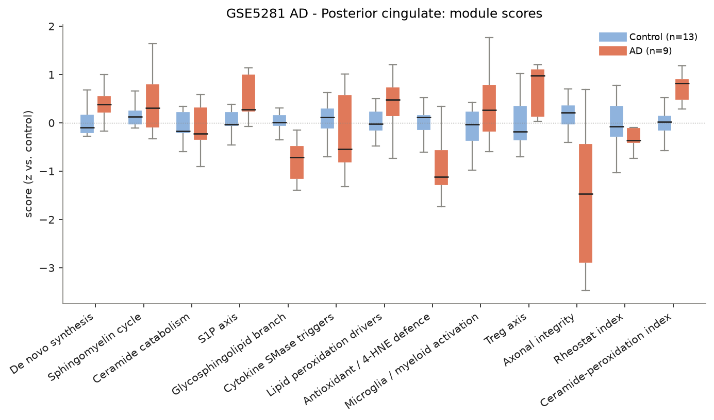
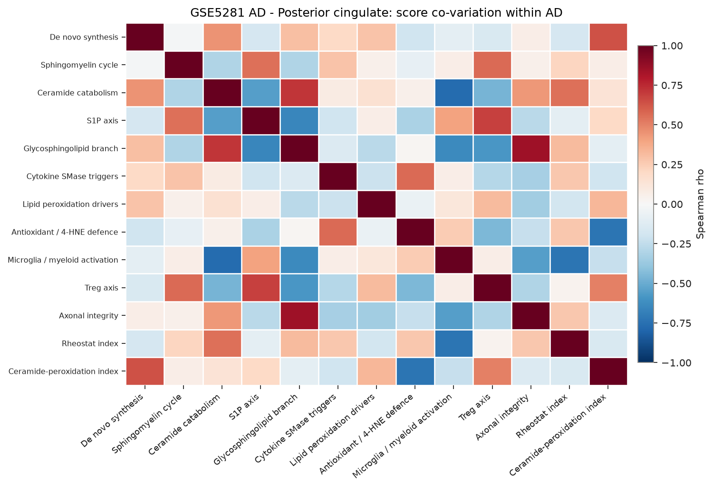
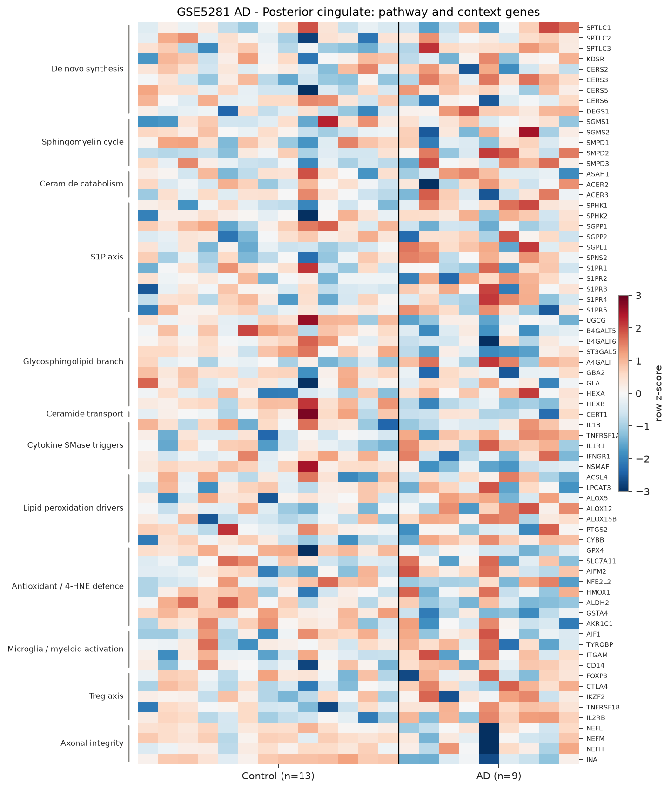

# sphingomap-CNS report: GSE5281 AD - Posterior cingulate

_sphingomap-CNS v0.1.0, generated 2026-11-11_

Source: Alzheimer's disease, six brain regions, laser-captured neurons (Affymetrix U133 Plus 2) (Liang W. S. et al., Physiol Genomics 28, 311 (2007))

## Design

- AD: **9**, Control: **13**
- Model: linear model, adjusted for sex_male, age, microglia_myeloid_score
- Genes tested: 71 (not in data / not expressed: CERS1, CERS4, DEGS2, SMPD4, ASAH2, ACER1, GBA1, GLB1, TNF, IFNG, ALOX15, NCF1, CD68, TREM2, C1QA, IL2RA, IL10, TGFB1, PRPH)

## Gene-level changes

13 genes with FDR < 0.05 and |log2FC| >= 0.25.

- Up: CERS3, SPTLC3, SPHK1, DEGS1, SGPL1
- Down: INA, HEXB, GSTA4, SGPP1, NSMAF, ST3GAL5, B4GALT5, ALDH2

### Proposal focus genes

| Gene | log2FC | FDR |
|---|---:|---:|
| SMPD1 | -0.23 | 5.46e-01 |
| SMPD2 | +1.15 | 1.27e-01 |
| SMPD3 | +0.47 | 1.29e-01 |
| CERS2 | -0.33 | 4.47e-01 |
| CERS3 | +1.38 | 1.95e-02 |
| CERS5 | +0.57 | 2.58e-01 |
| CERS6 | -0.77 | 9.58e-02 |
| ASAH1 | -0.09 | 8.46e-01 |
| SGMS1 | -0.03 | 9.00e-01 |
| SGMS2 | -0.06 | 9.33e-01 |
| UGCG | -0.95 | 6.80e-02 |
| SPHK1 | +1.07 | 2.71e-02 |
| S1PR1 | -0.26 | 7.26e-01 |
| GPX4 | -1.13 | 1.27e-01 |
| ACSL4 | +0.02 | 9.60e-01 |

### Top 25 genes

| Gene | Module | log2FC | FDR |
|---|---|---:|---:|
| GSTA4 | Antioxidant / 4-HNE defence | -1.01 | 8.48e-04 |
| INA | Axonal integrity | -1.70 | 3.06e-03 |
| NSMAF | Cytokine SMase triggers | -0.83 | 4.85e-03 |
| HEXB | Glycosphingolipid branch | -1.26 | 9.67e-03 |
| SPTLC3 | De novo synthesis | +1.27 | 9.67e-03 |
| DEGS1 | De novo synthesis | +0.82 | 1.19e-02 |
| B4GALT5 | Glycosphingolipid branch | -0.58 | 1.78e-02 |
| ST3GAL5 | Glycosphingolipid branch | -0.63 | 1.95e-02 |
| CERS3 | De novo synthesis | +1.38 | 1.95e-02 |
| SPHK1 | S1P axis | +1.07 | 2.71e-02 |
| SGPL1 | S1P axis | +0.63 | 2.76e-02 |
| SGPP1 | S1P axis | -0.90 | 3.79e-02 |
| ALDH2 | Antioxidant / 4-HNE defence | -0.56 | 4.68e-02 |
| ALOX15B | Lipid peroxidation drivers | +1.54 | 5.15e-02 |
| CTLA4 | Treg axis | +1.33 | 5.33e-02 |
| TNFRSF18 | Treg axis | +1.34 | 5.35e-02 |
| CYBB | Lipid peroxidation drivers | +1.28 | 5.35e-02 |
| UGCG | Glycosphingolipid branch | -0.95 | 6.80e-02 |
| A4GALT | Glycosphingolipid branch | +1.29 | 6.80e-02 |
| HEXA | Glycosphingolipid branch | +0.64 | 6.80e-02 |
| CERS6 | De novo synthesis | -0.77 | 9.58e-02 |
| IL2RB | Treg axis | +1.28 | 1.05e-01 |
| SPNS2 | S1P axis | +0.74 | 1.17e-01 |
| TNFRSF1A | Cytokine SMase triggers | +1.34 | 1.17e-01 |
| SMPD2 | Sphingomyelin cycle | +1.15 | 1.27e-01 |

## Module scores and indices

Scores are mean z-scores relative to the control group. The rheostat index is pro-survival (S1P/GSL) minus pro-ceramide genes; the ceramide-peroxidation (CPA) index is ceramide-generation + peroxidation-driver genes minus ceramide-clearance + antioxidant genes.

| Score | Mean difference | Hedges' g | FDR |
|---|---:|---:|---:|
| Glycosphingolipid branch | -0.69 | -2.07 | 1.53e-03 |
| De novo synthesis | +0.45 | +1.72 | 4.71e-03 |
| Ceramide-peroxidation index | +0.83 | +1.56 | 5.99e-03 |
| Antioxidant / 4-HNE defence | -0.94 | -1.54 | 5.99e-03 |
| Treg axis | +0.79 | +1.28 | 1.79e-02 |
| S1P axis | +0.43 | +1.05 | 4.75e-02 |
| Axonal integrity | -1.76 | -0.90 | 8.44e-02 |
| Lipid peroxidation drivers | +0.42 | +0.84 | 9.88e-02 |
| Sphingomyelin cycle | +0.41 | +0.60 | 2.42e-01 |
| Cytokine SMase triggers | -0.28 | -0.36 | 5.14e-01 |
| Rheostat index | -0.13 | -0.27 | 6.25e-01 |
| Ceramide catabolism | -0.10 | -0.15 | 7.43e-01 |
| Microglia / myeloid activation | +0.00 | +0.14 | 7.43e-01 |

## Caveats

- mRNA / protein abundance is not enzyme activity or lipid concentration; confirm with lipidomics (LC-MS/MS, HPTLC).
- Module scores and indices are exploratory transcript-level heuristics, not validated biomarkers.
- Post-mortem bulk tissue mixes cell types; changes can reflect cell-composition shifts (e.g. neuron loss, gliosis) rather than per-cell regulation.
