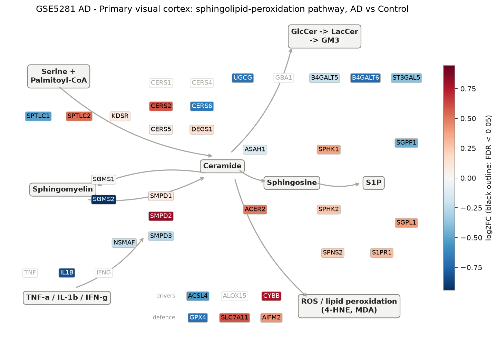
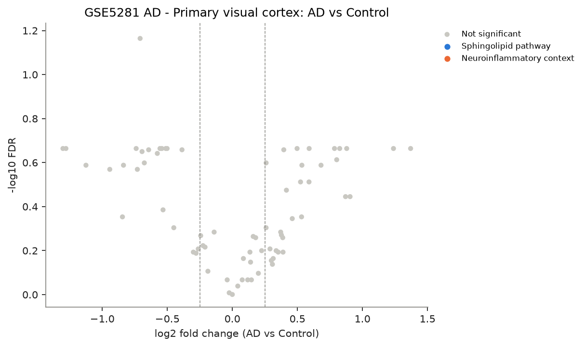
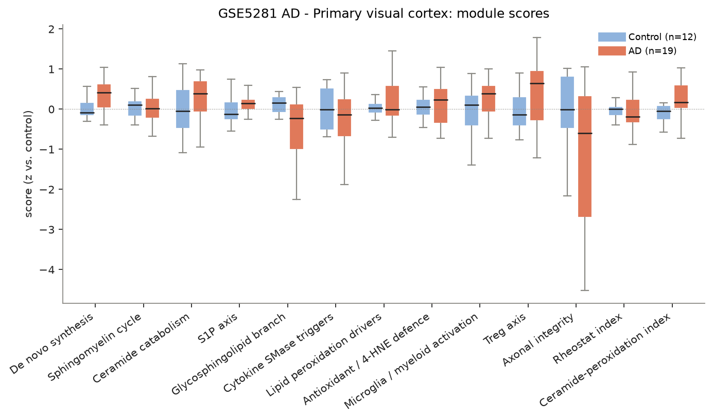
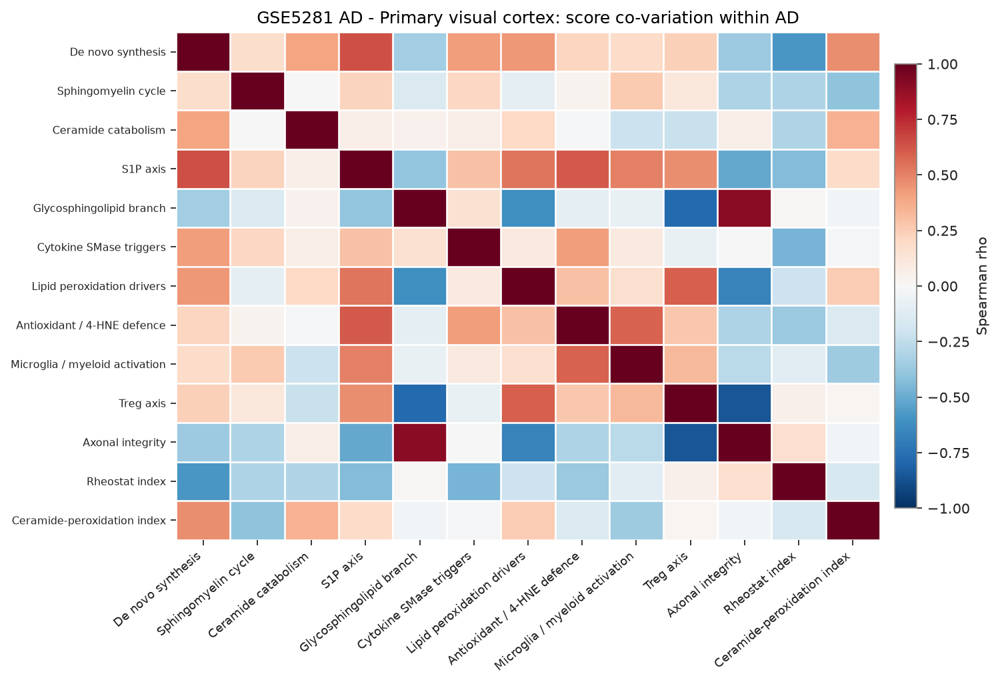
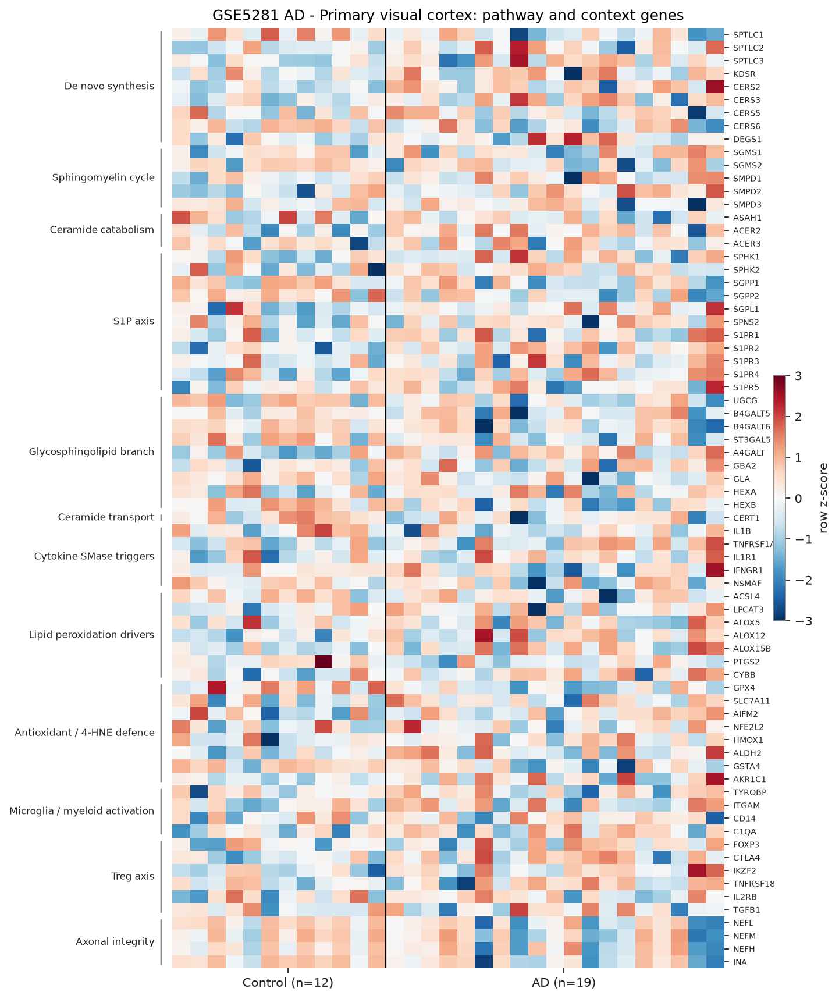

# sphingomap-CNS report: GSE5281 AD - Primary visual cortex

_sphingomap-CNS v0.1.0, generated 2026-11-11_

Source: Alzheimer's disease, six brain regions, laser-captured neurons (Affymetrix U133 Plus 2) (Liang W. S. et al., Physiol Genomics 28, 311 (2007))

## Design

- AD: **19**, Control: **12**
- Model: linear model, adjusted for sex_male, age, microglia_myeloid_score
- Genes tested: 72 (not in data / not expressed: CERS1, CERS4, DEGS2, SMPD4, ASAH2, ACER1, GBA1, GLB1, TNF, IFNG, ALOX15, NCF1, AIF1, CD68, TREM2, IL2RA, IL10, PRPH)

## Gene-level changes

0 genes with FDR < 0.05 and |log2FC| >= 0.25.

- Up: -
- Down: -

### Proposal focus genes

| Gene | log2FC | FDR |
|---|---:|---:|
| SMPD1 | +0.08 | 8.57e-01 |
| SMPD2 | +0.83 | 2.17e-01 |
| SMPD3 | -0.26 | 6.20e-01 |
| CERS2 | +0.59 | 2.17e-01 |
| CERS3 | +0.53 | 4.43e-01 |
| CERS5 | +0.04 | 9.15e-01 |
| CERS6 | -0.68 | 2.52e-01 |
| ASAH1 | -0.14 | 5.20e-01 |
| SGMS1 | -0.00 | 9.99e-01 |
| SGMS2 | -0.94 | 2.70e-01 |
| UGCG | -0.69 | 2.24e-01 |
| SPHK1 | +0.38 | 5.36e-01 |
| S1PR1 | +0.29 | 6.20e-01 |
| GPX4 | -0.71 | 6.85e-02 |
| ACSL4 | -0.53 | 4.12e-01 |

### Top 25 genes

| Gene | Module | log2FC | FDR |
|---|---|---:|---:|
| GPX4 | Antioxidant / 4-HNE defence | -0.71 | 6.85e-02 |
| SGPP2 | S1P axis | -0.74 | 2.17e-01 |
| A4GALT | Glycosphingolipid branch | +1.37 | 2.17e-01 |
| S1PR2 | S1P axis | +1.24 | 2.17e-01 |
| SPTLC1 | De novo synthesis | -0.51 | 2.17e-01 |
| GLA | Glycosphingolipid branch | -0.56 | 2.17e-01 |
| ACER2 | Ceramide catabolism | +0.50 | 2.17e-01 |
| CERT1 | Ceramide transport | -0.54 | 2.17e-01 |
| ALOX12 | Lipid peroxidation drivers | +0.88 | 2.17e-01 |
| CERS2 | De novo synthesis | +0.59 | 2.17e-01 |
| INA | Axonal integrity | -1.30 | 2.17e-01 |
| HEXB | Glycosphingolipid branch | -0.50 | 2.17e-01 |
| CYBB | Lipid peroxidation drivers | +0.79 | 2.17e-01 |
| NEFL | Axonal integrity | -1.28 | 2.17e-01 |
| SMPD2 | Sphingomyelin cycle | +0.83 | 2.17e-01 |
| SGPL1 | S1P axis | +0.40 | 2.20e-01 |
| ST3GAL5 | Glycosphingolipid branch | -0.39 | 2.20e-01 |
| PTGS2 | Lipid peroxidation drivers | -0.64 | 2.20e-01 |
| UGCG | Glycosphingolipid branch | -0.69 | 2.24e-01 |
| GSTA4 | Antioxidant / 4-HNE defence | -0.58 | 2.28e-01 |
| ALOX15B | Lipid peroxidation drivers | +0.80 | 2.44e-01 |
| CERS6 | De novo synthesis | -0.68 | 2.52e-01 |
| SPHK2 | S1P axis | +0.26 | 2.52e-01 |
| IKZF2 | Treg axis | +0.53 | 2.58e-01 |
| IL1B | Cytokine SMase triggers | -0.84 | 2.58e-01 |

## Module scores and indices

Scores are mean z-scores relative to the control group. The rheostat index is pro-survival (S1P/GSL) minus pro-ceramide genes; the ceramide-peroxidation (CPA) index is ceramide-generation + peroxidation-driver genes minus ceramide-clearance + antioxidant genes.

| Score | Mean difference | Hedges' g | FDR |
|---|---:|---:|---:|
| De novo synthesis | +0.30 | +0.92 | 3.69e-01 |
| Axonal integrity | -1.24 | -0.70 | 3.69e-01 |
| Glycosphingolipid branch | -0.52 | -0.66 | 3.69e-01 |
| Ceramide-peroxidation index | +0.36 | +0.50 | 3.69e-01 |
| S1P axis | +0.21 | +0.52 | 4.07e-01 |
| Lipid peroxidation drivers | +0.26 | +0.49 | 4.22e-01 |
| Treg axis | +0.35 | +0.60 | 4.30e-01 |
| Ceramide catabolism | +0.28 | +0.40 | 4.36e-01 |
| Cytokine SMase triggers | -0.27 | -0.24 | 5.65e-01 |
| Sphingomyelin cycle | -0.11 | -0.08 | 7.76e-01 |
| Rheostat index | -0.07 | -0.23 | 7.81e-01 |
| Antioxidant / 4-HNE defence | +0.03 | +0.24 | 9.52e-01 |
| Microglia / myeloid activation | -0.00 | +0.52 | 9.52e-01 |

## Caveats

- mRNA / protein abundance is not enzyme activity or lipid concentration; confirm with lipidomics (LC-MS/MS, HPTLC).
- Module scores and indices are exploratory transcript-level heuristics, not validated biomarkers.
- Post-mortem bulk tissue mixes cell types; changes can reflect cell-composition shifts (e.g. neuron loss, gliosis) rather than per-cell regulation.
