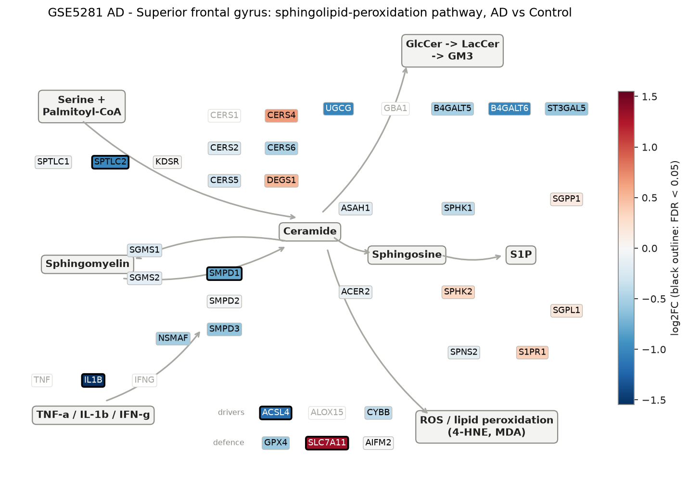
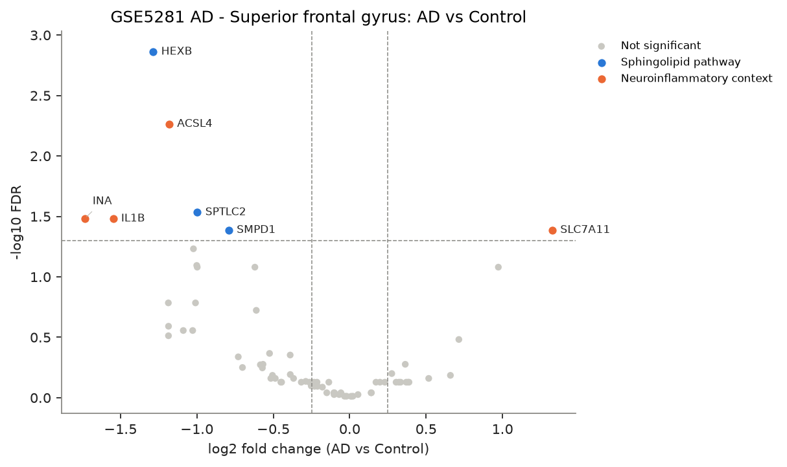
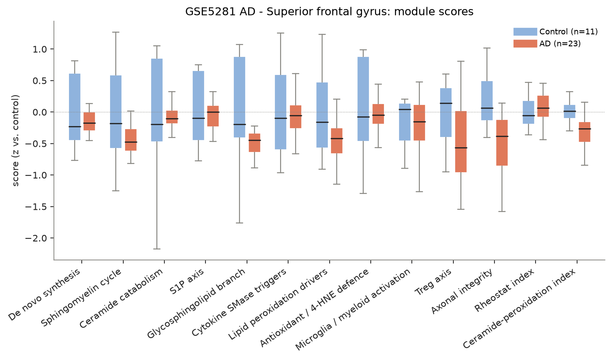
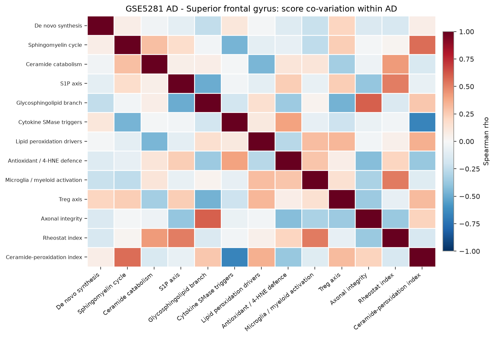
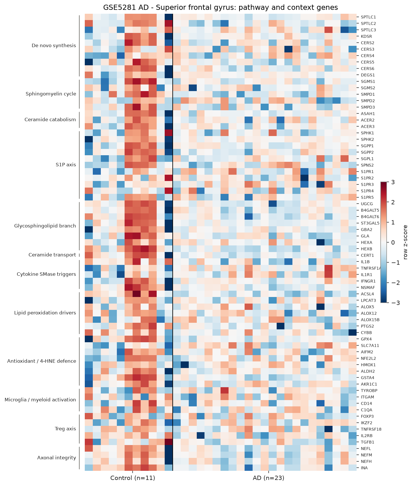

# sphingomap-CNS report: GSE5281 AD - Superior frontal gyrus

_sphingomap-CNS v0.1.0, generated 2026-11-11_

Source: Alzheimer's disease, six brain regions, laser-captured neurons (Affymetrix U133 Plus 2) (Liang W. S. et al., Physiol Genomics 28, 311 (2007))

## Design

- AD: **23**, Control: **11**
- Model: linear model, adjusted for sex_male, age, microglia_myeloid_score
- Genes tested: 71 (not in data / not expressed: CERS1, DEGS2, SMPD4, ASAH2, ACER1, A4GALT, GBA1, GLB1, TNF, IFNG, ALOX15, NCF1, AIF1, CD68, TREM2, IL2RA, CTLA4, IL10, PRPH)

## Gene-level changes

7 genes with FDR < 0.05 and |log2FC| >= 0.25.

- Up: SLC7A11
- Down: INA, IL1B, HEXB, ACSL4, SPTLC2, SMPD1

### Proposal focus genes

| Gene | log2FC | FDR |
|---|---:|---:|
| SMPD1 | -0.79 | 4.11e-02 |
| SMPD2 | -0.03 | 9.72e-01 |
| SMPD3 | -0.61 | 1.89e-01 |
| CERS2 | -0.21 | 7.44e-01 |
| CERS3 | -0.32 | 7.44e-01 |
| CERS4 | +0.66 | 6.53e-01 |
| CERS5 | -0.29 | 7.33e-01 |
| CERS6 | -0.49 | 6.92e-01 |
| ASAH1 | -0.18 | 8.18e-01 |
| SGMS1 | -0.23 | 7.44e-01 |
| SGMS2 | -0.15 | 9.11e-01 |
| UGCG | -1.03 | 2.78e-01 |
| SPHK1 | -0.39 | 6.43e-01 |
| S1PR1 | +0.36 | 5.29e-01 |
| GPX4 | -0.57 | 5.67e-01 |
| ACSL4 | -1.18 | 5.44e-03 |

### Top 25 genes

| Gene | Module | log2FC | FDR |
|---|---|---:|---:|
| HEXB | Glycosphingolipid branch | -1.29 | 1.38e-03 |
| ACSL4 | Lipid peroxidation drivers | -1.18 | 5.44e-03 |
| SPTLC2 | De novo synthesis | -1.00 | 2.93e-02 |
| IL1B | Cytokine SMase triggers | -1.55 | 3.31e-02 |
| INA | Axonal integrity | -1.73 | 3.31e-02 |
| SLC7A11 | Antioxidant / 4-HNE defence | +1.33 | 4.11e-02 |
| SMPD1 | Sphingomyelin cycle | -0.79 | 4.11e-02 |
| B4GALT6 | Glycosphingolipid branch | -1.02 | 5.86e-02 |
| PTGS2 | Lipid peroxidation drivers | -1.00 | 8.05e-02 |
| GSTA4 | Antioxidant / 4-HNE defence | -1.00 | 8.32e-02 |
| TNFRSF1A | Cytokine SMase triggers | +0.97 | 8.32e-02 |
| GLA | Glycosphingolipid branch | -0.62 | 8.32e-02 |
| CERT1 | Ceramide transport | -1.01 | 1.64e-01 |
| IL2RB | Treg axis | -1.19 | 1.64e-01 |
| SMPD3 | Sphingomyelin cycle | -0.61 | 1.89e-01 |
| NEFL | Axonal integrity | -1.19 | 2.56e-01 |
| TGFB1 | Treg axis | -1.09 | 2.78e-01 |
| UGCG | Glycosphingolipid branch | -1.03 | 2.78e-01 |
| NEFM | Axonal integrity | -1.19 | 3.07e-01 |
| IL1R1 | Cytokine SMase triggers | +0.71 | 3.30e-01 |
| NSMAF | Cytokine SMase triggers | -0.52 | 4.30e-01 |
| CYBB | Lipid peroxidation drivers | -0.39 | 4.44e-01 |
| S1PR2 | S1P axis | -0.73 | 4.59e-01 |
| SGPP2 | S1P axis | -0.57 | 5.29e-01 |
| S1PR1 | S1P axis | +0.36 | 5.29e-01 |

## Module scores and indices

Scores are mean z-scores relative to the control group. The rheostat index is pro-survival (S1P/GSL) minus pro-ceramide genes; the ceramide-peroxidation (CPA) index is ceramide-generation + peroxidation-driver genes minus ceramide-clearance + antioxidant genes.

| Score | Mean difference | Hedges' g | FDR |
|---|---:|---:|---:|
| Ceramide-peroxidation index | -0.32 | -1.18 | 3.39e-02 |
| Glycosphingolipid branch | -0.47 | -0.88 | 1.19e-01 |
| Lipid peroxidation drivers | -0.39 | -0.83 | 1.19e-01 |
| Axonal integrity | -0.52 | -0.76 | 1.19e-01 |
| Sphingomyelin cycle | -0.36 | -0.75 | 1.19e-01 |
| Treg axis | -0.42 | -0.67 | 1.53e-01 |
| De novo synthesis | -0.12 | -0.35 | 5.65e-01 |
| Rheostat index | +0.10 | +0.34 | 5.65e-01 |
| Microglia / myeloid activation | +0.00 | +0.21 | 8.21e-01 |
| Ceramide catabolism | -0.10 | -0.15 | 8.72e-01 |
| S1P axis | -0.04 | -0.10 | 9.19e-01 |
| Cytokine SMase triggers | -0.02 | -0.04 | 9.59e-01 |
| Antioxidant / 4-HNE defence | +0.01 | +0.02 | 9.59e-01 |

## Caveats

- mRNA / protein abundance is not enzyme activity or lipid concentration; confirm with lipidomics (LC-MS/MS, HPTLC).
- Module scores and indices are exploratory transcript-level heuristics, not validated biomarkers.
- Post-mortem bulk tissue mixes cell types; changes can reflect cell-composition shifts (e.g. neuron loss, gliosis) rather than per-cell regulation.
